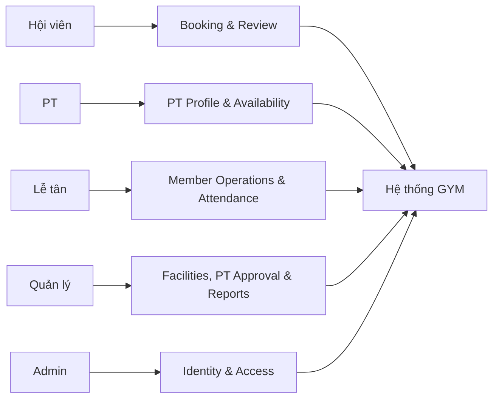

# Đặc tả tác nhân hệ thống — v3.0

## 1. Nguyên tắc mô hình hóa

Tác nhân là vai trò bên ngoài tương tác với hệ thống. `User`, `Member` và `PersonalTrainer` trong CSDL là dữ liệu, không phải cây kế thừa actor. Baseline MVP dùng một vai trò chính cho mỗi tài khoản; quyền còn phụ thuộc phạm vi bản ghi và trạng thái nghiệp vụ theo `06_ma_tran_phan_quyen.md`.

## 2. Danh sách tác nhân

| Mã | Tác nhân | Vai trò hệ thống | Mục tiêu | Phạm vi dữ liệu |
|---|---|---|---|---|
| ACT-01 | Hội viên | `MEMBER` | Tìm phiên phòng, đặt/hủy lịch, xem lịch cá nhân và đánh giá PT. | Hồ sơ, booking và đánh giá của chính mình; danh sách PT đã duyệt và dữ liệu phiên phòng công khai. |
| ACT-02 | Huấn luyện viên cá nhân | `PT` | Nộp hồ sơ chuyên môn, quản lý khả dụng, phản hồi yêu cầu và xem lịch dạy. | Hồ sơ/lịch của mình; thông tin tối thiểu của hội viên trong booking được gán. |
| ACT-03 | Lễ tân | `RECEPTIONIST` | Quản lý hồ sơ hội viên tại quầy, đặt hộ, hủy ngoại lệ và điểm danh. | Hội viên, booking và phiên phòng cần cho tác nghiệp; không gán vai trò hoặc duyệt PT. |
| ACT-04 | Quản lý | `MANAGER` | Điều phối phòng/ca/phiên, duyệt PT và xem báo cáo vận hành. | Tài nguyên, PT, lịch và báo cáo của cơ sở; không quản trị mật khẩu/token. |
| ACT-05 | Quản trị viên | `ADMIN` | Quản lý tài khoản, vai trò, khóa truy cập và cấu hình kỹ thuật. | Tài khoản và toàn bộ dữ liệu cần xử lý sự cố; quyền nghiệp vụ vẫn được khai báo tường minh và audit. |

Hệ thống/job nền không phải tác nhân con người. Chúng thực thi BR-12, BR-20, BR-22 và NFR-05 theo lịch.

## 3. Mô tả chi tiết

### ACT-01 — Hội viên

- Tiền điều kiện chung: tài khoản `ACTIVE`, hồ sơ hội viên tồn tại.
- Chỉ được sửa hồ sơ của mình; không tự thay mã hội viên, trạng thái hay hạn thẻ.
- Backend suy ra `member_id` từ tài khoản; không tin ID do client gửi cho thao tác của chính mình.
- Chỉ đặt khi BR-03, BR-06…BR-15 đều thỏa; chỉ hủy/đánh giá theo BR-17/BR-21.

### ACT-02 — PT

- Admin tạo tài khoản vai trò PT. PT tạo hoặc cập nhật hồ sơ chuyên môn và gửi duyệt.
- `PENDING`/`REJECTED`: được đăng nhập, xem lý do và nộp lại; không nhận lịch.
- `APPROVED`: được cấu hình lịch làm/nghỉ, xem yêu cầu được gán và phản hồi theo BR-16.
- `SUSPENDED`: không xuất hiện cho booking mới; lịch tương lai được Quản lý xử lý theo từng trường hợp.

### ACT-03 — Lễ tân

- Tạo/cập nhật/vô hiệu hóa hồ sơ hội viên; không hard-delete.
- Đặt hộ ghi `created_by_user_id`; hủy ngoại lệ ghi người thực hiện và lý do.
- Điểm danh bằng booking/mã hội viên/SĐT, nhưng hệ thống phải xác minh booking đúng người và phiên.

### ACT-04 — Quản lý

- Quản lý phòng, ca và phiên phòng theo BR-06…BR-10.
- Duyệt/từ chối/đình chỉ PT, ghi người quyết định, thời gian và lý do.
- Xem báo cáo booking, occupancy, check-in, no-show, rating và chuyên cần; không có doanh thu trong MVP.

### ACT-05 — Admin

- Tạo tài khoản, gán một vai trò, reset mật khẩu, khóa/mở khóa và tăng `auth_version` khi cần thu hồi token.
- Có thể hỗ trợ thao tác nghiệp vụ khi ma trận quyền cho phép; mọi thao tác nhạy cảm được audit.
- Không được sửa/xóa audit hoặc lịch sử để che giấu thay đổi.

## 4. Ranh giới trách nhiệm

Mỗi module gọi chính sách quyền ở server và ghi dữ liệu/audit theo baseline. Giao diện ẩn nút chỉ hỗ trợ trải nghiệm, không thay thế kiểm tra quyền phía server.
