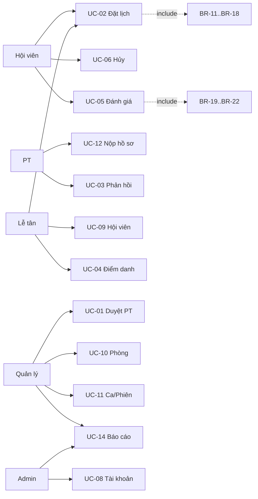

# Danh mục Use Case tổng quát — v3.0

Mã use case dưới đây là ổn định trong baseline v0.3 và là nguồn ánh xạ cho SRS, API, dữ liệu và kiểm thử.

| UC | Tên | Tác nhân chính | REQ liên quan | Kết quả |
|---|---|---|---|---|
| UC-01 | Duyệt/từ chối/đình chỉ hồ sơ PT | Quản lý | REQ-17 | Quyết định PT có audit; không tự thay trạng thái tài khoản. |
| UC-02 | Đặt phòng và PT tùy chọn | Hội viên, Lễ tân | REQ-06, 08 | Booking `CONFIRMED` hoặc `PENDING_PT`; không vượt sức chứa/xung đột. |
| UC-03 | PT chấp nhận/từ chối lịch | PT | REQ-18 | `CONFIRMED` hoặc `REJECTED`; đúng PT, đúng hạn. |
| UC-04 | Điểm danh người tham gia | Lễ tân | REQ-09 | Attendance riêng cho hội viên/PT. |
| UC-05 | Đánh giá PT | Hội viên | REQ-19, 20 | Một review hợp lệ cho một booking hoàn tất. |
| UC-06 | Hủy booking | Hội viên, PT, Lễ tân, Quản lý, Admin | REQ-07 | `CANCELLED` có điều kiện/lý do; tài nguyên được giải phóng một lần. |
| UC-07 | Đăng nhập/đăng xuất | Tất cả | REQ-01 | Phiên xác thực hợp lệ hoặc lỗi không tiết lộ tài khoản. |
| UC-08 | Quản lý tài khoản và vai trò | Admin | REQ-02, 12 | Tài khoản/role/status cập nhật; token cũ bị thu hồi khi cần. |
| UC-09 | Quản lý và tra cứu hội viên | Lễ tân, Quản lý, Admin | REQ-03, 11 | Hồ sơ được tạo/cập nhật/vô hiệu hóa và tìm kiếm phân trang. |
| UC-10 | Quản lý phòng | Quản lý, Admin | REQ-04 | Phòng được tạo/cập nhật/vô hiệu hóa mà không phá lịch sử. |
| UC-11 | Quản lý ca và phiên phòng | Quản lý, Admin | REQ-05 | Ca không chồng; phiên phòng có thời gian/sức chứa/trạng thái hợp lệ. |
| UC-12 | Nộp/nộp lại hồ sơ PT | PT | REQ-16 | Hồ sơ `PENDING` kèm tài liệu; lịch sử quyết định được giữ. |
| UC-13 | Xem lịch | Tất cả | REQ-13 | Dữ liệu theo vai trò và phạm vi bản ghi. |
| UC-14 | Xem báo cáo vận hành | Quản lý, Admin | REQ-10, 20 | Chỉ số booking, attendance, occupancy, rating, chuyên cần có công thức. |
| UC-15 | Xuất báo cáo | Quản lý, Admin | REQ-15 | File theo bộ lọc và cùng nguồn dữ liệu với dashboard. |
| UC-16 | Xem yêu cầu/thông báo | Hội viên, PT, Lễ tân | REQ-14 | Toast cho thao tác hiện tại; danh sách trạng thái được lấy lại từ server. |

## Quan hệ chính

`REQ-02` là chính sách cắt ngang mọi UC. Job hết hạn booking pending, kết thúc buổi và tính lại chỉ số là xử lý nội bộ, không cấp mã UC riêng.
