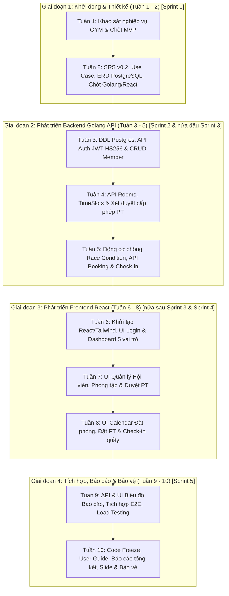

# KẾ HOẠCH VÀ KHUNG TIẾN ĐỘ THỰC HIỆN ĐỒ ÁN 10 TUẦN

> **Trạng thái:** Đây là lịch kế hoạch ban đầu, không phải bằng chứng công việc đã hoàn thành. Yêu cầu và thứ tự phụ thuộc hiện hành nằm ở `13_backlog_v0.3.md`; chỉ cập nhật “Đã hoàn thành/Đã kiểm thử/Đã phê duyệt” khi có biên bản hoặc kết quả tương ứng.

## Bổ sung tiến độ baseline v0.3 — 10/10/2026

| Hạng mục | Trạng thái có bằng chứng trong workspace | Bước tiếp theo |
|---|---|---|
| Phân tích/tài liệu v0.3 | Đã soạn và kiểm tra nhất quán tĩnh | Nhóm rà soát nghiệp vụ thực tế và ký biên bản nếu chấp thuận. |
| Schema v0.3 | Đã soạn DDL bootstrap, chưa chạy PostgreSQL | Chạy trên DB test rỗng; viết migration v0.2 → v0.3 và test dữ liệu. |
| Backend/Frontend | Chưa có mã nguồn trong workspace này | Thực hiện theo thứ tự phụ thuộc của backlog v0.3. |
| Unit/API/E2E/load | Chưa có kết quả chạy | Thực hiện `15_ke_hoach_kiem_thu.md`; lưu report theo build/schema version. |
| Backup/restore | Chưa có restore drill | Thực hiện `16_runbook_van_hanh_nang_cap.md` trước khi công bố RPO/RTO đạt. |

Thứ tự phát triển hiện hành: Identity → Master data → Booking core → Attendance/Review → Reporting. REQ-15 xuất file là Could và có thể hoãn; REQ-09 điểm danh được nâng thành Must vì là dữ liệu đầu vào bắt buộc của REQ-19/20.
## HỆ THỐNG QUẢN LÝ PHÒNG TẬP GYM (GYM MANAGEMENT SYSTEM)

---

| Thông tin đồ án | Chi tiết |
| :--- | :--- |
| **Tên đề tài** | Hệ thống quản lý GYM (GYM Management System) |
| **Môn học** | Thực tập cơ sở ngành (TTCSN) |
| **Nhóm thực hiện** | Nhóm 1 |
| **Thời gian thực hiện** | **10/09/2026 – 20/11/2026 (10 Tuần)** |
| **Thành viên nhóm** | 1. Nguyễn Quang Đảm (Nhóm trưởng)<br>2. Nguyễn Thành Long<br>3. Lê Công Quân<br>4. Nguyễn Xuân Mạnh |
| **Ngăn xếp công nghệ** | Frontend: React.js + Tailwind CSS<br>Backend: Golang (Gin Framework)<br>Database: PostgreSQL 16+ |
| **Phiên bản tài liệu** | **v2.0 (Chuẩn hóa khung tiến độ 10 tuần - 5 Sprint x 2 tuần)** |
| **Ngày cập nhật** | Tháng 10/2026 |

---

## 1. THÔNG TIN CHUNG VÀ PHÂN CÔNG VAI TRÒ NHÂN SỰ

Để bảo đảm dự án hoàn thành đúng hạn 10 tuần với chất lượng kỹ thuật cao nhất, 4 thành viên trong Nhóm 1 được phân công đảm nhiệm các vai trò chuyên trách:

| STT | Họ và tên | Vai trò dự án | Trách nhiệm chính |
| :-: | :--- | :--- | :--- |
| **1** | **Nguyễn Quang Đảm** | **Nhóm trưởng / Fullstack Lead** | - Điều phối tiến độ tổng thể 10 tuần, quản lý kho mã nguồn (Git/GitHub).<br>- Phụ trách kiến trúc hệ thống 3 tầng, module Xác thực & Phân quyền (Auth/RBAC).<br>- Thuật toán xử lý xung đột đặt phòng (Golang Concurrency & Row Locking) và API cốt lõi.<br>- Chủ trì tích hợp hệ thống và biên soạn báo cáo tổng kết đồ án. |
| **2** | **Nguyễn Thành Long** | **Backend & Database Developer** | - Thiết kế lược đồ CSDL vật lý (PostgreSQL Schema, Index, Constraints).<br>- Xây dựng API Golang Quản lý phòng tập, Khung giờ (TimeSlots) và API Báo cáo thống kê.<br>- Tối ưu hóa truy vấn CSDL, quy trình sao lưu tự động `pg_dump` và tài liệu Postman API. |
| **3** | **Lê Công Quân** | **Frontend Lead & UI/UX Designer** | - Thiết kế giao diện (UI) và trải nghiệm người dùng (UX) với React & Tailwind CSS.<br>- Xây dựng giao diện Đặt phòng theo lịch (Calendar View), Dashboard Lễ tân/Quản lý.<br>- Đảm bảo giao diện chuẩn Responsive thích ứng đa thiết bị (Desktop/Tablet/Mobile).<br>- Soạn thảo Sách hướng dẫn sử dụng (User Guide). |
| **4** | **Nguyễn Xuân Mạnh** | **QA / Tester & Fullstack Support** | - Phát triển API & Giao diện Quản lý hồ sơ Hội viên (CRUD Member Profile) và Quản lý PT.<br>- Lập kế hoạch kiểm thử, viết Test Cases kiểm thử đơn vị (Unit Test) và tích hợp (Integration Test).<br>- Thực hiện kiểm thử tải và kiểm tra xung đột trùng lịch (Concurrency Race Condition).<br>- Chuẩn bị kịch bản Demo và Slide thuyết trình bảo vệ trước Hội đồng. |

---

## 2. TỔNG QUAN CÁC GIAI ĐOẠN PHÁT TRIỂN DỰ ÁN (10 TUẦN)

Dự án được triển khai theo quy trình Agile/Scrum tinh gọn chia thành **5 Sprint (mỗi Sprint kéo dài 2 tuần)**, tương ứng với **4 giai đoạn phát triển**:

```
+--------------------------------------------------------------------------------------------------+
|                            4 GIAI ĐOẠN PHÁT TRIỂN DỰ ÁN (10 TUẦN)                                |
+------------------------------------+-------------------+-----------------------------------------+
| Giai đoạn 1: Khởi động & Thiết kế  | Tuần 1 - Tuần 2   | Khảo sát, đặc tả yêu cầu, CSDL & K/trúc |
| Giai đoạn 2: Phát triển Backend API| Tuần 3 - Tuần 5   | Xây dựng CSDL PostgreSQL & API Golang   |
| Giai đoạn 3: Phát triển Frontend   | Tuần 6 - Tuần 8   | Giao diện React, Calendar, tích hợp API |
| Giai đoạn 4: Tích hợp & Bảo vệ     | Tuần 9 - Tuần 10  | Báo cáo thống kê, Testing, Slide & Demo |
+------------------------------------+-------------------+-----------------------------------------+
```

---

## 3. BẢNG TIẾN ĐỘ CHI TIẾT 10 TUẦN (10/09/2026 – 20/11/2026)

| Tuần | Thời gian | Giai đoạn & Sprint | Công việc chính | Sản phẩm đầu ra | Người phụ trách |
| :---: | :---: | :--- | :--- | :--- | :--- |
| **Tuần 1** | 10/09 – 20/09/2026 | **Giai đoạn 1**<br>*(Sprint 1 - Nửa đầu)* | - Họp khởi động dự án, thống nhất đề tài và quy chế làm việc nhóm.<br>- Khảo sát quy trình nghiệp vụ phòng gym thực tế.<br>- Khảo sát 03 phần mềm thương mại (GymMaster, Mindbody, Perfect Gym).<br>- Xác định phạm vi sản phẩm khả thi tối thiểu (MVP). | - Biên bản họp nhóm Tuần 1.<br>- Kế hoạch làm việc nhóm tổng thể.<br>- Báo cáo khảo sát chức năng (`01_khao_sat_chuc_nang.md`). | **Cả nhóm**<br>*(Đảm chủ trì)* |
| **Tuần 2** | 21/09 – 30/09/2026 | **Giai đoạn 1**<br>*(Sprint 1 - Nửa sau)* | - Phân tích đặc tả yêu cầu người dùng và hệ thống (SRS v0.2).<br>- Xác định 05 Tác nhân (Actors) và ma trận phân quyền RBAC.<br>- Xây dựng biểu đồ Use Case tổng quát và Use Case chi tiết.<br>- Thiết kế mô hình dữ liệu (ERD) và từ điển dữ liệu trên PostgreSQL.<br>- Chốt kiến trúc 3 tầng và Tech Stack: Golang (Gin) + React + PostgreSQL. | - Tài liệu SRS v0.2 hoàn chỉnh (`07_SRS_v0.2.md`).<br>- Biểu đồ Use Case chi tiết (`08_use_case_chi_tiet.md`).<br>- Lược đồ ERD & CSDL (`09_ERD_va_CSDL.md`).<br>- Khung tiến độ 10 tuần được phê duyệt. | **Cả nhóm**<br>*(Long, Mạnh: ERD;<br>Đảm, Quân: SRS & Use Case)* |
| **Tuần 3** | 01/10 – 07/10/2026 | **Giai đoạn 2**<br>*(Sprint 2 - Nửa đầu)* | - Cài đặt môi trường Go 1.22+, PostgreSQL 16+, khởi tạo Git repo và chuẩn hóa cấu trúc thư mục Clean Architecture.<br>- Viết file script CSDL DDL (`09_schema.sql`) bổ sung cột đường dẫn ảnh `avatar_url` và seed dữ liệu mẫu.<br>- Xây dựng API Đăng nhập, xác thực Token JWT HS256 và Middleware phân quyền (RBAC) trong Gin.<br>- Xây dựng bộ API CRUD Quản lý hồ sơ hội viên (hỗ trợ lưu đường dẫn ảnh thẻ `avatar_url`) và tìm kiếm/lọc. | - Database schema hoàn chỉnh trên PostgreSQL.<br>- Bộ API Auth JWT & RBAC Middleware.<br>- API CRUD Quản lý hội viên (POST /login, GET/POST/PUT /members).<br>- Postman Collection v1.0. | **Long, Mạnh**<br>*(Đảm hỗ trợ Auth JWT)* |
| **Tuần 4** | 08/10 – 14/10/2026 | **Giai đoạn 2**<br>*(Sprint 2 - Nửa sau)* | - Thiết kế và xây dựng API Quản lý phòng tập: Thêm, sửa, xem danh sách, cập nhật trạng thái phòng.<br>- Xây dựng API Quản lý khung giờ (TimeSlots): Cấu hình ca tập tiêu chuẩn trong ngày.<br>- Xây dựng API Đăng ký hồ sơ PT (`POST /pts/register` kèm ảnh đại diện & chứng chỉ `certificate_url`) và API Xét duyệt cấp phép PT (`PUT /pts/{id}/approve`) cho Quản lý.<br>- Cấu hình endpoint Static File Serving trong Gin (`/uploads`) để phục vụ ảnh.<br>- Viết Unit Test cho các endpoint quản lý thực thể. | - Bộ REST API Quản lý phòng tập & khung giờ.<br>- Bộ REST API Đăng ký & Xét duyệt cấp phép PT.<br>- Cấu hình Static File Serving cho ảnh đại diện/chứng chỉ.<br>- Postman Collection v1.1 cập nhật kiểm thử tự động. | **Long, Quân**<br>*(Long: API core;<br>Quân: Test endpoint)* |
| **Tuần 5** | 15/10 – 21/10/2026 | **Giai đoạn 2**<br>*(Sprint 3 - Nửa đầu)* | - Xây dựng thuật toán chống xung đột lịch `BookingConflictEngine` với Database Transaction và Row-Level Locking (`SELECT ... FOR UPDATE`).<br>- Xây dựng API Đặt phòng & Đặt PT (`POST /bookings`) và Hủy đặt phòng (`PUT /bookings/{id}/cancel`).<br>- Xây dựng API Check-in tại quầy dành cho Lễ tân (`PUT /bookings/{id}/checkin`).<br>- Xây dựng API Đánh giá chất lượng PT và tính điểm uy tín tự động.<br>- Kiểm thử tải giả lập Race Condition trường hợp nhiều người cùng đặt slot cuối cùng. | - Hoàn thành toàn bộ Core Backend API v1.0 bằng Golang Gin.<br>- Thuật toán kiểm tra xung đột vượt qua 100% test case đặt trùng.<br>- Postman Collection v2.0 đầy đủ 20 chức năng. | **Đảm, Long**<br>*(Đảm: Động cơ Concurrency;<br>Long: Transaction DB)* |
| **Tuần 6** | 22/10 – 28/10/2026 | **Giai đoạn 3**<br>*(Sprint 3 - Nửa sau)* | - Khởi tạo dự án ReactJS bằng Vite, cấu hình Tailwind CSS, React Router và Axios Client (Interceptor Bearer Token).<br>- Xây dựng trang Đăng nhập (Login Page) tích hợp lưu JWT an toàn.<br>- Xây dựng khung giao diện chính (App Layout, Header, Sidebar đa vai trò).<br>- Xây dựng Dashboard tổng quan theo 5 vai trò (Admin, Manager, Receptionist, Member, PT). | - Khung dự án Frontend React SPA hoạt động mượt mà.<br>- Giao diện Login kết nối thành công với Go Backend API.<br>- Layout điều hướng phân quyền (Protected Routes) 5 vai trò. | **Quân, Đảm**<br>*(Quân: UI Tailwind;<br>Đảm: Auth State & Routing)* |
| **Tuần 7** | 29/10 – 04/11/2026 | **Giai đoạn 3**<br>*(Sprint 4 - Nửa đầu)* | - Xây dựng màn hình Quản lý danh sách hội viên: Tra cứu, lọc theo trạng thái thẻ, form thêm mới/sửa hội viên.<br>- Xây dựng màn hình Quản lý danh mục phòng tập & khung giờ tập cho Quản lý/Admin.<br>- Xây dựng màn hình Xét duyệt & Cấp phép hồ sơ PT (dành cho Quản lý) và màn hình nộp hồ sơ PT.<br>- Tích hợp Toast notification và modal xác nhận thao tác. | - Màn hình UI Quản lý hội viên hoàn chỉnh.<br>- Màn hình UI Quản lý phòng tập & khung giờ.<br>- Màn hình UI Xét duyệt PT hoạt động ổn định.<br>- Kết nối thông suốt với API Backend Tuần 3 & 4. | **Quân, Mạnh**<br>*(Quân: UI Phòng & PT;<br>Mạnh: UI Hội viên)* |
| **Tuần 8** | 05/11 – 11/11/2026 | **Giai đoạn 3**<br>*(Sprint 4 - Nửa sau)* | - Xây dựng giao diện Lịch đặt phòng dạng lưới trực quan (Calendar Grid View) theo từng ngày và khung giờ.<br>- Xây dựng luồng thao tác Đặt phòng & Chọn PT cho Hội viên, hiển thị số chỗ trống theo thời gian thực.<br>- Xây dựng màn hình Lịch sử đặt phòng cá nhân và chức năng Hủy lịch có cảnh báo thời gian ($\ge 2$ giờ).<br>- Xây dựng màn hình Check-in nhanh 1-click dành riêng cho quầy Lễ tân.<br>- Xây dựng modal Đánh giá sao (1-5) và nhận xét PT. | - Giao diện đặt lịch tập trực quan, thân thiện, chuẩn Responsive.<br>- Luồng đặt chỗ, hủy chỗ và check-in hoàn tất trên giao diện Web.<br>- Tính năng đánh giá PT hoạt động chính xác. | **Quân, Đảm**<br>*(Quân: Calendar UI;<br>Đảm: Tích hợp Booking flow)* |
| **Tuần 9** | 12/11 – 18/11/2026 | **Giai đoạn 4**<br>*(Sprint 5 - Nửa đầu)* | - Xây dựng API Thống kê và Báo cáo (Doanh số lượt đặt, công suất phòng, khung giờ cao điểm theo tuần/tháng).<br>- Xây dựng giao diện biểu đồ thống kê Dashboard (Chart.js / Recharts) cho Quản lý.<br>- Xây dựng tính năng xuất báo cáo định dạng Excel / PDF.<br>- Tiến hành tích hợp toàn diện End-to-End giữa React và Golang.<br>- Thực hiện kiểm thử áp lực (Load Testing) và xử lý triệt để các lỗi phát sinh. | - Module Báo cáo thống kê hoàn chỉnh cả API và UI biểu đồ.<br>- Hệ thống tích hợp End-to-End hoạt động ổn định.<br>- Báo cáo kết quả kiểm thử (Test Report - 0 lỗi Critical/High). | **Long, Đảm, Quân**<br>*(Long: API Báo cáo;<br>Quân: UI Biểu đồ;<br>Đảm: Tích hợp E2E)* |
| **Tuần 10** | 19/11 – 20/11/2026 | **Giai đoạn 4**<br>*(Sprint 5 - Nửa sau)* | - Nghiệm thu toàn diện hệ thống, đóng băng mã nguồn (Code Freeze).<br>- Soạn thảo Sách hướng dẫn sử dụng (User Guide) chi tiết cho 5 tác nhân.<br>- Hoàn thiện Báo cáo tổng kết đồ án Thực tập cơ sở ngành đúng quy chuẩn.<br>- Thiết kế bộ Slide trình chiếu thuyết trình bảo vệ đồ án chuyên nghiệp.<br>- Chuẩn bị kịch bản Demo thực tế và bảo vệ đồ án thành công trước Hội đồng chấm thi. | - Bản phát hành Release v1.0 Final.<br>- Sách hướng dẫn sử dụng (User Guide PDF).<br>- Tập báo cáo tổng kết đồ án hoàn chỉnh.<br>- Slide thuyết trình & Demo kịch bản sẵn sàng.<br>- Bảo vệ đồ án thành công xuất sắc. | **Cả nhóm**<br>*(Đảm: Báo cáo & Demo;<br>Mạnh, Quân: Slide & User Guide)* |

---

## 4. SƠ ĐỒ TIẾN ĐỘ VÀ DÒNG THỜI GIAN (MERMAID)



---

## 5. CÁC MỐC KIỂM SOÁT TIẾN ĐỘ CHÍNH (MILESTONES)

Để bảo đảm tiến độ nhanh gọn trong 10 tuần, nhóm thiết lập **05 cột mốc kiểm soát chất lượng (Quality Gates)**:

```
[M1: SRS & ERD] ---> [M2: Backend API] ---> [M3: Core Frontend] ---> [M4: Full Integration] ---> [M5: Hoàn tất Bảo vệ]
  (Cuối Tuần 2)        (Cuối Tuần 5)          (Cuối Tuần 8)             (Cuối Tuần 9)              (Cuối Tuần 10)
```

| Cột mốc | Thời điểm | Tên cột mốc | Tiêu chí nghiệm thu bắt buộc |
| :---: | :---: | :--- | :--- |
| **M1** | Cuối Tuần 2 | **Chốt Phân tích & Thiết kế** | - Báo cáo khảo sát hoàn thành.<br>- ERD PostgreSQL và tài liệu Use Case được các thành viên phê duyệt 100%.<br>- Bộ công nghệ Go 1.22+, PostgreSQL 16+, Node.js sẵn sàng trên máy nhóm. |
| **M2** | Cuối Tuần 5 | **Hoàn thành Core Backend API** | - Toàn bộ 20 API chạy thông suốt trên Postman Collection.<br>- Thuật toán chống trùng lịch vượt qua bài kiểm tra race condition với Transaction & Row-Locking. |
| **M3** | Cuối Tuần 8 | **Hoàn thành Frontend Web App** | - Người dùng có thể thực hiện thông suốt flow trên giao diện React: Đăng nhập -> Xem lịch phòng Calendar -> Đặt phòng & PT -> Check-in tại quầy -> Đánh giá PT. |
| **M4** | Cuối Tuần 9 | **Tích hợp toàn diện & Báo cáo** | - Module biểu đồ báo cáo thống kê hoạt động chính xác.<br>- 0 lỗi nghiêm trọng (Critical/High) trong kiểm thử tích hợp E2E. |
| **M5** | Cuối Tuần 10 | **Bảo vệ đồ án thành công** | - Hoàn thành bài thuyết trình mạch lạc trước Hội đồng chấm thi.<br>- Trình diễn trơn tru kịch bản demo và trả lời xuất sắc câu hỏi phản biện. |

---

## 6. QUẢN LÝ RỦI RO TRONG KHUNG 10 TUẦN (RISK MANAGEMENT)

Với thời lượng rút gọn xuống 10 tuần, nhóm tăng cường nhận diện và kiểm soát rủi ro như sau:

| STT | Rủi ro tiềm ẩn | Mức độ | Nguyên nhân | Kế hoạch phòng ngừa và ứng phó |
| :-: | :--- | :---: | :--- | :--- |
| **1** | **Xung đột đặt trùng phòng (Race condition)** | **Cao** | Nhiều hội viên cùng bấm đặt phòng vào slot cuối cùng trong cùng mili-giây. | - Thiết kế Database Transaction với Row-Level Locking (`SELECT ... FOR UPDATE` trong PostgreSQL).<br>- Khóa dòng phòng tập và kiểm tra lại sức chứa phòng ngay trước khi thực thi lệnh `INSERT INTO bookings`. |
| **2** | **Áp lực thời gian 10 tuần (Tight Schedule)** | **Cao** | Thời lượng ngắn hơn thông thường, dễ bị dồn ứ công việc ở giai đoạn cuối. | - Phân bổ Sprint 2 tuần rõ ràng, rà soát tiến độ hằng tuần.<br>- Tập trung hoàn thiện dứt điểm các tính năng **Must Have** trước, các tính năng phụ trợ giải quyết trong Sprint 4-5. |
| **3** | **Lệch pha tích hợp Frontend - Backend** | **Trung bình** | Cấu trúc dữ liệu JSON giữa React và Golang không khớp nhau. | - Thống nhất chuẩn dữ liệu JSON Envelope `{ success, data, message }` ngay từ Tuần 3.<br>- Dùng Postman Collection làm hợp đồng dữ liệu chuẩn mực giữa 2 nhóm Frontend và Backend. |
| **4** | **Phát sinh quá nhiều tính năng (Scope Creep)** | **Trung bình** | Muốn thêm tính năng thanh toán online, quét mã QR/vân tay,... | - Kiên định tuân thủ phạm vi **MVP** đã chốt tại Tuần 1 và Tuần 2.<br>- Tuyệt đối không nhận thêm tính năng ngoài backlog v0.2. |

---

## 7. KẾT LUẬN

Khung tiến độ 10 tuần được thiết kế khoa học, chặt chẽ và có tính khả thi rất cao cho **Nhóm 1**. Sự phân chia rõ ràng thành 5 Sprint x 2 tuần, định rõ công việc, người phụ trách và tiêu chí nghiệm thu cho từng tuần giúp cả nhóm chủ động làm chủ thời gian, tối ưu hóa sự phối hợp giữa Frontend (React) và Backend (Golang/PostgreSQL), hướng tới mục tiêu hoàn thành đồ án môn học với chất lượng xuất sắc và bảo vệ thành công trước Hội đồng chấm thi.
