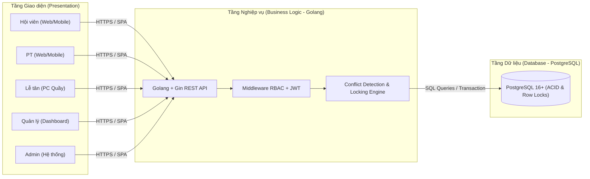
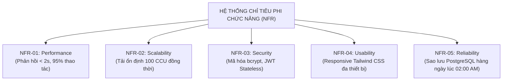

# ĐẶC TẢ YÊU CẦU PHẦN MỀM (SOFTWARE REQUIREMENTS SPECIFICATION - SRS)

> **Lịch sử:** SRS v0.2 được giữ để truy vết. Baseline hiện hành là `07_SRS_v0.3.md`; các ánh xạ UC, trạng thái và chữ ký trong file này không được dùng làm bằng chứng hiện hành.
## HỆ THỐNG QUẢN LÝ PHÒNG TẬP GYM (GYM MANAGEMENT SYSTEM)
### Phiên bản: v0.2 (Cập nhật sau Sprint 1 & Hoàn thiện Tuần 2)

---

### THÔNG TIN DỰ ÁN
* **Tên dự án:** Hệ thống quản lý phòng tập GYM
* **Môn học:** Thực tập cơ sở ngành (TTCSN)
* **Đơn vị:** Khoa Công nghệ Thông tin
* **Nhóm thực hiện:** Nhóm 1
* **Thành viên nhóm:**
  1. **Nguyễn Quang Đảm** (Trưởng nhóm - Phân tích yêu cầu & Backend)
  2. **Nguyễn Thành Long** (Thiết kế CSDL & Backend)
  3. **Lê Công Quân** (Thiết kế UI/UX & Frontend)
  4. **Nguyễn Xuân Mạnh** (Phân tích Use Case & Frontend)
* **Ngày phát hành:** 03/10/2026

---

## 1. GIỚI THIỆU (INTRODUCTION)

### 1.1. Mục đích tài liệu (Purpose)
Tài liệu Đặc tả Yêu cầu Phần mềm (SRS v0.2) này được xây dựng nhằm:
- Đặc tả chi tiết và chuẩn hóa các yêu cầu chức năng (Functional Requirements - 20 REQ) và yêu cầu phi chức năng (Non-Functional Requirements - 5 NFR) của sản phẩm MVP (Minimum Viable Product).
- Đóng vai trò là cầu nối giao tiếp kỹ thuật giữa các thành viên Nhóm 1, làm căn cứ chính xác để xây dựng sơ đồ Use Case chi tiết (`08_use_case_chi_tiet.md`), thiết kế cơ sở dữ liệu (`09_ERD_va_CSDL.md`), thiết kế kiến trúc (`11_kien_truc_he_thong.md`) và triển khai mã nguồn.
- Làm tài liệu nghiệm thu kỹ thuật chính thức cho đồ án Thực tập cơ sở ngành.

### 1.2. Phạm vi sản phẩm (Product Scope)
Hệ thống Quản lý GYM là giải pháp ứng dụng Web đa người dùng phục vụ chuyển đổi số và tự động hóa quy trình vận hành tại các trung tâm thể hình thể thao. Phạm vi triển khai của hệ thống trong 10 tuần bao gồm:
- Xác thực tập trung và kiểm soát truy cập theo 5 vai trò: Hội viên, PT, Lễ tân, Quản lý, Quản trị viên (Admin).
- Quản lý hồ sơ hội viên và thời hạn thẻ tập; hỗ trợ tìm kiếm và lọc đa tiêu chí.
- Quản lý hồ sơ, lịch làm việc và uy tín của Personal Trainer (PT).
- Quản lý tài nguyên phòng tập chuyên biệt (Gym, Yoga, Boxing, Cardio) và các khung giờ hoạt động tiêu chuẩn trong ngày.
- Nghiệp vụ đặt phòng trực tuyến (dành cho hội viên) và hỗ trợ đặt phòng trực tiếp tại quầy, có hỗ trợ lựa chọn PT kèm theo.
- Nghiệp vụ hủy đặt phòng linh hoạt, tự động hoàn trả sức chứa khả dụng theo quy chế.
- Cơ chế kiểm soát xung đột tự động (Conflict Detection Engine): Ngăn chặn đặt trùng khung giờ của hội viên/PT và ngăn chặn vượt quá sức chứa phòng.
- Nghiệp vụ điểm danh (Check-in) hội viên tại quầy lễ tân và hệ thống đánh giá PT sau khi hoàn thành buổi tập.
- Báo cáo thống kê cơ bản về lượt đặt, tỷ lệ lấp đầy phòng, tăng trưởng hội viên; định hướng xuất file Excel/PDF.

### 1.3. Định nghĩa, từ viết tắt (Definitions & Acronyms)

| Thuật ngữ / Từ viết tắt | Tên tiếng Anh đầy đủ | Định nghĩa / Diễn giải |
|:---|:---|:---|
| **SRS** | Software Requirements Specification | Tài liệu đặc tả yêu cầu phần mềm |
| **MVP** | Minimum Viable Product | Sản phẩm khả dụng tối thiểu đáp ứng các tính năng cốt lõi |
| **PT** | Personal Trainer | Huấn luyện viên cá nhân |
| **RBAC** | Role-Based Access Control | Cơ chế kiểm soát quyền truy cập dựa trên vai trò người dùng |
| **JWT** | JSON Web Token | Chuỗi mã xác thực không lưu trạng thái (Stateless token) |
| **SPA** | Single Page Application | Ứng dụng web trang đơn nạp động dữ liệu thông qua REST API |
| **CRUD** | Create, Read, Update, Delete | Các thao tác cơ bản: Thêm mới, Xem, Cập nhật, Xóa |
| **TimeSlot** | Time Slot | Khung giờ tập luyện cấu hình trong ngày (ví dụ: 06:00 - 08:00) |
| **Capacity** | Room Capacity | Sức chứa tối đa của phòng tập trong một khung giờ cụ thể |
| **Conflict Engine** | Conflict Detection Engine | Động cơ tự động phát hiện và chặn trùng lặp lịch đặt phòng |
| **MoSCoW** | Must - Should - Could - Won't | Phương pháp phân loại độ ưu tiên phát triển yêu cầu phần mềm |

### 1.4. Tài liệu tham khảo (References)
1. Chuẩn tài liệu kỹ thuật IEEE Std 830-1998 (*IEEE Recommended Practice for SRS*).
2. Tài liệu Product Backlog v0.2 (`13_backlog_v0.2.md`) - Nhóm 1 TTCSN.
3. Tài liệu Ma trận phân quyền (`06_ma_tran_phan_quyen.md`) & Chi tiết Use Case (`08_use_case_chi_tiet.md`).
4. Biên bản họp nhóm Tuần 1 và Tuần 2 (Tháng 09 - 10/2026).

---

## 2. MÔ TẢ TỔNG QUAN HỆ THỐNG (OVERALL DESCRIPTION)

### 2.1. Bối cảnh sản phẩm (Product Perspective)
Hệ thống Quản lý GYM được phát triển độc lập theo mô hình kiến trúc **Client-Server 3 tầng**:
- **Client:** Xây dựng bằng React.js và Tailwind CSS, chạy trên môi trường trình duyệt web của người dùng cuối.
- **Server:** Xây dựng bằng Golang và Gin Framework, cung cấp RESTful API hiệu năng cao, thực thi xác thực JWT và kiểm tra logic nghiệp vụ.
- **Database:** Hệ quản trị cơ sở dữ liệu quan hệ PostgreSQL 16+, đảm bảo tính toàn vẹn ACID, MVCC và cơ chế khóa hàng chống Race Condition cho các giao dịch đặt phòng.

### 2.2. Chức năng chính của hệ thống (Product Functions)
Hệ thống cung cấp các nhóm chức năng chính sau:
1. **Xác thực & Quản trị tài khoản:** Đăng nhập, đổi mật khẩu, phân quyền 5 vai trò, quản lý tài khoản nhân viên và PT.
2. **Quản lý danh mục hội viên & PT:** Đăng ký thẻ tập, cập nhật hồ sơ, quản lý cấp phép PT, tìm kiếm & lọc nhanh đa tiêu chí.
3. **Quản lý cơ sở vật chất:** Quản lý danh mục phòng tập chức năng, sức chứa và thiết lập các khung giờ hoạt động trong ngày.
4. **Quản lý đặt & hủy phòng:** Hội viên chủ động đặt chỗ online, chọn PT kèm theo, lễ tân hỗ trợ đặt chỗ tại quầy, hủy chỗ theo quy chế.
5. **Động cơ chống xung đột lịch tập:** Tự động phát hiện trùng ca tập cá nhân/PT và quá tải sức chứa theo thời gian thực.
6. **Vận hành tại quầy, Đánh giá & Báo cáo:** Check-in điểm danh hội viên, đánh giá chất lượng PT, thống kê lượt đặt, tỷ lệ lấp đầy phòng và xuất báo cáo.

### 2.3. Đặc điểm người dùng & 5 vai trò (User Classes and Characteristics)
Hệ thống thiết lập 5 nhóm tác nhân với quyền hạn và mục đích sử dụng riêng biệt:
1. **Hội viên (Member):** Khách hàng sử dụng dịch vụ tại trung tâm. Sử dụng hệ thống để đăng nhập, tra cứu phòng còn chỗ, tự đặt chỗ, chọn PT, tự hủy chỗ của mình trước 2 tiếng, đánh giá PT sau buổi tập, và xem lịch sử tập luyện cá nhân.
2. **PT (Personal Trainer):** Huấn luyện viên cá nhân tại phòng tập. Nộp hồ sơ đăng ký tài khoản, chờ cấp phép (Trust). Sử dụng hệ thống để xem lịch làm việc, nhận thông báo đặt lịch từ hội viên, Xác nhận/Từ chối lịch tập, và theo dõi điểm uy tín cá nhân.
3. **Lễ tân (Receptionist):** Nhân viên tiếp đón tại quầy dịch vụ. Phụ trách quản lý hồ sơ hội viên, tìm kiếm thông tin khách hàng, hỗ trợ đặt/hủy chỗ tại quầy và thực hiện check-in điểm danh hội viên khi đến phòng tập.
4. **Quản lý (Manager):** Cán bộ quản lý vận hành cơ sở. Có quyền quản lý danh mục phòng tập, cấu hình khung giờ hoạt động, giám sát toàn bộ lịch đặt phòng, xét duyệt và cấp phép cho PT, xử lý hủy phòng sự cố và theo dõi bảng điều khiển báo cáo thống kê.
5. **Quản trị viên (Admin):** Quản trị viên kỹ thuật cao nhất. Quản lý toàn bộ tài khoản người dùng (tạo tài khoản, khóa tài khoản, phân quyền), cấu hình hệ thống, giám sát an toàn và có toàn quyền can thiệp vào các module nghiệp vụ.

### 2.4. Ràng buộc thiết kế và triển khai (Design Constraints)
- **Tiến độ:** Tuân thủ khung kế hoạch 10 tuần của học phần (5 Sprint, mỗi Sprint 2 tuần).
- **Ngăn xếp công nghệ:** Bắt buộc tuân thủ bộ công nghệ đã chốt: React + Tailwind CSS (Frontend), Golang/Gin (Backend), PostgreSQL 16+ (Database).
- **Ràng buộc nghiệp vụ đặt phòng:**
  - Một hội viên hoặc một PT không được phép đặt lịch trùng ca (2 phòng trong cùng một khung giờ của cùng một ngày).
  - Số lượng hội viên đặt phòng trong một khung giờ không được vượt quá `Capacity` của phòng.
  - Hội viên chỉ được tự hủy lịch trước giờ bắt đầu ca tập tối thiểu 2 giờ. Sau mốc này, chỉ Lễ tân/Quản lý mới có quyền hủy bỏ lịch.

### 2.5. Giả định và phụ thuộc (Assumptions and Dependencies)
- Hệ thống hoạt động trong môi trường có kết nối mạng Internet/Intranet ổn định.
- Đồng hồ hệ thống máy chủ được đồng bộ thời gian chuẩn NTP (múi giờ GMT+7, Asia/Ho_Chi_Minh).

---

## 3. CÁC YÊU CẦU CHỨC NĂNG (FUNCTIONAL REQUIREMENTS - 20 REQ)

Toàn bộ 20 yêu cầu chức năng dưới đây được đồng bộ chính xác với **Product Backlog v0.2** (`13_backlog_v0.2.md`):

---

### REQ-01: Đăng nhập hệ thống (Authentication)
* **Tác nhân:** Tất cả các vai trò (Hội viên, PT, Lễ tân, Quản lý, Admin).
* **Mức độ ưu tiên:** **Must Have** | **Sprint dự kiến:** Sprint 1 (Tuần 1-2).
* **Mô tả:** Cho phép người dùng xác thực danh tính vào hệ thống bằng tên đăng nhập (`username`) và mật khẩu (`password`).
* **Đầu vào:** `username`, `password`.
* **Xử lý:**
  1. Kiểm tra dữ liệu đầu vào không được để trống.
  2. Truy vấn người dùng trong bảng `Users`. Nếu không tìm thấy hoặc tài khoản bị khóa (`status = 'Inactive'`), trả về lỗi.
  3. Đối soát mật khẩu bằng `bcrypt.compare`.
  4. Nếu hợp lệ: Cấp phiên làm việc an toàn thông qua JWT Token (chứa `userId`, `roleName`, thời hạn 24h).
  5. Điều hướng người dùng về trang giao diện tương ứng với vai trò.
* **Đầu ra:** HTTP 200 OK kèm mã JWT và thông tin tài khoản; hoặc HTTP 401 Unauthorized khi thông tin không chính xác.

---

### REQ-02: Phân quyền theo vai trò (Role-Based Access Control)
* **Tác nhân:** Quản trị viên (Admin) cấu hình; Hệ thống tự động thực thi.
* **Mức độ ưu tiên:** **Must Have** | **Sprint dự kiến:** Sprint 1 (Tuần 1-2).
* **Mô tả:** Thiết lập cơ chế kiểm soát truy cập nghiêm ngặt theo 5 vai trò dựa trên Ma trận Phân quyền (`06_ma_tran_phan_quyen.md`).
* **Đầu vào:** Token xác thực của người dùng đính kèm trong HTTP Header `Authorization`.
* **Xử lý:**
  1. Middleware `verifyToken` xác thực tính hợp lệ và chữ ký của JWT.
  2. Middleware `checkRole` kiểm tra quyền của vai trò hiện tại đối với API/Endpoint tương ứng.
  3. Chặn đứng mọi hành vi truy cập trái phép qua URL phía Frontend và qua API phía Backend.
* **Đầu ra:** Cho phép yêu cầu tiếp tục được xử lý hoặc phản hồi HTTP 403 Forbidden.

---

### REQ-03: Quản lý thông tin hội viên (CRUD Members)
* **Tác nhân:** Lễ tân, Quản lý, Admin.
* **Mức độ ưu tiên:** **Must Have** | **Sprint dự kiến:** Sprint 2 (Tuần 3-4).
* **Mô tả:** Cung cấp đầy đủ các thao tác Thêm, Xem, Sửa, Xóa/Khóa đối với hồ sơ hội viên.
* **Đầu vào:** Họ tên, số điện thoại, email, ảnh đại diện/ảnh thẻ (`avatar_url`), ngày sinh, giới tính, địa chỉ, ngày tham gia, ngày hết hạn gói thẻ tập.
* **Xử lý:**
  1. Kiểm tra tính duy nhất của Số điện thoại và Email.
  2. Tạo bản ghi tài khoản `Users` và hồ sơ `Members` liên kết với nhau.
  3. Hỗ trợ cập nhật thông tin và gia hạn thời hạn gói tập.
  4. Xóa mềm (Soft Delete) bằng cách chuyển trạng thái hội viên sang `Inactive`.
* **Đầu ra:** Hồ sơ hội viên được tạo lập/cập nhật thành công trong cơ sở dữ liệu.

---

### REQ-04: Quản lý phòng tập (Room Management)
* **Tác nhân:** Quản lý, Admin (Hội viên và Lễ tân chỉ được xem).
* **Mức độ ưu tiên:** **Must Have** | **Sprint dự kiến:** Sprint 2 (Tuần 3-4).
* **Mô tả:** Tạo lập, cấu hình và bảo trì danh mục các phòng tập thể chất của trung tâm.
* **Đầu vào:** Tên phòng, loại hình (Gym, Yoga, Boxing, Cardio), sức chứa tối đa (`Capacity` $> 0$), mô tả thiết bị, trạng thái (Sẵn sàng, Đang bảo trì, Tạm dừng).
* **Xử lý:**
  1. Kiểm tra tên phòng không được trùng lặp.
  2. Lưu trữ hoặc cập nhật thông tin vào bảng `Rooms`.
  3. Cập nhật trạng thái phòng (khi chuyển sang bảo trì thì không cho phép đặt phòng mới).
* **Đầu ra:** Danh sách phòng tập được cập nhật phục vụ việc phân bổ lịch tập.

---

### REQ-05: Quản lý khung giờ (TimeSlots Management)
* **Tác nhân:** Quản lý, Admin.
* **Mức độ ưu tiên:** **Must Have** | **Sprint dự kiến:** Sprint 2 (Tuần 3-4).
* **Mô tả:** Thiết lập danh sách các khung giờ tập luyện cố định trong ngày tại trung tâm (ví dụ: 06:00 - 08:00, 17:30 - 19:30).
* **Đầu vào:** Tên ca tập, Giờ bắt đầu (`start_time`), Giờ kết thúc (`end_time`), Trạng thái kích hoạt.
* **Xử lý:**
  1. Kiểm tra: `end_time` phải lớn hơn `start_time`.
  2. Lưu cấu hình khung giờ vào bảng `TimeSlots`.
  3. Hỗ trợ bật/tắt khung giờ linh hoạt theo mùa hoặc theo kế hoạch hoạt động của phòng tập.
* **Đầu ra:** Danh mục khung giờ tiêu chuẩn sẵn sàng cho chức năng đặt phòng.

---

### REQ-06: Đặt phòng & Đặt PT (Booking Creation)
* **Tác nhân:** Hội viên (đặt cho mình), Lễ tân (đặt hỗ trợ hội viên tại quầy).
* **Mức độ ưu tiên:** **Must Have** | **Sprint dự kiến:** Sprint 3 (Tuần 5-6).
* **Mô tả:** Cho phép tạo phiếu đặt chỗ cho một ca tập cụ thể trong ngày, hỗ trợ chọn kèm PT.
* **Đầu vào:** `member_id`, `room_id`, `time_slot_id`, `booking_date`, `pt_id` (optional).
* **Xử lý:**
  1. Kiểm tra thời hạn thẻ tập của hội viên (`expiry_date >= booking_date`).
  2. Kích hoạt **REQ-08 (Conflict Engine)** để kiểm tra trùng ca tập và kiểm tra số chỗ trống khả dụng.
  3. Nếu có chọn PT, kiểm tra lịch PT xem có trống không.
  4. Nếu hợp lệ: Tạo bản ghi vào bảng `Bookings` với trạng thái `Confirmed` (nếu không kèm PT) hoặc `Pending PT` (nếu kèm PT). Giảm số chỗ trống khả dụng của ca tập đó.
  5. Nếu do Lễ tân thực hiện: Ghi nhận mã nhân viên vào trường `created_by_user_id`.
* **Đầu ra:** HTTP 201 Created kèm mã đặt phòng (`booking_id`) và chi tiết lịch tập.

---

### REQ-07: Hủy phòng (Booking Cancellation)
* **Tác nhân:** Hội viên (hủy phiếu của mình), PT (từ chối lịch tập), Lễ tân, Quản lý, Admin (hủy phiếu bất kỳ).
* **Mức độ ưu tiên:** **Must Have** | **Sprint dự kiến:** Sprint 3 (Tuần 5-6).
* **Mô tả:** Thực hiện hủy lượt đặt phòng đã tạo trước đó, giải phóng chỗ trống cho người khác.
* **Đầu vào:** `booking_id`, Lý do hủy (nếu có).
* **Xử lý:**
  1. Nếu người hủy là Hội viên: Kiểm tra tính sở hữu và thời gian hiện tại phải cách giờ bắt đầu ca tập ít nhất 2 giờ.
  2. Nếu người hủy là Lễ tân/Quản lý: Cho phép hủy ngay lập tức trong các trường hợp sự cố phòng tập hoặc yêu cầu đột xuất.
  3. Nếu PT từ chối, cập nhật trạng thái phiếu về không có PT hoặc hủy lịch tùy theo quy trình thực tế.
  4. Cập nhật trạng thái phiếu đặt sang `Cancelled`. Tự động hoàn lại 1 chỗ trống khả dụng cho ca tập đó.
* **Đầu ra:** Thông báo hủy lịch thành công; chỗ trống được giải phóng ngay lập tức trên hệ thống.

---

### REQ-08: Kiểm tra trùng lịch (Conflict Detection Engine)
* **Tác nhân:** Hệ thống (tự động kích hoạt khi thực hiện REQ-06).
* **Mức độ ưu tiên:** **Must Have** | **Sprint dự kiến:** Sprint 3 (Tuần 5-6).
* **Mô tả:** Cơ chế tự động phát hiện và ngăn chặn xung đột thời gian và sức chứa:
  1. *Ngăn chặn trùng ca:* Cùng một hội viên hoặc một PT không thể đặt 2 ca tập trong cùng một ngày và cùng một khung giờ.
  2. *Ngăn chặn quá tải:* Tổng số lượt đặt hợp lệ trong phòng tại khung giờ đó không được vượt quá `Capacity` của phòng.
* **Đầu vào:** Bộ tham số `(member_id, room_id, time_slot_id, booking_date, pt_id)`.
* **Xử lý:**
  - Thực thi truy vấn kiểm tra trong một Database Transaction an toàn:
    - `COUNT(Bookings)` của hội viên trong cùng ngày và khung giờ phải bằng 0.
    - `COUNT(Bookings)` của PT (nếu có) trong cùng ngày và khung giờ phải bằng 0.
    - `COUNT(Bookings)` của phòng trong khung giờ phải nhỏ hơn `Room.Capacity`.
* **Đầu ra:** Phê duyệt cho phép tạo phiếu đặt hoặc từ chối kèm mã lỗi `409 Conflict`.

---

### REQ-09: Check-in hội viên (Member Check-in)
* **Tác nhân:** Lễ tân, Quản lý, Admin.
* **Mức độ ưu tiên:** **Should Have** | **Sprint dự kiến:** Sprint 4 (Tuần 7-8).
* **Mô tả:** Ghi nhận sự hiện diện thực tế của hội viên tại quầy tiếp đón trước khi vào tập.
* **Đầu vào:** `booking_id` hoặc Mã hội viên / Số điện thoại.
* **Xử lý:**
  1. Lễ tân tra cứu danh sách các lượt đặt phòng của ngày hôm nay.
  2. Xác minh thông tin và bấm "Check-in".
  3. Hệ thống chuyển trạng thái phiếu đặt từ `Confirmed` sang `CheckedIn`, ghi nhận thời gian `checked_in_at = NOW()`.
* **Đầu ra:** Trạng thái phiếu đặt chuyển thành `CheckedIn`; hiển thị xác nhận chào mừng hội viên.

---

### REQ-10: Báo cáo thống kê cơ bản (Basic Analytics Dashboard)
* **Tác nhân:** Quản lý, Quản trị viên (Admin).
* **Mức độ ưu tiên:** **Should Have** | **Sprint dự kiến:** Sprint 4 (Tuần 7-8).
* **Mô tả:** Cung cấp bảng điều khiển trực quan tổng hợp các chỉ số vận hành cơ bản:
  - Tổng số lượt đặt phòng theo ngày/tuần/tháng.
  - Tỷ lệ lấp đầy (Occupancy Rate) của từng phòng tập.
  - Số lượng check-in thực tế so với số lượng đặt trước.
  - Thống kê số lượng hội viên và PT mới tham gia.
* **Đầu vào:** Khoảng thời gian thống kê (Từ ngày - Đến ngày), Bộ lọc phòng.
* **Xử lý:** Truy vấn tổng hợp (Aggregation SQL queries: `COUNT`, `SUM`, `GROUP BY`) và tính toán tỷ lệ.
* **Đầu ra:** Bảng số liệu và biểu đồ trực quan (cột, tròn) trên giao diện Quản lý.

---

### REQ-11: Tìm kiếm / lọc hội viên đa tiêu chí
* **Tác nhân:** Lễ tân, Quản lý, Admin.
* **Mức độ ưu tiên:** **Should Have** | **Sprint dự kiến:** Sprint 2 (Tuần 3-4).
* **Mô tả:** Trang bị bộ lọc dữ liệu và tìm kiếm nhanh danh sách hội viên.
* **Đầu vào:** Chuỗi tìm kiếm (Tên, SĐT, Mã hội viên), Bộ lọc trạng thái thẻ (Đang hoạt động, Sắp hết hạn, Đã hết hạn).
* **Xử lý:** Tìm kiếm linh hoạt với mệnh đề `LIKE %keyword%` kết hợp các chỉ mục Index để đảm bảo tốc độ phản hồi dưới 1 giây. Hỗ trợ phân trang dữ liệu (Pagination).
* **Đầu ra:** Danh sách kết quả tìm kiếm hiển thị dạng bảng trực quan.

---

### REQ-12: Quản lý tài khoản người dùng (User Management)
* **Tác nhân:** Quản trị viên (Admin).
* **Mức độ ưu tiên:** **Must Have** | **Sprint dự kiến:** Sprint 1 (Tuần 1-2).
* **Mô tả:** Quản lý tài khoản nội bộ của cán bộ nhân viên, PT và hội viên trong hệ thống.
* **Đầu vào:** `username`, `password`, `full_name`, `role_id`, `status` (Active / Inactive).
* **Xử lý:**
  1. Tạo tài khoản mới cho nhân viên lễ tân, quản lý, PT.
  2. Băm mật khẩu bằng `bcrypt`.
  3. Hỗ trợ đặt lại mật khẩu và khóa/mở khóa tài khoản khi có biến động nhân sự.
* **Đầu ra:** Tài khoản được khởi tạo hoặc thay đổi trạng thái theo quyền Admin.

---

### REQ-13: Xem lịch đặt phòng (Schedule & Calendar View)
* **Tác nhân:** Tất cả các vai trò (Hội viên/PT xem của mình; Lễ tân/Quản lý/Admin xem toàn bộ).
* **Mức độ ưu tiên:** **Should Have** | **Sprint dự kiến:** Sprint 3 (Tuần 5-6).
* **Mô tả:** Hiển thị giao diện lịch biểu trực quan dạng bảng lưới (Grid View / Calendar View) theo ngày/tuần.
* **Đầu vào:** Ngày xem, Mã phòng, Bộ lọc trạng thái.
* **Xử lý:**
  - Hội viên: Hiển thị các ca tập sắp diễn ra và lịch sử tập luyện của bản thân.
  - PT: Hiển thị lịch dạy sắp tới.
  - Lễ tân/Quản lý: Hiển thị ma trận toàn bộ phòng tập và khung giờ trong ngày kèm số chỗ đã đặt / sức chứa tối đa.
* **Đầu ra:** Lưới lịch trực quan, có mã màu phân biệt trạng thái (Còn chỗ, Sắp kín, Kín chỗ).

---

### REQ-14: Thông báo đặt phòng thành công
* **Tác nhân:** Hội viên, PT, Lễ tân.
* **Mức độ ưu tiên:** **Could Have** | **Sprint dự kiến:** Sprint 4 (Tuần 7-8).
* **Mô tả:** Hệ thống hiển thị thông báo tức thời (Toast Alert / Notification) trên màn hình ngay khi hoàn thành thao tác đặt/hủy phòng. Định hướng mở rộng gửi thông báo qua email xác nhận.
* **Đầu vào:** Trạng thái phản hồi từ API đặt phòng.
* **Xử lý:** Bật Toast component với màu sắc và âm thanh thông báo phù hợp; hiển thị tóm tắt thông tin lịch tập.
* **Đầu ra:** Hộp thoại thông báo hiển thị cho người dùng trong 3-5 giây.

---

### REQ-15: Xuất báo cáo PDF/Excel
* **Tác nhân:** Quản lý, Quản trị viên (Admin).
* **Mức độ ưu tiên:** **Could Have** | **Sprint dự kiến:** Sprint 5 (Tuần 9-10).
* **Mô tả:** Cho phép trích xuất danh sách hội viên, lịch sử đặt phòng và số liệu thống kê vận hành ra file định dạng Excel (`.xlsx`) hoặc tài liệu PDF phục vụ lưu trữ ngoại tuyến và đối soát.
* **Đầu vào:** Danh sách dữ liệu đang hiển thị hoặc khoảng thời gian cần xuất báo cáo.
* **Xử lý:** Sử dụng thư viện xuất file (ExcelJS / jsPDF) để định dạng tiêu đề, bảng số liệu và sinh file tải xuống.
* **Đầu ra:** Tệp tin `.xlsx` hoặc `.pdf` được tải về máy tính của người dùng.

---

### REQ-16: Đăng ký hồ sơ PT
* **Tác nhân:** PT.
* **Mức độ ưu tiên:** **Must Have** | **Sprint dự kiến:** Sprint 2 (Tuần 3-4).
* **Mô tả:** PT nộp hồ sơ đăng ký tài năng, chuyên môn, bằng cấp trên hệ thống để chờ quản lý xét duyệt.
* **Đầu vào:** Tên, năm sinh, hình ảnh, kinh nghiệm, bằng cấp, lĩnh vực huấn luyện.
* **Xử lý:** Lưu thông tin vào CSDL với trạng thái `Pending Approval`.
* **Đầu ra:** Thông báo nộp hồ sơ thành công, đợi phê duyệt.

---

### REQ-17: Duyệt/Cấp phép PT
* **Tác nhân:** Quản lý.
* **Mức độ ưu tiên:** **Must Have** | **Sprint dự kiến:** Sprint 2 (Tuần 3-4).
* **Mô tả:** Quản lý xem xét độ tin cậy (TRUST) và cấp phép cho hồ sơ PT hoạt động, thiết lập cấp độ của PT.
* **Đầu vào:** `pt_id`, Quyết định (Duyệt / Từ chối).
* **Xử lý:** Đổi trạng thái tài khoản PT thành `Active` nếu duyệt, cấp quyền truy cập hệ thống dành cho PT.
* **Đầu ra:** Hồ sơ PT được phê duyệt, hệ thống mở khóa chức năng nhận lịch tập.

---

### REQ-18: Xác nhận lịch tập 1-1
* **Tác nhân:** PT.
* **Mức độ ưu tiên:** **Must Have** | **Sprint dự kiến:** Sprint 3 (Tuần 5-6).
* **Mô tả:** Khi Hội viên đặt phòng có chọn PT, PT sẽ nhận được thông báo để chủ động Xác nhận hoặc Từ chối lịch tập.
* **Đầu vào:** `booking_id`, Thao tác (Xác nhận / Từ chối).
* **Xử lý:** Cập nhật trạng thái đặt phòng thành `Confirmed` (nếu PT chấp nhận) hoặc gửi thông báo lại cho hội viên (nếu PT từ chối).
* **Đầu ra:** Trạng thái đơn đặt phòng được cập nhật.

---

### REQ-19: Đánh giá PT
* **Tác nhân:** Hội viên.
* **Mức độ ưu tiên:** **Should Have** | **Sprint dự kiến:** Sprint 4 (Tuần 7-8).
* **Mô tả:** Hội viên đánh giá điểm sao (1-5) và nhận xét PT sau khi hoàn thành buổi tập.
* **Đầu vào:** `booking_id`, `pt_id`, `rating` (1-5 sao), `review_text`.
* **Xử lý:** Ghi nhận đánh giá vào CSDL, kích hoạt REQ-20 để tính lại điểm uy tín.
* **Đầu ra:** Đánh giá được lưu trữ hiển thị công khai trên hồ sơ PT.

---

### REQ-20: Tính điểm uy tín PT
* **Tác nhân:** Hệ thống.
* **Mức độ ưu tiên:** **Should Have** | **Sprint dự kiến:** Sprint 4 (Tuần 7-8).
* **Mô tả:** Hệ thống cập nhật tự động điểm uy tín rating và chuyên cần của PT.
* **Đầu vào:** Đánh giá mới nhất, số buổi tập hoàn thành so với số buổi vắng mặt.
* **Xử lý:** Tính trung bình cộng số sao, tính tỷ lệ chuyên cần (Attendance rate) và cập nhật vào hồ sơ PT.
* **Đầu ra:** Điểm uy tín của PT (Trust Score) được cập nhật liên tục.

---

## 4. CÁC YÊU CẦU PHI CHỨC NĂNG (NON-FUNCTIONAL REQUIREMENTS - 5 NFR)

Năm yêu cầu phi chức năng then chốt được chuẩn hóa đồng bộ với Backlog v0.2:

### NFR-01: Hiệu năng hệ thống (Performance)
- **Thời gian phản hồi:** Thời gian phản hồi của hệ thống (Response Time) đối với $95\%$ các thao tác người dùng (truy vấn danh sách phòng, tìm kiếm hội viên, đặt chỗ) phải đạt dưới **$2.0$ giây** trong điều kiện mạng bình thường (với Golang backend, thời gian phản hồi API trung bình $< 50ms$).
- **Tối ưu hóa CSDL:** Toàn bộ các truy vấn lọc và nối bảng phải được tối ưu thông qua hệ thống chỉ mục (Index) trên các trường khóa chính, khóa ngoại, bộ ba `(room_id, booking_date, time_slot_id)` và Partial Unique Index trên PostgreSQL. Bắt buộc áp dụng phân trang (Pagination) dữ liệu.

### NFR-02: Khả năng mở rộng & Chịu tải (Scalability)
- **Người dùng đồng thời:** Hệ thống máy chủ ứng dụng Golang (Gin Framework) và cơ sở dữ liệu PostgreSQL 16+ phải chịu tải ổn định với tối thiểu **$100$ người dùng đồng thời (concurrent users - 100 CCU)** mà không phát sinh lỗi sập máy chủ (mã lỗi 5xx) hoặc rò rỉ bộ nhớ (Memory Leak). Cơ chế Goroutines cho phép dễ dàng mở rộng lên hàng nghìn CCU.
- **Kiến trúc phi trạng thái:** Máy chủ Backend áp dụng kiến trúc Stateless REST API kết hợp cơ chế Connection Pooling của Go (`database/sql` / GORM) với PostgreSQL để tối ưu hóa việc tái sử dụng kết nối CSDL.

### NFR-03: An toàn và Bảo mật (Security)
- **Mã hóa mật khẩu:** Mật khẩu của mọi tài khoản tuyệt đối không lưu dưới dạng văn bản thô (Plain text), bắt buộc phải được băm một chiều bằng thuật toán an toàn **bcrypt** (`golang.org/x/crypto/bcrypt`) với Salt Rounds tối thiểu là **$10$**.
- **Xác thực phiên:** Áp dụng chuẩn **JSON Web Token (JWT)** có chữ ký bảo mật HS256 (`golang-jwt/jwt/v5`), thời hạn sống của token không quá 24 giờ.
- **Phòng chống tấn công:**
  - *SQL Injection:* $100\%$ truy vấn sử dụng ORM (GORM) hoặc Parameterized Prepared Statements.
  - *XSS & CSRF:* React tự động lọc ký tự nguy hiểm; áp dụng kiểm soát định dạng tham số đầu vào bằng `go-playground/validator` và cấu hình CORS chặt chẽ trong Gin.

### NFR-04: Tính khả dụng & Trải nghiệm người dùng (Usability & Responsive)
- **Giao diện thích ứng (Responsive Design):** Giao diện người dùng được thiết kế chuẩn Responsive tương thích trên nhiều kích thước màn hình: Máy tính để bàn (Desktop $\ge 1200px$), Máy tính bảng (Tablet $\ge 768px$) và Điện thoại thông minh (Mobile $\ge 375px$) bằng Tailwind CSS.
- **Thao tác nhanh gọn:** Hội viên có thể hoàn tất việc tra cứu và đặt phòng trong vòng tối đa **3 bước tương tác**. Các thông báo xác nhận thành công hoặc cảnh báo lỗi đều hiển thị bằng tiếng Việt rõ ràng, dễ hiểu.

### NFR-05: Độ tin cậy & Sao lưu dữ liệu (Reliability & Backup)
- **Sao lưu định kỳ:** Hệ thống thiết lập quy trình tự động sao lưu dữ liệu (Database Backup) định kỳ hằng ngày vào khung giờ thấp điểm (**02:00 AM**) bằng tiện ích `pg_dump`.
- **Mục tiêu phục hồi:** Bản sao lưu được nén và lưu trữ an toàn, đảm bảo khả năng phục hồi dữ liệu khi xảy ra sự cố phần cứng với chỉ số thời gian phục hồi RTO $< 2$ giờ và tổn thất dữ liệu tối đa RPO $< 24$ giờ. Giao dịch đặt phòng tuân thủ nghiêm ngặt chuẩn ACID và Row-Level Locking của PostgreSQL.

---

## 5. YÊU CẦU GIAO DIỆN BÊN NGOÀI (EXTERNAL INTERFACE REQUIREMENTS)

### 5.1. Giao diện người dùng (User Interfaces - UI)
- **Ngôn ngữ:** Giao diện hoàn toàn bằng tiếng Việt chuẩn ngữ pháp công nghệ thông tin.
- **Phong cách trực quan:** Thiết kế theo phong cách phẳng (Flat Design) kết hợp Dashboard hiện đại với Tailwind CSS:
  - Header: Hiển thị logo GYM, tên người dùng, vai trò hiện tại và nút Đăng xuất.
  - Sidebar: Menu điều hướng theo từng vai trò đã được phân quyền.
  - Main Panel: Lưới hiển thị danh sách phòng, thẻ tóm tắt số liệu (KPI Cards) và bảng dữ liệu tương tác.
  - Feedback UI: Modal xác nhận thao tác nguy hiểm (Hủy phòng, Khóa tài khoản) và Toast notification thông báo kết quả.

### 5.2. Giao diện phần cứng (Hardware Interfaces)
- Không yêu cầu thiết bị phần cứng đặc thù trong giai đoạn MVP.
- Vận hành mượt mà trên phần cứng tiêu chuẩn: Máy tính cá nhân, Laptop có bàn phím và chuột; Máy tính bảng và điện thoại di động có màn hình cảm ứng.

### 5.3. Giao diện phần mềm (Software Interfaces)
- **Phía Client:** Các trình duyệt Web hiện đại hỗ trợ HTML5/ES6: Google Chrome (phiên bản 100+), Microsoft Edge (100+), Mozilla Firefox (100+), Apple Safari (15+).
- **Phía Server:** Go Runtime phiên bản v1.22+ LTS chạy trên các hệ điều hành phổ biến (Windows 10/11, Ubuntu Linux 20.04/22.04 LTS, macOS).
- **Hệ quản trị CSDL:** PostgreSQL Server phiên bản 16 trở lên.

### 5.4. Giao diện truyền thông (Communications Interfaces)
- **Giao thức:** HTTPS (HTTP/1.1 hoặc HTTP/2 kết hợp chứng chỉ SSL/TLS).
- **Kiến trúc:** RESTful API trao đổi dữ liệu qua định dạng chuẩn `application/json; charset=utf-8`.
- **Header xác thực:** `Authorization: Bearer <JWT_TOKEN>`.

---

## 6. MA TRẬN TRUY VẾT YÊU CẦU (REQUIREMENT TRACEABILITY MATRIX)

Bảng ma trận truy vết thể hiện sự liên kết toàn diện giữa 20 Yêu cầu chức năng (REQ), các Use Case tương ứng, Tác nhân thực hiện, Mức độ ưu tiên MoSCoW và Sprint phân bổ theo Khung 10 tuần (5 Sprint x 2 tuần):

| Mã REQ | Tên yêu cầu chức năng | Use Case ánh xạ | Tác nhân thực hiện (Actors) | Độ ưu tiên | Sprint phân bổ | Trạng thái phân tích |
|:---:|:---|:---:|:---|:---:|:---:|:---:|
| **REQ-01** | Đăng nhập hệ thống | **UC-01** Đăng nhập | Tất cả 5 vai trò | **Must** | Sprint 1 (Tuần 1-2) | Đã phân tích |
| **REQ-02** | Phân quyền theo vai trò | **Hạ tầng RBAC** | Quản trị viên (Admin) | **Must** | Sprint 1 (Tuần 1-2) | Đã phân tích |
| **REQ-03** | Quản lý thông tin hội viên (CRUD) | **UC-02** Quản lý hội viên | Lễ tân, Quản lý | **Must** | Sprint 2 (Tuần 3-4) | Đã phân tích |
| **REQ-04** | Quản lý phòng tập | **UC-03** Quản lý phòng tập | Quản lý | **Must** | Sprint 2 (Tuần 3-4) | Đã phân tích |
| **REQ-05** | Quản lý khung giờ | **UC-03** Quản lý phòng tập | Quản lý | **Must** | Sprint 2 (Tuần 3-4) | Đã phân tích |
| **REQ-06** | Đặt phòng & Đặt PT | **UC-04** Đặt phòng | Hội viên, Lễ tân | **Must** | Sprint 3 (Tuần 5-6) | Đã phân tích |
| **REQ-07** | Hủy phòng | **UC-05** Hủy đặt phòng | Hội viên, Lễ tân, Quản lý, PT | **Must** | Sprint 3 (Tuần 5-6) | Đã phân tích |
| **REQ-08** | Kiểm tra trùng lịch | **UCT** (Include trong UC-04) | Hệ thống tự động | **Must** | Sprint 3 (Tuần 5-6) | Đã phân tích |
| **REQ-09** | Check-in hội viên | **UC-02** Nghiệp vụ tại quầy | Lễ tân | **Should** | Sprint 4 (Tuần 7-8) | Đã phân tích |
| **REQ-10** | Báo cáo thống kê cơ bản | **UC-06** Xem báo cáo | Quản lý, Admin | **Should** | Sprint 4 (Tuần 7-8) | Đã phân tích |
| **REQ-11** | Tìm kiếm / lọc hội viên | **UC-02** Quản lý hội viên | Lễ tân, Quản lý | **Should** | Sprint 2 (Tuần 3-4) | Đã phân tích |
| **REQ-12** | Quản lý tài khoản người dùng | **UC-01** Quản trị tài khoản | Quản trị viên (Admin) | **Must** | Sprint 1 (Tuần 1-2) | Đã phân tích |
| **REQ-13** | Xem lịch đặt phòng | **UC-04, UC-05** Xem lịch | Tất cả 5 vai trò | **Should** | Sprint 3 (Tuần 5-6) | Đã phân tích |
| **REQ-14** | Thông báo đặt phòng thành công | **UC-04** Đặt phòng | Hội viên, PT, Lễ tân | **Could** | Sprint 4 (Tuần 7-8) | Chưa phân tích |
| **REQ-15** | Xuất báo cáo PDF/Excel | **UC-06** Xem báo cáo | Quản lý, Admin | **Could** | Sprint 5 (Tuần 9-10) | Chưa phân tích |
| **REQ-16** | Đăng ký hồ sơ PT | **UC-07** Đăng ký PT | PT | **Must** | Sprint 2 (Tuần 3-4) | Chưa phân tích |
| **REQ-17** | Duyệt/Cấp phép PT | **UC-08** Duyệt PT | Quản lý | **Must** | Sprint 2 (Tuần 3-4) | Chưa phân tích |
| **REQ-18** | Xác nhận lịch tập 1-1 | **UC-09** Xác nhận lịch tập | PT | **Must** | Sprint 3 (Tuần 5-6) | Chưa phân tích |
| **REQ-19** | Đánh giá PT | **UC-10** Đánh giá PT | Hội viên | **Should** | Sprint 4 (Tuần 7-8) | Chưa phân tích |
| **REQ-20** | Tính điểm uy tín PT | **UCT** (Include trong UC-10) | Hệ thống tự động | **Should** | Sprint 4 (Tuần 7-8) | Chưa phân tích |

---

## 7. KẾ HOẠCH BÀN GIAO VÀ PHÊ DUYỆT TÀI LIỆU

Bản tài liệu **SRS v0.2** đã được toàn thể 4 thành viên **Nhóm 1** rà soát, đối chiếu với các tài liệu liên quan (`06_ma_tran_phan_quyen.md`, `08_use_case_chi_tiet.md`, `09_ERD_va_CSDL.md`, `10_so_sanh_cong_nghe.md`, `11_kien_truc_he_thong.md`, `13_backlog_v0.2.md`) và chính thức phê duyệt làm chuẩn mực phát triển từ ngày 03/10/2026.

---
*Hà Nội, ngày 03 tháng 10 năm 2026*  
**ĐẠI DIỆN NHÓM 1 - THỰC TẬP CƠ SỞ NGÀNH**

| Trưởng nhóm / Phân tích yêu cầu | Thiết kế CSDL & Backend | Thiết kế UI/UX & Frontend | Phân tích Use Case & Frontend |
|:---:|:---:|:---:|:---:|
| *(Đã ký)* | *(Đã ký)* | *(Đã ký)* | *(Đã ký)* |
| **Nguyễn Quang Đảm** | **Nguyễn Thành Long** | **Lê Công Quân** | **Nguyễn Xuân Mạnh** |
