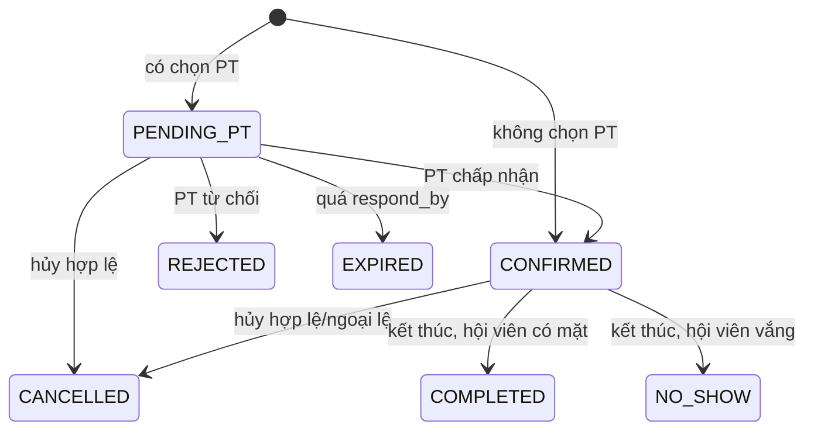

# Đặc tả Use Case chi tiết — v3.0

Mỗi use case áp dụng `REQ-02`, ma trận quyền và các BR được dẫn chiếu. Mã lỗi/API chi tiết nằm ở `12_dac_ta_API.md`.

## UC-01 — Duyệt/từ chối/đình chỉ hồ sơ PT

- Tác nhân: Quản lý; Admin hỗ trợ.
- Tiền điều kiện: hồ sơ `PENDING` khi duyệt/từ chối; `APPROVED` khi đình chỉ.
- Luồng chính: mở hồ sơ → xem dữ liệu/chứng chỉ qua endpoint riêng → chọn quyết định → nhập lý do khi từ chối/đình chỉ → hệ thống cập nhật trạng thái, người/thời gian quyết định và audit.
- Ngoại lệ: trạng thái đã đổi → `409 INVALID_STATE`; tài khoản PT đang khóa vẫn giữ quyết định hồ sơ; đình chỉ có lịch tương lai → hệ thống trả danh sách cần xử lý, không xóa lịch tự động.
- Hậu điều kiện: chỉ PT `APPROVED` + tài khoản `ACTIVE` được nhận booking mới.

## UC-02 — Đặt phòng và PT tùy chọn

- Tác nhân: Hội viên; Lễ tân/Admin đặt hộ.
- Tiền điều kiện: phiên `OPEN`, chưa bắt đầu; hội viên thỏa BR-03; PT tùy chọn thỏa BR-04.
- Luồng chính: chọn ngày/phòng/ca → lấy phiên và số chỗ → chọn PT tùy chọn → gửi request với `Idempotency-Key` → transaction khóa `room_sessions` → kiểm tra hạn thẻ, trạng thái, sức chứa và xung đột → tạo `CONFIRMED` không PT hoặc `PENDING_PT` có PT → commit → trả booking.
- Ngoại lệ: phòng đầy/trùng lịch → `409`; PT không còn rảnh → `409 PT_UNAVAILABLE`; key khác payload → `409 IDEMPOTENCY_CONFLICT`; commit lỗi → không trả thành công.
- Hậu điều kiện: booking giữ tài nguyên đúng một lần; đặt hộ ghi người thực hiện.

## UC-03 — PT chấp nhận/từ chối lịch

- Tác nhân: PT được gán.
- Luồng chính: xem yêu cầu → chọn chấp nhận/từ chối → hệ thống khóa booking và kiểm tra `PENDING_PT`, chủ thể, `respond_by` → cập nhật `CONFIRMED` hoặc `REJECTED` → audit → commit.
- Ngoại lệ: job đã hết hạn hoặc người khác xử lý trước → `409 INVALID_STATE`; PT sai → `404/403` theo chính sách.
- Hậu điều kiện: REJECTED giải phóng tài nguyên; hội viên thấy trạng thái mới khi tải lại danh sách.

## UC-04 — Điểm danh

- Tác nhân: Lễ tân; Quản lý/Admin hỗ trợ.
- Luồng chính: tìm booking theo mã hội viên/SĐT/booking → xác minh đúng ngày/phiên và `CONFIRMED` → chọn người tham gia MEMBER hoặc PT → ghi `booking_attendance` với người ghi/thời gian.
- Ngoại lệ: người không thuộc booking → `422`; điểm danh lặp → trả bản ghi hiện có hoặc `409` ổn định; ngoài cửa sổ điểm danh → `422` trừ override có lý do.
- Hậu điều kiện: trạng thái booking không đổi chỉ vì một người check-in; job kết thúc buổi dùng attendance để chọn COMPLETED/NO_SHOW.

## UC-05 — Đánh giá PT

- Tác nhân: Hội viên sở hữu booking.
- Tiền điều kiện: BR-21.
- Luồng chính: chọn booking → nhập 1–5 sao và bình luận → backend suy ra member/PT → kiểm tra attendance và trạng thái → tạo review duy nhất → tính lại rating PT trong transaction.
- Ngoại lệ: chưa đủ điều kiện → `422 REVIEW_NOT_ELIGIBLE`; đã đánh giá → `409 REVIEW_EXISTS`.
- Hậu điều kiện: review liên kết booking; rating có thể tính lại từ dữ liệu nguồn.

## UC-06 — Hủy booking

- Tác nhân: Hội viên, PT được gán, Lễ tân/Quản lý/Admin.
- Luồng chính: tải booking → kiểm tra quyền/trạng thái/mốc giờ → nhập lý do nếu bắt buộc → khóa booking và phiên → chuyển `CANCELLED` → ghi người/lý do/audit → commit.
- Ngoại lệ: hội viên hủy muộn → `422 CANCELLATION_WINDOW_CLOSED`; trạng thái kết thúc → `409`; gọi lặp cùng request → trả kết quả ổn định.

## UC-07 — Đăng nhập/đăng xuất

- Đăng nhập: xác thực username/password, kiểm tra `ACTIVE`, phát access token có `sub`, `role`, `auth_version`, `jti`, `exp`.
- Đăng xuất: client xóa token; nếu hỗ trợ thu hồi phiên, server ghi JTI/session đến khi token hết hạn. Khóa/reset/đổi role tăng `auth_version`.
- Lỗi đăng nhập dùng thông báo chung, không phân biệt tài khoản không tồn tại và sai mật khẩu.

## UC-08 — Quản lý tài khoản

- Admin tạo tài khoản một role, reset mật khẩu, khóa/mở và đổi role.
- Username/email chuẩn hóa phải duy nhất; SĐT không bắt buộc duy nhất ở `users` vì có thể dùng chung, còn mã hội viên là duy nhất.
- Đổi role phải kiểm tra dữ liệu hồ sơ cần thiết; không tự xóa hồ sơ/lịch sử cũ.

## UC-09 — Quản lý và tra cứu hội viên

- Lễ tân/Quản lý/Admin tạo, cập nhật, gia hạn và vô hiệu hóa hồ sơ.
- Tìm theo mã, tên, SĐT, email, trạng thái/hạn thẻ; phân trang bắt buộc.
- Không hard-delete; thay đổi trạng thái/hạn thẻ không hồi tố xóa booking.

## UC-10 — Quản lý phòng

- Tạo/sửa mô tả/loại/trạng thái; tên phòng duy nhất không phân biệt hoa thường.
- Chuyển bảo trì trả danh sách phiên/booking tương lai bị ảnh hưởng để người có quyền xử lý.
- Không xóa phòng đã được tham chiếu.

## UC-11 — Quản lý ca và phiên phòng

- Tạo ca chung phải thỏa BR-06; ca đã dùng chỉ được vô hiệu hóa.
- Mở phiên theo phòng/ngày/ca, chốt timestamp và capacity.
- Giảm sức chứa hoặc đóng phiên phải khóa phiên, kiểm tra booking giữ chỗ và audit.

## UC-12 — Nộp/nộp lại hồ sơ PT

- PT nhập chuyên môn/kinh nghiệm và tải chứng chỉ theo chính sách file.
- Nộp chuyển `DRAFT/REJECTED` sang `PENDING`; lý do cũ được giữ trong audit.
- File chứng chỉ là riêng tư; URL public không được dùng để bỏ qua authorization.

## UC-13 — Xem lịch

- Hội viên xem booking của mình; PT xem booking được gán; Lễ tân/Quản lý/Admin xem toàn cơ sở.
- Bộ lọc: khoảng ngày, phòng, PT, trạng thái; phân trang hoặc giới hạn khoảng thời gian.

## UC-14 — Xem báo cáo

- Chỉ số: số booking tạo/xác nhận/hủy/hoàn tất/no-show; số attendance; occupancy; rating/chuyên cần.
- Occupancy = booking giữ chỗ hoặc hoàn tất theo mục tiêu báo cáo / tổng capacity các phiên `OPEN` trong khoảng. Mỗi báo cáo phải ghi công thức đang dùng.
- Không hiển thị doanh thu trong MVP.

## UC-15 — Xuất báo cáo

- Dùng cùng service/query và bộ lọc với UC-14; ghi thời gian xuất, múi giờ và người xuất.
- File lớn xử lý có giới hạn; dữ liệu nhạy cảm chỉ dành cho vai trò được phép.

## UC-16 — Xem yêu cầu/thông báo

- Toast phản hồi request hiện tại.
- PT lấy danh sách `PENDING_PT`; Hội viên lấy lịch/trạng thái mới bằng polling có kiểm soát.
- Email/SMS/WebSocket và notification lưu bền nằm ngoài MVP.

## Sơ đồ trạng thái booking

