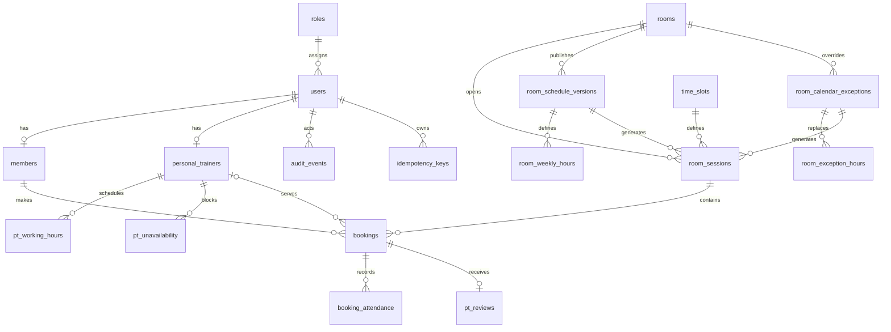

# ERD và thiết kế CSDL — v3.0

**Nền tảng:** PostgreSQL 16+ · **Baseline:** SRS v0.3  
**Amendment lịch phòng 11/10/2026:** 18 bảng nghiệp vụ + lịch sử Goose; migration v3. Bốn bảng bổ sung là `room_schedule_versions`, `room_weekly_hours`, `room_calendar_exceptions`, `room_exception_hours`.
**Amendment ảnh/Booking 12/10/2026:** migration v4 thêm `cover_image`, `cover_thumbnail` (BYTEA), `cover_alt_text`, `cover_version`, `cover_is_demo` vào rooms. Không thêm bảng nghiệp vụ; bytes và audit được cập nhật cùng transaction. Cover không được đưa vào JSON danh sách/chi tiết phòng; chỉ trả metadata. Booking dùng các bảng bookings/idempotency/audit hiện có, không reset dữ liệu dev.
**Amendment provenance Booking 14/10/2026:** migration v5 thêm `confirmed_at`, `cancellation_source`, `cancelled_actor_role` vào `bookings`. Không thêm bảng nghiệp vụ. Bản hủy lịch sử được phân loại `UNKNOWN`; actor role để null nếu không có snapshot xác thực. Booking cũ không được gán mốc xác nhận từ timestamp khác.
`09_schema.sql` dùng cho CSDL mới/rỗng. Nâng cấp dữ liệu cũ phải theo migration trong `16_runbook_van_hanh_nang_cap.md`.

## 1. Nguyên tắc

- Tách identity (`users`) khỏi hồ sơ nghiệp vụ (`members`, `personal_trainers`).
- Tách ca mẫu (`time_slots`) khỏi phiên thực tế theo phòng/ngày (`room_sessions`).
- Một trạng thái chính cho booking; attendance là bảng riêng từng người.
- Review liên kết booking duy nhất để chứng minh người/ PT/buổi hợp lệ.
- Không hard-delete lịch sử; FK dùng RESTRICT. Trạng thái vô hiệu hóa điều khiển vòng đời.
- Các trạng thái giữ tài nguyên là PENDING_PT và CONFIRMED.

## 2. ERD

## 3. Từ điển dữ liệu tóm tắt

`rooms.calendar_revision` chống cập nhật ghi đè; `calendar_required` chỉ FALSE cho phòng có trước migration v3 và chuyển TRUE khi công bố tuần đầu tiên. `calendar_prepared_through`/`calendar_job_error` phản ánh chuẩn bị phiên. Weekly version ACTIVE có cửa sổ `[effective_from,effective_until)` không chồng; bản tương lai thay thế giữ SUPERSEDED. Hours có bước 60 phút, `[0,1440)`, exclusion theo ngày/version. Ngoại lệ ACTIVE unique phòng/ngày; PATCH tạo bản thay thế và giữ bản cũ WITHDRAWN. Phiên có origin, FK version/exception và closure_source MANUAL/CALENDAR/ROOM; phiên tự động cho phép actor NULL nhưng bắt buộc nguồn. Exclusion `tstzrange` chống các phiên OPEN chồng nhau. Booking composite FK và IDs cũ giữ nguyên. DDL chi tiết ở `09_schema.sql`, hành vi tại `21_huong_dan_lich_phong.md`.

| Bảng | Mục đích | Khóa/ràng buộc quan trọng |
|---|---|---|
| `roles` | 5 role cố định | `code` unique và CHECK miền. |
| `users` | Danh tính, trạng thái, thu hồi token | username/email unique không phân biệt hoa; role RESTRICT; `auth_version`. |
| `members` | Hồ sơ/hạn thẻ | user và member_code unique; expiry ≥ join_date. |
| `personal_trainers` | Hồ sơ và quyết định duyệt | một hồ sơ/user; trạng thái riêng; người/thời gian quyết định. |
| `pt_working_hours` | Lịch làm định kỳ | ngày 1–7; start < end. |
| `pt_unavailability` | Khoảng nghỉ/không nhận lịch | exclusion ngăn khoảng nghỉ của cùng PT chồng nhau. |
| `rooms` | Phòng và capacity mặc định | tên unique CI; không xóa khi đã dùng. |
| `time_slots` | Ca chung | exclusion ngăn ca active chồng; ca đã dùng chỉ inactive. |
| `room_sessions` | Phiên phòng cụ thể | unique phòng/ngày/ca; timestamps/capacity/status được chốt. |
| `bookings` | Một chỗ của member trong phiên | trạng thái chuẩn; mốc xác nhận; nguồn/role snapshot khi hủy; creator/cancellation audit; FK composite bảo đảm snapshot ca đúng phiên. |
| `booking_attendance` | Có mặt từng người | unique booking + MEMBER/PT; người ghi/thời gian. |
| `pt_reviews` | Đánh giá theo buổi | một review/booking; rating 1–5. |
| `idempotency_keys` | Retry an toàn | unique actor/scope/key; hash payload và response sau commit. |
| `audit_events` | Lịch sử thao tác nhạy cảm | append-only ở tầng ứng dụng; không chứa secret. |

## 4. Mô hình trạng thái

### User

`ACTIVE ↔ LOCKED`. Khóa/reset/đổi role tăng `auth_version`; không xóa hồ sơ.

### PT

`DRAFT → PENDING → APPROVED|REJECTED`; REJECTED có thể sửa/nộp lại; APPROVED có thể SUSPENDED. Duyệt PT độc lập trạng thái User.

### Booking

`PENDING_PT → CONFIRMED|REJECTED|EXPIRED|CANCELLED`; `CONFIRMED → CANCELLED|COMPLETED|NO_SHOW`. Chuyển trạng thái khác bị từ chối.

## 5. Toàn vẹn và đồng thời

### Bảo vệ ở CSDL

- CHECK miền trạng thái, thời gian, capacity, rating và ngày thẻ.
- Unique partial index ngăn MEMBER/PT có hai booking giữ cùng ngày/ca.
- Unique phòng/ngày/ca và review/booking.
- Exclusion constraint ngăn ca active chồng và khoảng nghỉ PT chồng.
- FK RESTRICT giữ lịch sử.

### Bảo vệ trong transaction ứng dụng

1. Tải và khóa `room_sessions` bằng `FOR UPDATE`.
2. Kiểm tra session OPEN/chưa bắt đầu, member đủ điều kiện, PT APPROVED/available.
3. Kiểm tra unique/xung đột và đếm booking PENDING_PT/CONFIRMED.
4. Tạo/thay trạng thái booking và audit/idempotency trong cùng transaction.
5. Chỉ trả thành công khi Commit không lỗi.

Mọi luồng làm thay đổi số chỗ hoặc tính khả dụng phải dùng cùng thứ tự khóa. Deadlock/serialization failure được retry giới hạn; lỗi unique được ánh xạ thành mã xung đột nghiệp vụ.

## 6. Dữ liệu dẫn xuất

- `rating_average` và `attendance_rate` là cache có thể tính lại từ review/attendance/booking; job hoặc transaction cập nhật phải có kiểm tra đối soát.
- “Số chỗ còn lại” = capacity − số booking PENDING_PT/CONFIRMED tại thời điểm truy vấn; không lưu một bộ đếm tự do trong MVP.
- Trạng thái thẻ hết hạn được xác định bằng `membership_expiry` theo ngày vận hành; không cần job đổi thành EXPIRED.

## 7. Chỉ mục truy vấn

Schema có chỉ mục lịch phiên, lịch sử member/PT, booking theo phiên/status và audit theo entity/actor. Sau khi có dữ liệu đại diện, dùng `EXPLAIN (ANALYZE, BUFFERS)` để xác nhận; không khẳng định nhanh hơn theo hệ số khi chưa đo.

## 8. Migration từ schema v0.2

Mapping phải xử lý riêng:

- `users.password` → `password_hash`; bổ sung status/auth_version/full_name.
- `bookings.status + pt_status` → trạng thái duy nhất; các tổ hợp mơ hồ đưa vào danh sách đối chiếu.
- Tạo `room_sessions` từ room/date/slot cũ và backfill FK/snapshot.
- Review cũ thiếu booking không được tự gán; giữ staging/legacy và loại khỏi metric đã xác minh.
- Không bịa attendance/check-in từ trạng thái booking cũ.

Không chạy script DROP. Backup và restore drill trước chuyển đổi; bật constraint sau khi báo cáo làm sạch dữ liệu đạt yêu cầu.
