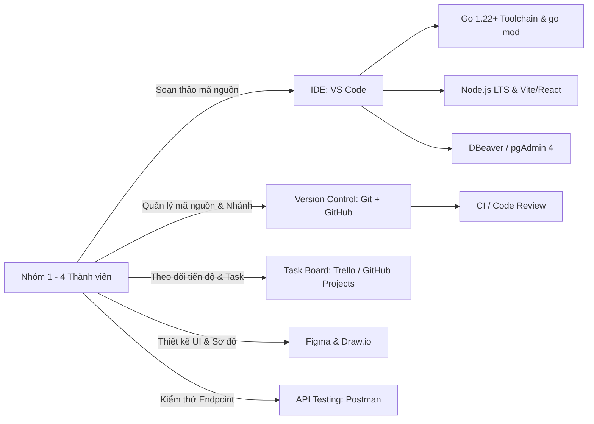

# BÁO CÁO PHÂN TÍCH VÀ SO SÁNH CÔNG NGHỆ DỰ ÁN

> **Trạng thái:** Tài liệu tham khảo lựa chọn công nghệ. Các con số RPS/RAM/độ trễ và từ ngữ tuyệt đối là giả thuyết cho tới khi có benchmark. Kiến trúc triển khai hiện hành nằm ở `11_kien_truc_he_thong.md` v3.0.
## HỆ THỐNG QUẢN LÝ PHÒNG TẬP GYM (GYM MANAGEMENT SYSTEM)

---

### THÔNG TIN DỰ ÁN
* **Tên dự án:** Hệ thống quản lý phòng tập GYM
* **Môn học:** Thực tập cơ sở ngành (TTCSN)
* **Nhóm thực hiện:** Nhóm 1
* **Thành viên nhóm:**
  1. Nguyễn Quang Đảm
  2. Nguyễn Thành Long
  3. Lê Công Quân
  4. Nguyễn Xuân Mạnh
* **Phiên bản:** v2.0 (Cập nhật Backend Golang & Database PostgreSQL)
* **Ngày cập nhật:** 04/10/2026

---

## 1. TỔNG QUAN VÀ MỤC ĐÍCH NGHIÊN CỨU

Trong giai đoạn phân tích và thiết kế hệ thống phần mềm, việc lựa chọn ngăn xếp công nghệ (Technology Stack) đóng vai trò quyết định tới:
- Tốc độ hoàn thiện sản phẩm đáp ứng tiến độ môn học (10 tuần).
- Tính ổn định, hiệu năng cao, khả năng chịu tải và giải quyết bài toán xung đột đồng thời (Concurrency / Race Condition) khi đặt phòng tập.
- Khả năng tiếp cận, độ dốc học tập (learning curve) và sự phân công phối hợp nhịp nhàng giữa 4 thành viên trong nhóm.

Tài liệu này trình bày các phân tích, bảng so sánh đa chiều giữa các phương án công nghệ phổ biến cho ba tầng kiến trúc chính: **Frontend**, **Backend**, **Database**, cùng các **Công cụ hỗ trợ phát triển**, từ đó đưa ra lựa chọn tối ưu nhất cho dự án Hệ thống Quản lý GYM.

---

## 2. SO SÁNH VÀ LỰA CHỌN CÔNG NGHỆ FRONTEND

Frontend chịu trách nhiệm cung cấp giao diện trực quan, tương tác mượt mà cho 5 nhóm tác nhân (Hội viên, PT, Lễ tân, Quản lý, Admin). Ba giải pháp tiêu biểu trên thị trường hiện nay được đưa vào đánh giá gồm:
1. **React.js kết hợp Tailwind CSS**
2. **Vue.js kết hợp Vuetify**
3. **Angular kết hợp Angular Material**

### 2.1. Bảng so sánh chi tiết Frontend

| Tiêu chí so sánh | React + Tailwind CSS | Vue.js + Vuetify | Angular + Material |
|:---|:---|:---|:---|
| **Cơ chế hoạt động** | Thư viện giao diện dựa trên Component, Virtual DOM linh hoạt | Framework tiến bộ (Progressive Framework), Two-way binding | Framework toàn diện (Full-fledged), kiến trúc MVC/MVVM chặt chẽ |
| **Độ dốc học tập (Learning Curve)** | **Trung bình:** Yêu cầu nắm vững JavaScript (ES6+), JSX và tư duy Component | **Thấp - Dễ tiếp cận:** Cú pháp template trực quan, tương tự HTML/CSS truyền thống | **Cao:** Yêu cầu nắm vững TypeScript, Dependency Injection, RxJS, Observables |
| **Cộng đồng & Hệ sinh thái** | **Rất lớn (Top 1):** Hệ sinh thái npm khổng lồ, số lượng tài liệu, hướng dẫn và thư viện phong phú nhất | **Lớn:** Tài liệu tiếng Anh và cộng đồng rất tốt nhưng ít giải pháp mở rộng hơn React | **Lớn (Doanh nghiệp):** Được Google bảo trợ nhưng xu hướng trong cộng đồng sinh viên thấp hơn |
| **Tùy biến giao diện (Styling)** | **Rất cao (Utility-first):** Tailwind CSS cho phép tùy biến không giới hạn, không bị gò bó bởi component mẫu | **Khá:** Vuetify theo phong cách Material Design chuẩn, khó tùy biến sâu phong cách riêng | **Trung bình:** Angular Material gắn chặt với quy chuẩn Material Design của Google |
| **Kích thước gói & Hiệu suất** | Nhẹ, tối ưu hóa CSS bằng cách purge class không dùng; nạp trang cực nhanh | Gọn nhẹ, hiệu năng render ảo tương đương React | Khá nặng do bộ core framework chứa nhiều module tích hợp sẵn |
| **Mức độ phù hợp với nhóm 1** | **Rất cao:** Các thành viên đã có nền tảng React/Tailwind; dễ dàng phân chia module giao diện độc lập | **Khá:** Dễ học nhưng Vuetify khó tùy chỉnh theo bố cục phòng tập GYM chuyên biệt | **Thấp:** Độ phức tạp cao, tốn thời gian học cú pháp TypeScript/RxJS nâng cao |

### 2.2. Kết luận lựa chọn Frontend: **React + Tailwind CSS**
* **Lý do lựa chọn:**
  1. **Tối ưu hóa thời gian phát triển:** Nhóm 1 có thể tái sử dụng tối đa các Component như `Button`, `Modal`, `Table`, `RoomCard`, `BookingScheduleGrid`.
  2. **Giao diện hiện đại, chuẩn Responsive:** Tailwind CSS giúp xây dựng giao diện phòng tập thể thao năng động, thích ứng hoàn hảo trên cả máy tính để bàn (dành cho Lễ tân, Quản lý) và điện thoại di động (dành cho Hội viên đặt phòng, PT nhận lịch).
  3. **Tài liệu và hỗ trợ cộng đồng phong phú:** Khi gặp lỗi kỹ thuật trong quá trình làm đồ án, nhóm dễ dàng tìm kiếm giải pháp trên StackOverflow, GitHub và tài liệu chính thức.

---

## 3. SO SÁNH VÀ LỰA CHỌN CÔNG NGHỆ BACKEND

Backend đóng vai trò xử lý logic nghiệp vụ trung tâm của phòng tập: xác thực và phân quyền 5 vai trò (RBAC), kiểm tra trùng lịch phòng tập và PT, kiểm soát sức chứa tối đa trong cùng mili-giây (Race Condition), tính toán tỷ lệ lấp đầy. Bốn công nghệ phổ biến được đưa vào so sánh:
1. **Golang kết hợp Gin Framework**
2. **Node.js kết hợp Express.js**
3. **Java kết hợp Spring Boot**
4. **Python kết hợp FastAPI / Django**

### 3.1. Bảng so sánh chi tiết Backend

| Tiêu chí so sánh | Golang / Gin Framework | Node.js / Express.js | Java / Spring Boot | Python / FastAPI |
|:---|:---|:---|:---|:---|
| **Cơ chế thực thi & Ngôn ngữ** | **Biên dịch trực tiếp (Compiled binary)**, Static typing chặt chẽ | Thông dịch / JIT (V8 Engine), Dynamic typing (JS) | Máy ảo JVM (Bytecode), Static typing (OOP) | Thông dịch (CPython), Dynamic typing kèm Type Hints |
| **Mô hình Concurrency & I/O** | **Goroutines & Channels:** Cực nhẹ (~2KB/goroutine), hàng triệu luồng đồng thời không nghẽn | Single-thread Event Loop; Non-blocking I/O nhưng dễ bị block nếu tính toán nặng | Multi-threading OS threads; tốn tài nguyên (~1MB/thread) | Asyncio Event Loop (FastAPI) hoặc WSGI đồng bộ (Django) |
| **Tốc độ xử lý & Độ trễ (Throughput & Latency)** | **Cực cao:** Độ trễ micro-giây, throughput hàng chục nghìn RPS trên phần cứng phổ thông | Tốt với I/O nhẹ, giảm sút khi xử lý logic tính toán phức tạp | Cao và ổn định khi JVM đã warm-up, nhưng startup time lâu | Trung bình - Khá với FastAPI, chậm hơn đáng kể với Django |
| **Tiêu tốn tài nguyên (RAM/CPU)** | **Siêu tiết kiệm:** Ứng dụng chỉ chiếm khoảng 15MB - 30MB RAM; binary độc lập < 25MB | Tiêu tốn 100MB - 200MB RAM khi chạy các package npm | Tốn nhiều RAM nhất (thường từ 300MB - 800MB do JVM) | Tiêu tốn 80MB - 150MB RAM |
| **An toàn kiểu dữ liệu (Type Safety)** | **Tuyệt đối:** Phát hiện lỗi kiểu dữ liệu ngay khi biên dịch, không có lỗi runtime bất ngờ | Yếu (JS thuần), dễ gặp lỗi `undefined is not a function` tại runtime | Tuyệt đối: Trình biên dịch Java kiểm soát kiểu dữ liệu nghiêm ngặt | Khá (với Pydantic trong FastAPI), nhưng vẫn phụ thuộc runtime |
| **Hệ sinh thái ORM / Data Access** | **GORM / pgx / sqlx:** GORM hỗ trợ Migration, Hooks, Transaction ACID rất rõ ràng | Sequelize / Prisma: Tốt nhưng Prisma nặng build engine | Spring Data JPA / Hibernate: Rất mạnh mẽ nhưng cấu hình phức tạp | SQLAlchemy / Django ORM: Mạnh mẽ nhưng cú pháp tương đối nặng |
| **Độ dốc học tập (Learning Curve)** | **Thấp - Trung bình:** Cú pháp Go tinh gọn (chỉ 25 từ khóa), dễ tiếp cận cho sinh viên | Thấp: Dùng chung cú pháp JavaScript | Cao: Cần hiểu sâu IoC/DI, Spring Lifecycle, Annotations | Thấp: Cú pháp Python dễ đọc, ngắn gọn |
| **Phù hợp bài toán Đặt phòng GYM** | **Tối ưu vượt trội:** Xử lý hàng trăm yêu cầu đặt phòng đồng thời với Transaction và Row-Locking mà không lag | Khá tốt cho MVP nhỏ, nhưng dễ gặp rủi ro bất đồng bộ callback/promise | Rất tốt nhưng cồng kềnh cho đồ án quy mô 4 người 10 tuần | Tốt cho API nhỏ nhưng xử lý đồng thời quy mô cao chưa tối ưu |

### 3.2. Kết luận lựa chọn Backend: **Golang / Gin Framework**
* **Lý do lựa chọn:**
  1. **Hiệu năng vượt trội và xử lý đồng thời xuất sắc:** Golang với cơ chế Goroutines cho phép hệ thống tiếp nhận đồng thời hàng trăm hội viên cùng truy cập đặt phòng trong giờ cao điểm mà CPU/RAM vẫn ở mức tối thiểu.
  2. **Ngôn ngữ tinh gọn, kiểu tĩnh an toàn (Static Typing):** Go loại bỏ hoàn toàn các lỗi ngớ ngẩn lúc runtime thường gặp ở JavaScript (như sai kiểu, thiếu thuộc tính object, promise unhandled). Điều này giúp Nhóm 1 kiểm soát chất lượng mã nguồn tốt hơn nhiều.
  3. **Gin Web Framework:** Gin là framework web số 1 trong hệ sinh thái Golang, sử dụng Radix tree routing siêu nhanh, cung cấp hệ thống middleware chuẩn mực (CORS, JWT Authentication, Logging, Recovery) và bind JSON tự động thông qua `go-playground/validator`.
  4. **Triển khai và phân phối độc lập:** Golang biên dịch ra một file nhị phân (single binary) duy nhất, không yêu cầu cài đặt môi trường runtime nặng nề như Node.js (node_modules hàng trăm MB) hay Java (JDK/JVM).

---

## 4. SO SÁNH VÀ LỰA CHỌN CƠ SỞ DỮ LIỆU (DATABASE)

Dữ liệu của hệ thống phòng tập GYM bao gồm các thực thể liên kết chặt chẽ: Tài khoản, Hội viên, Huấn luyện viên (PT), Phòng tập, Khung giờ và Lịch đặt phòng. Ba hệ quản trị cơ sở dữ liệu được đưa vào so sánh:
1. **PostgreSQL 16+ (Hệ quản trị CSDL quan hệ - đối tượng tiên tiến)**
2. **MySQL 8.0 (RDBMS quan hệ truyền thống)**
3. **MongoDB (NoSQL Document)**

### 4.1. Bảng so sánh chi tiết Database

| Tiêu chí so sánh | PostgreSQL 16+ | MySQL 8.0 | MongoDB |
|:---|:---|:---|:---|
| **Mô hình dữ liệu** | Cơ sở dữ liệu quan hệ - đối tượng (ORDBMS), tuân thủ chuẩn ANSI-SQL khắt khe nhất | Cơ sở dữ liệu quan hệ (RDBMS), bảng và khóa | Cơ sở dữ liệu phi quan hệ (NoSQL Document JSON/BSON) |
| **Tính toàn vẹn dữ liệu (ACID)** | **Tuyệt đối:** Chuẩn ACID toàn diện, hỗ trợ Full Serializability và kiểm soát giao dịch cấp cao | **Tốt:** Hỗ trợ ACID với InnoDB, tuy nhiên mức cô lập mặc định có thể lỏng hơn | **Hạn chế:** Chỉ hỗ trợ ACID đầy đủ ở cấp Document, giao dịch multi-document chi phí cao |
| **Kiểm soát giao dịch đồng thời (Concurrency Control)** | **Xuất sắc (MVCC nâng cao):** Hỗ trợ `SELECT ... FOR UPDATE`, `FOR UPDATE NOWAIT`, `SKIP LOCKED` hoàn hảo | Khá: Hỗ trợ MVCC nhưng cơ chế khóa hàng (Row-locking) dễ bị leo thang thành Gap Lock/Table Lock | Kém: Dễ phát sinh xung đột ghi đồng thời, rất khó chặn overbooking |
| **Kiểu dữ liệu hỗ trợ** | **Phong phú:** Hỗ trợ `TIMESTAMPTZ` (múi giờ chuẩn), `JSONB` với index GIN, Range Types, Arrays, UUID, Enums | Hạn chế hơn: `DATETIME`, `JSON` cơ bản không có index chuyên dụng như JSONB | Dạng BSON phi cấu trúc |
| **Hệ thống chỉ mục (Indexing)** | **Đa dạng và mạnh mẽ:** B-tree, Hash, GiST, SP-GiST, GIN, BRIN, Partial Indexes | Hỗ trợ B-tree, R-tree, Full-text cơ bản | Single field, Compound, Multikey index |
| **Tương thích với Golang** | **Cực tốt:** Driver thuần Go `pgx` được đánh giá là một trong những driver CSDL nhanh nhất thế giới | Tốt: Driver `go-sql-driver/mysql` phổ biến | Tốt: Official MongoDB Go Driver |
| **Sao lưu và Khôi phục** | Tiện ích `pg_dump`, `pg_restore` cực kỳ ổn định và tin cậy | Tiện ích `mysqldump` | Tiện ích `mongodump` |
| **Mức độ phù hợp với dự án GYM** | **Tối ưu nhất:** Đảm bảo 100% không bị đặt trùng lịch hoặc vượt sức chứa phòng nhờ khóa hàng và Partial Index | Khá: Đạt yêu cầu nhưng tính năng nâng cao và kiểm soát đồng thời kém linh hoạt hơn Postgres | **Không phù hợp:** Dữ liệu phòng tập có tính liên kết quan hệ 1-N, N-N phức tạp, không hợp NoSQL |

### 4.2. Kết luận lựa chọn Database: **PostgreSQL 16+**
* **Lý do lựa chọn:**
  1. **Giải quyết triệt để bài toán Đặt trùng phòng & Vượt sức chứa (Race Condition):** Với việc áp dụng PostgreSQL kết hợp câu lệnh `SELECT ... FOR UPDATE` trong Transaction, hệ thống khóa chính xác dòng dữ liệu phòng/ca tập đang xét, ngăn chặn tuyệt đối tình huống hai hội viên cùng đặt thành công chỗ cuối cùng.
  2. **Hỗ trợ kiểu thời gian chính xác (`TIMESTAMPTZ`):** Quản lý lịch tập theo múi giờ chuẩn quốc tế (`Asia/Ho_Chi_Minh` UTC+7), loại bỏ sai lệch thời gian ca tập giữa máy chủ và người dùng.
  3. **Tương thích xuất sắc với Golang:** Thư viện GORM kết hợp driver `postgres` (dựa trên `pgx`) cung cấp cơ chế Connection Pool tự động, Prepared Statements bảo vệ 100% khỏi SQL Injection, và hỗ trợ Auto-Migration mượt mà.
  4. **Chuẩn công nghiệp hiện đại:** PostgreSQL là hệ quản trị cơ sở dữ liệu quan hệ mã nguồn mở được đánh giá cao nhất trong ngành công nghệ hiện nay, giúp các thành viên nhóm làm quen với công nghệ tiêu chuẩn doanh nghiệp.

---

## 5. CÔNG CỤ VÀ NỀN TẢNG PHỤ TRỢ PHÁT TRIỂN (TOOLING STACK)

Để đảm bảo hiệu suất làm việc nhóm và chất lượng phần mềm trong suốt chu kỳ dự án, Nhóm 1 thống nhất áp dụng bộ công cụ tiêu chuẩn sau:

### 5.1. Quản lý mã nguồn (Version Control): **Git & GitHub**
* **Dịch vụ lưu trữ:** GitHub (Tạo repository riêng cho nhóm, hỗ trợ quản lý Issue và Pull Request).
* **Quy ước nhánh (Branching Strategy):**
  - `main`: Nhánh ổn định, chỉ chứa mã nguồn đã kiểm thử và sẵn sàng báo cáo.
  - `develop`: Nhánh tích hợp chính của cả nhóm.
  - `feature/<tên-tính-năng>`: Nhánh làm việc riêng của từng thành viên (ví dụ: `feature/auth-jwt`, `feature/booking-conflict`, `feature/room-management`).
* **Quy tắc làm việc:** Mỗi thành viên khi hoàn thành tính năng phải tạo Pull Request (PR) và có ít nhất 1 thành viên khác review trước khi merge vào `develop`.

### 5.2. Quản lý công việc & Tiến độ (Task Board): **Trello / GitHub Projects**
* Sử dụng mô hình bảng Kanban kết hợp nguyên lý Agile/Scrum:
  - Cột trạng thái: `Backlog` → `To Do (Trong tuần)` → `In Progress` → `Review / Testing` → `Done`.
  - Mỗi thẻ công việc (Card) ghi rõ: Người thực hiện, hạn chót (Deadline), tiêu chí nghiệm thu (Checklist) và tài liệu đính kèm.

### 5.3. Công cụ thiết kế giao diện & Biểu đồ: **Figma & Draw.io**
* **Figma:** Dùng để dựng Wireframe và Prototype giao diện người dùng (Màn hình đăng nhập, Danh sách phòng, Lịch đặt phòng cá nhân, Bảng điều khiển quản lý, Giao diện duyệt PT).
* **Draw.io:** Dùng để vẽ sơ đồ Use Case tổng quát, lược đồ thực thể quan hệ (ERD), sơ đồ hoạt động (Activity Diagram) và sơ đồ kiến trúc hệ thống 3 tầng.

### 5.4. Môi trường phát triển tích hợp: **Visual Studio Code (VS Code)**
* IDE mã nguồn mở, nhẹ, hiệu năng cao và có kho extension phong phú.
* Cấu hình chuẩn hóa qua extensions:
  - *Go Extension (Google):* Hỗ trợ IntelliSense, auto-format (`gofmt`, `goimports`), linting (`golangci-lint`) và test runner.
  - *ESLint & Prettier:* Tự động định dạng mã nguồn React theo chuẩn chung của nhóm.
  - *Tailwind CSS IntelliSense:* Gợi ý class CSS thông minh.
  - *DBeaver / pgAdmin 4:* Quản lý trực quan CSDL PostgreSQL, chạy script và kiểm tra execution plan.

### 5.5. Kiểm thử giao diện lập trình: **Postman**
* Xây dựng bộ sưu tập API (Postman Collection) cho toàn bộ các endpoint của hệ thống.
* Quản lý biến môi trường (`{{base_url}}`, `{{token}}`), tự động lưu Bearer Token sau khi gọi API Đăng nhập để tái sử dụng trong các request yêu cầu xác thực.
* Hỗ trợ xuất dữ liệu kiểm thử (Postman Export) đính kèm vào báo cáo kỹ thuật.

---

## 6. ĐÁNH GIÁ TỔNG HỢP VÀ PHÂN CÔNG TRIỂN KHAI

### 6.1. Bảng tổng hợp công nghệ được chọn

| Hạng mục | Công nghệ được chọn | Phiên bản khuyến nghị | Ghi chú vai trò |
|:---|:---|:---|:---|
| **Frontend** | React.js + Tailwind CSS | React 18+, Tailwind v3+ | Giao diện SPA, linh hoạt, responsive đa thiết bị |
| **Backend** | Golang + Gin Framework | Go 1.22+ LTS, Gin v1.10+ | RESTful API, xử lý nghiệp vụ, concurrency, RBAC |
| **Database** | PostgreSQL | PostgreSQL 16+ | Lưu trữ quan hệ, đảm bảo ACID, Row-level lock |
| **ORM / Data Access** | GORM (`gorm.io/gorm`) | v1.25+ (Driver `postgres`) | Ánh xạ thực thể, quản lý migration, transaction |
| **Authentication** | JWT (JSON Web Token) | `golang-jwt/jwt/v5` | Xác thực không lưu trạng thái (Stateless), bảo mật cao |
| **Password Hashing** | Bcrypt | `golang.org/x/crypto/bcrypt` | Băm mật khẩu một chiều an toàn với Salt Rounds $\ge 10$ |
| **Validation** | Go Playground Validator | `go-playground/validator/v10` | Kiểm tra định dạng đầu vào của Request Payload |
| **Version Control** | Git + GitHub | Git 2.40+ | Quản lý phiên bản, làm việc nhóm |
| **API Testing** | Postman | Desktop Version | Kiểm thử tích hợp tự động các endpoint |

### 6.2. Kế hoạch tiếp cận và chuẩn bị kỹ thuật của Nhóm 1
1. **Thiết lập môi trường dùng chung (Tuần 2):** Toàn bộ 4 thành viên cài đặt Go 1.22+, PostgreSQL 16+, Node.js LTS (cho frontend), VS Code và cấu hình tài khoản GitHub.
2. **Khởi tạo khung dự án (Scaffolding):**
   - Thiết lập cấu trúc thư mục Client (`/client`) bằng Vite + React + Tailwind CSS.
   - Thiết lập cấu trúc thư mục Server (`/server`) theo chuẩn project Gin tham chiếu: `cmd/`, `internal/app/`, `internal/handler/v1/`, `internal/service/v1/`, `internal/repository/`, `internal/routes/v1/`, `internal/dto/v1/`, `internal/middleware/`, `internal/db/` và `pkg/auth/`.
3. **Phân công nhiệm vụ kỹ thuật:**
   - **Nguyễn Quang Đảm & Nguyễn Thành Long:** Phụ trách thiết kế CSDL PostgreSQL, xây dựng Backend API bằng Golang (Gin), cơ chế xác thực JWT, phân quyền RBAC và thuật toán kiểm tra xung đột lịch đặt phòng bằng Database Transaction.
   - **Lê Công Quân & Nguyễn Xuân Mạnh:** Phụ trách thiết kế Wireframe Figma, xây dựng Frontend React components, kết nối API Go RESTful và hoàn thiện trải nghiệm người dùng.

---

## 7. LỜI KẾT

Việc nâng cấp và lựa chọn ngăn xếp công nghệ **React + Tailwind CSS (Frontend) - Golang / Gin (Backend) - PostgreSQL (Database)** là quyết định mang tính chiến lược và tối ưu nhất cho Nhóm 1. Sự kết hợp giữa khả năng xử lý đồng thời vượt trội của **Golang** và cơ chế khóa hàng tin cậy của **PostgreSQL** giúp giải quyết triệt để bài toán hóc búa nhất của hệ thống quản lý phòng tập: **ngăn chặn tuyệt đối tình trạng đặt trùng phòng và vượt quá sức chứa khi nhiều người dùng thao tác cùng lúc**. Ngăn xếp công nghệ này không chỉ đảm bảo hoàn thành xuất sắc mục tiêu môn học Thực tập cơ sở ngành mà còn trang bị cho các thành viên kiến thức công nghệ hiện đại, vững chắc cho tương lai.
