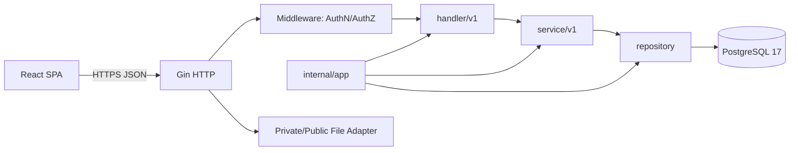
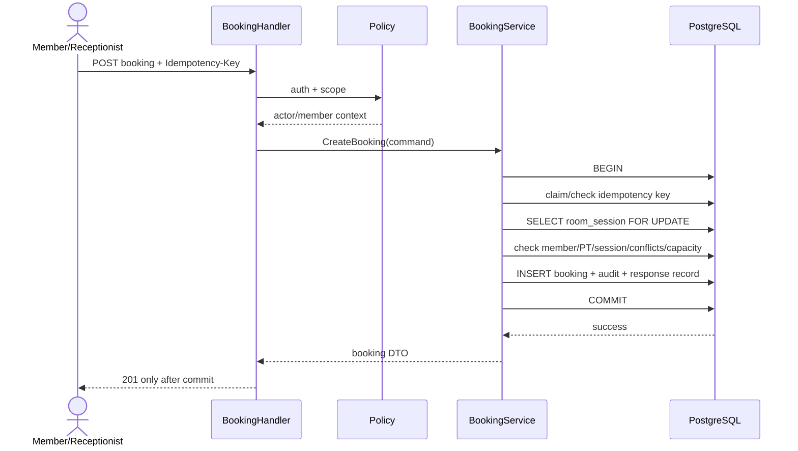

# Kiến trúc hệ thống — v3.0

## 1. Kiến trúc được chọn

Hệ thống là một **modular monolith** gồm React SPA, một Go/Gin API và PostgreSQL 17. Cách tổ chức package theo project Gin tham chiếu: handler nhận HTTP, service xử lý nghiệp vụ, repository làm việc với PostgreSQL; `app` chỉ chịu trách nhiệm ghép các thành phần.



## 2. Quy tắc phụ thuộc

- `internal/handler/v1` bind DTO, gọi service và ánh xạ lỗi HTTP; không chứa SQL hoặc business rule.
- `internal/service/v1` chứa nghiệp vụ, phân quyền và validation; không phụ thuộc `gin.Context`.
- `internal/repository` chứa truy vấn PostgreSQL và transaction. Các thao tác account cùng audit commit trong một transaction.
- `internal/dto/v1` chỉ mô tả contract HTTP. `internal/domain` chứa entity, enum và lỗi nghiệp vụ.
- `internal/middleware` xử lý request ID, recovery, log, CORS và xác thực. `internal/routes/v1` đăng ký endpoint. `internal/app` là composition root.

```text
server/
  cmd/api/
  internal/
    app/
    config/
    db/migrations/
    domain/
    dto/v1/
    handler/v1/
    middleware/
    repository/
    routes/v1/
    service/v1/
  pkg/auth/
```

## 3. Luồng booking an toàn



Quy tắc kỹ thuật:

1. Kiểm tra lỗi `Begin`, mọi query/write và `Commit`; rollback khi lỗi/panic.
2. Thứ tự khóa thống nhất: idempotency → room_session → booking (khi có) → dữ liệu phụ.
3. Unique violation MEMBER/PT ánh xạ conflict; capacity được kiểm tra sau khóa session.
4. Deadlock/serialization retry giới hạn, có backoff và metric; không retry lỗi nghiệp vụ.
5. Request context timeout truyền xuống DB; response không chứa chi tiết SQL.

## 4. Xác thực và phân quyền

- Password dùng bcrypt cost cấu hình tối thiểu 10.
- Access token ngắn hạn chứa `sub`, `role`, `auth_version`, `jti`, `exp`; middleware tải/truy cập cache trạng thái/version theo chính sách triển khai.
- Khóa tài khoản, reset mật khẩu hoặc đổi role tăng auth_version để token cũ bị từ chối.
- Policy layer kiểm tra permission + object scope; handler không tự viết ma trận quyền.
- Nếu triển khai denylist/logout server-side, lưu JTI đến exp; xóa token ở client chỉ là một phần của logout.

Token trong MVP nên giữ trong memory nếu phù hợp UX; nếu persistence bắt buộc, quyết định riêng giữa HttpOnly cookie có CSRF defense và bearer storage. Không ghi “LocalStorage hoặc Context” trong thiết kế triển khai cuối cùng.

## 5. File

- Avatar có thể public sau validate/chuyển tên; chứng chỉ PT là private và tải qua endpoint authorization.
- Allowlist MIME/extension, giới hạn kích thước, tên object ngẫu nhiên, không dùng tên/path client.
- Metadata file thuộc hồ sơ; xóa/vô hiệu hóa theo retention. Log không chứa nội dung/file token.

## 6. Job nền

| Job | Quy tắc | Tính idempotent |
|---|---|---|
| Expire pending PT | PENDING_PT và `respond_by < now` → EXPIRED | Cập nhật có điều kiện trạng thái nguồn. |
| Finalize sessions | CONFIRMED và `ends_at < now` → COMPLETED/NO_SHOW từ attendance MEMBER | Chỉ xử lý CONFIRMED. |
| Recalculate PT metrics | Tính rating và attendance rate từ dữ liệu nguồn | Upsert giá trị dẫn xuất; có đối soát. |
| Backup monitor | Xác nhận backup gần nhất và cảnh báo lỗi | Không tạo bản backup giả; ghi kết quả chạy. |

Mỗi job có request/run ID, thời điểm bắt đầu/kết thúc, số bản ghi, lỗi/retry và cảnh báo. Có thể chạy scheduler trong app cho demo một instance; triển khai nhiều instance cần cơ chế chỉ một worker/khóa phù hợp.

## 7. API và phiên bản

API theo `12_dac_ta_API.md`, OpenAPI 3.x là artifact máy đọc. `/api/v1` chỉ thay đổi tương thích; breaking change cần `/v2` hoặc kế hoạch deprecation. Error code ổn định, request ID xuyên suốt log/audit.

## 8. Dữ liệu và migration

- Migration SQL có số phiên bản, chạy một lần, ghi lịch sử; không dùng AutoMigrate làm nguồn production.
- `09_schema.sql` chỉ bootstrap CSDL mới.
- Migration lớn theo expand → backfill → validate → switch → contract; backup/restore drill trước thay đổi phá tương thích.
- Schema, application và job phải tương thích trong cửa sổ rollout; không deploy code yêu cầu cột chưa tồn tại.

## 9. Quan sát và xử lý lỗi

- Structured log: timestamp, level, request_id, actor_id (khi có), route, status, latency, error_code; không log password/token/chứng chỉ.
- Metrics tối thiểu: request count/latency/error, DB pool, transaction retries, lock wait, booking conflict/room full, job success/failure.
- `/health/live` kiểm tra process; `/health/ready` kiểm tra phụ thuộc cần thiết với timeout ngắn.
- Panic recovery trả 500 có request ID; lỗi nghiệp vụ không bị đổi thành 500.

## 10. Cấu hình và triển khai

- Cấu hình qua biến môi trường/secret store: DB URL, JWT secret/key, token TTL, file storage, timezone, CORS origins, pool/timeout.
- Không commit secret. CORS dùng allowlist domain; TLS ở reverse proxy hoặc app.
- Connection pool được đo theo môi trường; con số open/idle không cố định trước khi test.

## 11. Chiến lược kiểm thử

- Unit test cho transition, cancellation boundary, review eligibility, report formulas.
- Integration test với PostgreSQL thật cho constraint, transaction và migration.
- Concurrency test nhiều connection/process cho chỗ cuối/xung đột.
- HTTP contract/authz test từ OpenAPI/ma trận quyền.
- Load, restore drill và browser test theo `15_ke_hoach_kiem_thu.md`.

Các tuyên bố throughput, RAM, “không bao giờ overbook” hoặc RTO/RPO chỉ được đưa vào báo cáo kết quả sau khi đo; kiến trúc hiện tại mô tả cơ chế và mục tiêu.

## 12. Amendment lịch phòng đã triển khai — 11/10/2026

Giữ `handler/v1 → service/v1 → repository`; domain/DTO lịch ở facility, job ở `internal/job`, composition root tại app. Lịch mở cửa tách khỏi độ dài ca và snapshot phiên. Preview HMAC gắn actor/phòng/mutation/revision/fingerprint, TTL 5 phút; confirm khóa phòng → advisory lock ca → phiên tương lai theo ID. Tất cả ca writer dùng cùng advisory lock. Booking tương lai phải tuân thủ thứ tự khóa trong decision log; hiện chưa có API Booking.

Transaction ghi version/ngoại lệ, revision, phiên, audit và idempotency cùng nhau. Phiên có nguồn CALENDAR/MANUAL, nguồn đóng CALENDAR/MANUAL/ROOM; job chỉ tạo thiếu, không viết lại snapshot hoặc tự mở phiên đóng. Request đã commit replay từ DB sau restart; preview chưa commit phải tạo lại. Job startup và 00:05 Việt Nam có context timeout/shutdown, audit SYSTEM actor NULL và lỗi an toàn. Runbook hiện hành tại tài liệu 21; không suy ra NFR đã đạt từ các cơ chế này.
