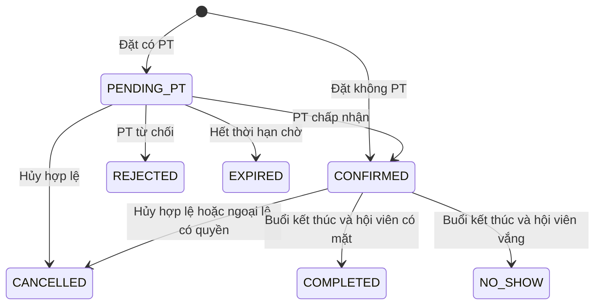

# Kế hoạch hoàn thiện phân tích và thiết kế hệ thống GYM

> **Trạng thái 10/10/2026:** Đã dùng để tạo baseline tài liệu v0.3. Xem `README.md` và `CHANGELOG.md`. Việc triển khai ứng dụng, chạy DDL/migration, test tải và restore drill vẫn chưa được xác nhận.

Ngày lập: **10/10/2026** · Phiên bản kế hoạch: **v0.1** · Trạng thái: **Đề xuất, chưa triển khai**.

Kết quả rà soát: bộ tài liệu đã có khung chức năng, 5 tác nhân, SRS, ERD và kiến trúc tương đối đầy đủ. Điểm cần hoàn thiện trước tiên là **quy tắc nghiệp vụ và sự nhất quán giữa yêu cầu, quyền truy cập, trạng thái và dữ liệu**. Các quy tắc chưa chốt này sẽ khiến việc sửa schema hoặc viết thêm API phải làm lại nhiều lần.

Mục tiêu của kế hoạch là tạo một bộ tài liệu có thể dùng để triển khai, kiểm thử, bảo trì và nâng cấp. “Agent” trong yêu cầu được hiểu là **tác nhân/vai trò người dùng (Actors)** theo tài liệu hiện có.

## 1. Phạm vi và căn cứ rà soát

Đã đọc **12 tài liệu Markdown và 1 file SQL** trong `docs/`: khảo sát chức năng, hai backlog, tác nhân, hai tài liệu use case, khung tiến độ, phân quyền, SRS, ERD, so sánh công nghệ, kiến trúc và schema.

Các phát hiện dưới đây là kết quả đối chiếu tài liệu và đọc tĩnh SQL/pseudocode. Workspace hiện không cung cấp mã nguồn ứng dụng, kết quả chạy PostgreSQL hoặc báo cáo kiểm thử của hệ thống. Vì vậy, chưa kết luận ứng dụng thực tế có lỗi tương ứng, chưa xác nhận hiệu năng và chưa xác nhận CSDL đã được triển khai.

Kế hoạch này được bổ sung thành một file riêng. Các tài liệu nguồn, schema và workbook tiến độ hiện có được giữ nguyên trong lần lập kế hoạch này. Hạn **20/11/2026** lấy từ khung tiến độ hiện tại, là hạn kế hoạch trong tài liệu, chưa được xác minh bên ngoài.

Quy ước ưu tiên:

| Mức | Ý nghĩa |
|---|---|
| **P0** | Phải giải quyết trước khi chốt thiết kế phần nghiệp vụ liên quan; có thể làm sai lịch, quyền truy cập hoặc mất lịch sử nếu triển khai theo bản hiện tại. |
| **P1** | Phải hoàn thiện để bàn giao bộ tài liệu triển khai và bảo trì. |
| **P2** | Có thể đưa sang phiên bản tiếp theo sau khi phần cốt lõi ổn định. |

## 2. Các khoảng trống đã tìm thấy

Số dòng trong bảng là vị trí tại thời điểm rà soát; khi tài liệu thay đổi, tra cứu tiếp bằng tên mục/REQ/UC tương ứng.

| ID | Ưu tiên | Bằng chứng trong tài liệu hiện tại | Ảnh hưởng và việc cần làm |
|---|---|---|---|
| F01 | P1 | `01_khao_sat_chuc_nang.md`, mục 2–4, chủ yếu so sánh sản phẩm thương mại; chưa trình bày biên bản khảo sát quy trình tại một phòng GYM cụ thể hoặc nguồn cho từng nhận định. | Bổ sung quy trình hiện tại, nhu cầu từng bên, nguồn và giả định; không coi tính năng của phần mềm thương mại là bằng chứng nhu cầu của khách hàng mục tiêu. |
| F02 | P0 | `01_khao_sat_chuc_nang.md`: dòng 99, 125–129, 170 nêu 4 vai trò; `03_tac_nhan.md`: dòng 21–30 nêu 5 vai trò. Khảo sát dòng 97, 161 có ghi nhận thanh toán nhưng backlog/schema chưa mô hình hóa thanh toán. | Chốt phạm vi 5 vai trò và phạm vi gói tập/thanh toán. Báo cáo doanh thu phải có nguồn giao dịch hoặc được đưa ra ngoài MVP. |
| F03 | P1 | `07_SRS_v0.2.md`: dòng 452–471 dùng UC-01 là đăng nhập, UC-04 là đặt phòng; `08_use_case_chi_tiet.md`: UC-01 là duyệt PT, UC-04 là check-in. | Ma trận truy vết đang trỏ sai ca sử dụng. Lập danh mục UC duy nhất và sửa tất cả liên kết. |
| F04 | P0 | `03_tac_nhan.md`: dòng 69 cho Quản lý chỉ đọc hồ sơ hội viên và Lễ tân không xóa; `06_ma_tran_phan_quyen.md`: dòng 24 cho cả hai thêm/sửa/xóa. PT được xem báo cáo riêng ở file 03 dòng 74 nhưng bị cấm ở file 06 dòng 34. | Chốt quyền theo hành động và phạm vi bản ghi; tách khóa hồ sơ khỏi xóa dữ liệu. Không triển khai hai ma trận quyền song song. |
| F05 | P0 | `06_ma_tran_phan_quyen.md`: dòng 21 chỉ PT được đăng ký hồ sơ; `07_SRS_v0.2.md`: REQ-17 cấp quyền PT sau khi duyệt. `users` chỉ có một `role_id`. | Chưa rõ ai tạo tài khoản ứng viên và quyền của PT đang chờ duyệt. Tách danh tính, vai trò và trạng thái phê duyệt chuyên môn. |
| F06 | P0 | `08_use_case_chi_tiet.md`: dòng 37–38, 50, 71 dùng CONFIRMED/PENDING_PT/REJECTED/CHECKED_IN; `09_schema.sql`: dòng 85–86 dùng `pt_status` và active/cancelled/completed. | Chưa có một mô hình trạng thái chung. Lập bảng chuyển trạng thái và quy tắc trạng thái nào giữ chỗ/giữ lịch PT. |
| F07 | P0 | `07_SRS_v0.2.md`: REQ-01/03/05/06/09/12 yêu cầu trạng thái tài khoản, tên và dữ liệu hồ sơ, tên/trạng thái ca, người đặt hộ, thời điểm check-in. Các cột tương ứng thiếu trong DDL; SĐT ở `users` cũng chưa có UNIQUE như REQ-03. | Lập ma trận yêu cầu → dữ liệu; thêm hoặc điều chỉnh yêu cầu có chủ đích. Chốt chính sách SĐT dùng chung trước khi đặt UNIQUE. |
| F08 | P0 | `08_use_case_chi_tiet.md`: UC-02 hiển thị PT rảnh, UC-03 từ chối thành REJECTED; `07_SRS_v0.2.md`: dòng 226 cho giữ phòng không PT hoặc hủy “tùy quy trình”. Chưa có thời hạn chờ PT. | Chốt lịch làm việc/nghỉ của PT, cách giữ chỗ khi chờ và kết quả từ chối/hết hạn; tránh giữ tài nguyên vô thời hạn. |
| F09 | P0 | `13_backlog_v0.2.md`: REQ-05 có ca và sức chứa theo từng phòng; `09_schema.sql`: dòng 69–75 chỉ có ca giờ dùng chung, không có phòng/ngày/sức chứa theo ca. Unique index dòng 114–121 chỉ so cùng `time_slot_id`. | Hai ca 06:00–08:00 và 07:00–09:00 có ID khác nhau vẫn có thể chồng thời gian. Cần chốt ca không giao nhau trong MVP hoặc thiết kế kiểm tra khoảng thời gian. |
| F10 | P0 | `11_kien_truc_he_thong.md`: dòng 198–207 khóa cả dòng phòng và chỉ đếm `status='active'`; dòng 173, 182, 191, 207, 220 chưa xử lý đủ lỗi Begin/Count/Commit. | Khóa dòng phòng có thể dùng cho mô hình hiện tại nếu mọi luồng ghi tuân thủ; nhưng sẽ tuần tự hóa các ngày/ca khác nhau. Đồng bộ bộ đếm với trạng thái mới, xử lý lỗi và thiết kế khóa đúng phạm vi. |
| F11 | P0 | `08_use_case_chi_tiet.md`: UC-04 ghi nhận cả Hội viên và PT; SRS REQ-20 tính chuyên cần PT. `09_schema.sql`: bảng bookings không có dữ liệu điểm danh từng người. | Một trạng thái booking không chứng minh cả hai đã đến. Thiết kế điểm danh riêng và tiêu chí hoàn thành/no-show. |
| F12 | P0 | `09_schema.sql`: dòng 95–104, `pt_reviews` không có `booking_id` hoặc ràng buộc một đánh giá/buổi; SRS REQ-19 đầu vào lại có `booking_id`. | Chưa chứng minh người đánh giá đã tập với đúng PT, dễ đánh giá lặp. Ràng buộc đánh giá theo buổi và xác minh tại backend. |
| F13 | P0 | `09_schema.sql`: dòng 7–15 DROP toàn bộ bảng; dòng 44, 57, 88–90, 102–103 dùng CASCADE xóa hồ sơ/lịch/đánh giá. SRS REQ-03 lại quy định khóa/xóa mềm. | Script hiện tại là reset demo, không phải đường nâng cấp giữ dữ liệu. Tách reset/seed khỏi migration; bảo toàn lịch sử bằng vô hiệu hóa và chính sách khóa ngoại. |
| F14 | P1 | `11_kien_truc_he_thong.md`: dòng 120 có hai lựa chọn lưu token, dòng 154 phục vụ chung `/uploads`, dòng 376 chỉ hủy token phía client. SRS REQ-12 có khóa tài khoản. | Chốt một chính sách phiên và thu hồi quyền; phân biệt ảnh đại diện với chứng chỉ PT; mô tả quyền tải/xem file và giới hạn upload. |
| F15 | P1 | SRS REQ-14 mô tả toast từ phản hồi API của người thao tác; UC-02/03 lại cần thông báo cho người dùng khác. | Toast cho người đặt chưa giải quyết việc PT nhận yêu cầu. Chốt danh sách yêu cầu/inbox và cơ chế cập nhật tối thiểu. |
| F16 | P1 | `05_khung_tien_do_10_tuan.md`: tuần 3 làm Auth; SRS/backlog xếp Auth ở Sprint 1. Khoảng ngày của các “tuần” không đều 7 ngày. SRS dòng 477, 485 ghi đã phê duyệt/đã ký. | Đồng bộ lịch theo mốc học phần và bằng chứng tiến độ thực tế. Trạng thái phê duyệt trong bản cũ cần đối chiếu biên bản, không tự xác nhận từ nội dung tài liệu. |
| F17 | P1 | SRS NFR-01/02, kiến trúc dòng 222, 363–368 và so sánh công nghệ mục 3–4 có các khẳng định hiệu năng, an toàn tuyệt đối và mở rộng chưa kèm đo kiểm. Seed SQL dòng 168–174 có lịch tương lai nhưng đã có đánh giá. | Chuyển khẳng định chưa đo thành mục tiêu/giả định, bổ sung phương pháp kiểm chứng và seed đúng vòng đời. |

## 3. Những quyết định nghiệp vụ cần chốt

Các phương án dưới đây là **đề xuất cho buổi rà soát**, chưa phải yêu cầu đã được khách hàng hoặc nhóm thông qua. Ghi quyết định vào decision log với người quyết định, ngày, lý do, tài liệu ảnh hưởng và tiêu chí kiểm thử.

| Mã | Quyết định | Phương án đề xuất và giới hạn |
|---|---|---|
| D01 | Một booking đại diện cho điều gì? | Một hội viên giữ một chỗ trong một phòng/ca cụ thể, có thể kèm PT 1-1. Thuê độc quyền cả phòng và lớp học nhóm là phạm vi mở rộng riêng. |
| D02 | Ca chung hay ca riêng từng phòng? | MVP dùng danh mục ca chung, không chồng giờ và có lịch mở phòng theo ngày/ca (`room_sessions`). Lịch mở phòng giữ thời gian và sức chứa đã chốt. Nếu cần ca linh hoạt, phải thiết kế kiểm tra khoảng thời gian trước khi triển khai. |
| D03 | PT từ chối hoặc không phản hồi? | Đề xuất từ chối thành REJECTED, hết hạn thành EXPIRED; cả hai giải phóng phòng và PT. Hội viên chủ động đặt lại không PT. Tránh tự đổi dịch vụ đã chọn. Thời hạn chờ phải cấu hình; mốc 30 phút có thể dùng để thảo luận, luôn không muộn hơn giờ bắt đầu. |
| D04 | Một người có nhiều vai trò? | Giữ 5 vai trò nghiệp vụ. Nếu PT đồng thời là hội viên hoặc nhân viên kiêm nhiệm, dùng `user_roles`; nếu MVP chỉ cần một vai trò, có thể giữ `role_id` và ghi đường chuyển đổi. Không bắt buộc bảng nối chỉ để dự phòng. |
| D05 | Tài khoản PT được tạo thế nào? | Đề xuất Admin tạo tài khoản có vai trò PT; PT PENDING/REJECTED vẫn đăng nhập, sửa/nộp lại hồ sơ nhưng chưa nhận lịch. Duyệt hồ sơ chuyên môn không tự mở lại tài khoản đang bị khóa. Tự đăng ký công khai là phạm vi riêng nếu cần. |
| D06 | Hủy, điểm danh và đánh giá? | Hội viên tự hủy khi `now <= starts_at - 2 giờ`, kể cả đúng mốc 2 giờ. PT chỉ xử lý lịch được gán; hủy sau xác nhận cần lý do. Nhân viên hủy ngoại lệ phải có quyền và audit. Điểm danh từng người; đề xuất chỉ đánh giá sau khi buổi kết thúc và cả hội viên/PT có mặt. |
| D07 | Thẻ tập, thời gian đặt và thay đổi lịch? | Kiểm tra tài khoản, hồ sơ hoạt động và hạn thẻ tại ngày tập. Chốt hạn đặt trước, ngưỡng check-in sớm/muộn và xử lý khóa/hết hạn sau khi đã đặt. Không sửa giờ ca đã được tham chiếu; tạo ca mới cho lịch mới. Không giảm sức chứa xuống dưới số chỗ đang giữ. |
| D08 | Thanh toán và doanh thu có thuộc MVP? | Đề xuất MVP quản lý hạn thẻ và lượt sử dụng; thanh toán/doanh thu chuyển sang backlog sau. Nếu bắt buộc có, bổ sung gói, đăng ký gói, giao dịch, hoàn tiền và quy tắc đối soát trước khi chốt ERD. |
| D09 | PT “rảnh” và “uy tín” được tính thế nào? | PT phải được duyệt, tài khoản hoạt động, nằm trong giờ làm việc, không nghỉ và không có lịch chiếm dụng. Rating trung bình và tỷ lệ chuyên cần là hai chỉ số riêng; chưa đặt công thức Trust Score tổng hợp khi chưa có quy tắc. |
| D10 | Có bao nhiêu cơ sở và loại thông báo? | Đề xuất một cơ sở; dữ liệu nhiều chi nhánh ở P2. PT/Hội viên có danh sách yêu cầu/lịch được lấy lại từ server; có thể polling trong MVP. Email, SMS, WebSocket và thông báo lưu bền riêng là mở rộng nếu chưa cần. |

## 4. Hoàn thiện phân tích hệ thống và tác nhân

### 4.1. Bổ sung khảo sát nghiệp vụ

Thu thập hoặc tổ chức walkthrough với người đóng vai Lễ tân, Quản lý, Hội viên, PT và Admin. Nếu không có đơn vị khảo sát thực tế, ghi rõ đây là **tình huống giả định được nhóm xác nhận**, không ghi là đã phỏng vấn khách hàng.

Với mỗi quy trình, mô tả: người khởi tạo, dữ liệu đầu vào, các bước hiện tại, điểm gây lỗi, quy tắc, trường hợp ngoại lệ, kết quả và bên chịu trách nhiệm. Ưu tiên sáu quy trình:

1. Tạo/khóa tài khoản, đăng ký/gia hạn thẻ, thay đổi vai trò.
2. Nộp/duyệt/từ chối/đình chỉ hồ sơ PT và lịch nghỉ của PT.
3. Mở/đóng phòng, tạo ca, bảo trì, đổi giờ và giảm sức chứa khi đã có lịch.
4. Đặt chỗ có/không PT, đặt hộ, hai yêu cầu cùng lúc, yêu cầu gửi lặp.
5. PT nhận/từ chối/hủy lịch, chờ hết hạn, hội viên hủy sát giờ.
6. Điểm danh, kết thúc buổi, no-show, đánh giá và báo cáo.

Đầu ra: sơ đồ bối cảnh; bảng vấn đề hiện tại; glossary; danh mục business rules có ID `BR-*`; activity/sequence diagram cho các luồng cần phối hợp. “Hệ thống” là nơi thực thi quy tắc tự động, không tự động trở thành tác nhân ngoài ranh giới hệ thống. Với sơ đồ Mermaid flowchart, ghi đúng là sơ đồ ánh xạ chức năng; nếu học phần yêu cầu UML Use Case, bổ sung sơ đồ UML đúng ký pháp.

### 4.2. Chuẩn hóa tác nhân và phân quyền

Tài khoản xác thực, hồ sơ hội viên/PT, vai trò và trạng thái phê duyệt là các khái niệm riêng. Sơ đồ kế thừa `User → MemberActor/PTActor/...` trong bản hiện tại chỉ minh họa tác nhân; không dùng nó làm thiết kế kế thừa bảng CSDL.

Một dòng ma trận quyền phải có dạng **hành động + đối tượng + phạm vi + điều kiện**, ví dụ:

| Vai trò | Hành động | Phạm vi/điều kiện đề xuất |
|---|---|---|
| Hội viên | `booking.create`, `booking.cancel`, `review.create` | Chỉ hồ sơ liên kết với tài khoản của mình; hủy theo thời gian; đánh giá buổi đủ điều kiện. Backend suy ra danh tính thay vì tin `member_id` do client tự gửi. |
| PT | `pt.profile.update`, `booking.accept/reject`, `attendance.read` | Hồ sơ/lịch được gán cho mình; trạng thái cho phép; chỉ đọc dữ liệu hội viên cần thiết cho buổi tập. Không tự duyệt hồ sơ. |
| Lễ tân | `member.create/update/deactivate`, `booking.create_for_member`, `attendance.record` | Đặt hộ phải ghi người thực hiện; thao tác ngoại lệ có lý do. Không được sửa rating, gán vai trò hoặc xóa lịch sử. |
| Quản lý | `room/session.manage`, `pt.approve/reject/suspend`, `report.read` | Chốt riêng quyền sửa hồ sơ hội viên; cấu hình tài nguyên phải bảo vệ lịch đã đặt. |
| Admin | `account.manage`, `role.assign`, `system.configure` | Các quyền nghiệp vụ được ghi tường minh. Thao tác khẩn cấp phải có audit và vẫn tuân thủ toàn vẹn dữ liệu. |

Mặc định từ chối; kiểm tra quyền ở server trên mọi yêu cầu và trên bản ghi cụ thể, không chỉ ở menu hay route. Đây là yêu cầu phù hợp với [OWASP Authorization Cheat Sheet](https://cheatsheetseries.owasp.org/cheatsheets/Authorization_Cheat_Sheet.html).

`06_ma_tran_phan_quyen.md` là nơi quản lý chính sách quyền; `03_tac_nhan.md` mô tả mục tiêu/trách nhiệm và dẫn chiếu sang ma trận này. Quyền tĩnh có thể được thực thi bằng policy trong code; bảng `permissions/role_permissions` chỉ cần khi có yêu cầu cấu hình quyền động.

## 5. Hướng sửa mô hình trạng thái và CSDL

### 5.1. Vòng đời booking đề xuất

Đề xuất một trạng thái nghiệp vụ chính; điểm danh là dữ liệu riêng. Không duy trì hai trường trạng thái có thể tạo các tổ hợp vô nghĩa như booking đã hủy nhưng PT vẫn pending.

Giữ chỗ phòng/lịch PT khi PENDING_PT hoặc CONFIRMED. Check-in không tự giải phóng chỗ. COMPLETED/NO_SHOW là kết quả lịch sử; không được đặt thêm vào ca đã bắt đầu/kết thúc. REJECTED/EXPIRED/CANCELLED giải phóng tài nguyên. Chốt quy tắc khóa lịch cá nhân lịch sử và quyền đánh giá độc lập với chỉ số giữ chỗ.

Mỗi chuyển trạng thái cần ghi: trạng thái nguồn/đích, người có quyền, điều kiện thời gian, hiệu ứng tài nguyên, lý do, sự kiện audit, mã lỗi và hành vi gọi lặp. Chuyển trạng thái phải kiểm tra trạng thái hiện tại trong transaction; yêu cầu không hợp lệ không được “ghi đè” kết quả mới hơn.

Trạng thái PT đề xuất: PENDING/APPROVED/REJECTED/SUSPENDED. “TRUST” có thể là nhãn giao diện cho APPROVED, không dùng làm tên quyền và điểm rating cùng lúc. Trạng thái tài khoản ACTIVE/LOCKED và trạng thái hồ sơ hội viên ACTIVE/INACTIVE độc lập; thẻ hết hạn được xác định từ ngày hết hạn theo quy tắc đã chốt.

### 5.2. Các thay đổi dữ liệu tối thiểu

Đây là mô hình mục tiêu để thiết kế ở pha 3, chưa phải DDL đã chạy. Chốt D01–D10 trước khi quyết định chính xác bảng/cột.

| Nhóm dữ liệu | Thay đổi cần thiết | Lý do |
|---|---|---|
| `users`, `roles` | Trạng thái tài khoản, `password_hash`, trường hồ sơ cần dùng, `updated_at`; cơ chế phiên/thu hồi quyền. `user_roles` tùy D04. | Thực hiện khóa tài khoản, đổi vai trò và tránh đồng nhất người dùng với actor. |
| `members` | Mã hội viên duy nhất, dữ liệu hồ sơ còn thiếu, ngày tham gia/hết hạn; CHECK ngày hợp lệ; lịch sử gia hạn bằng audit trong MVP. | Đáp ứng REQ-03/11; tách trạng thái hồ sơ khỏi trạng thái hết hạn tính theo ngày. |
| `personal_trainers` | Hồ sơ/chuyên môn, quyết định duyệt có người/thời điểm/lý do; lịch sử duyệt trong audit. | Đáp ứng đăng ký, nộp lại, đình chỉ và truy vết quyết định. |
| Giờ làm việc/nghỉ PT | Tối thiểu giờ làm việc theo quy tắc chung và các khoảng không làm việc `pt_unavailability`; lịch riêng nếu D09 yêu cầu. | Không coi “chưa có booking” là “đang làm việc”. |
| `rooms`, `time_slots` | Loại phòng/trạng thái; tên/trạng thái ca; quy tắc ca chung không giao nhau; ngừng sử dụng thay vì sửa/xóa ca có tham chiếu. | Đáp ứng REQ-04/05 và bảo vệ thời gian của lịch cũ. |
| `room_sessions` | Khóa duy nhất `(room_id, booking_date, time_slot_id)`; thời điểm bắt đầu/kết thúc, sức chứa chốt theo ca, trạng thái mở/đóng. Booking tham chiếu đúng bộ khóa này. | Thể hiện lịch mở phòng theo ngày, sức chứa theo ca và tạo dòng ổn định để khóa. |
| `bookings` | Trạng thái chuẩn, người tạo/đặt hộ, thời hạn chờ, người/lý do hủy, mốc cập nhật; liên kết phiên phòng. Quy tắc retry/idempotency được thiết kế ở API. | Giữ vòng đời, trách nhiệm và tính nhất quán khi có yêu cầu đồng thời. |
| `booking_attendance` | Điểm danh theo booking và người tham gia; hội viên/PT riêng; người ghi và thời gian. Unique chống điểm danh lặp; kiểm tra người tham gia đúng booking. | Có bằng chứng điểm danh và số liệu chuyên cần. |
| `pt_reviews` | `booking_id` bắt buộc với dữ liệu mới; một đánh giá/buổi theo D06. Suy ra PT/hội viên từ booking; nếu giữ ID dư thì phải kiểm tra nhất quán. | Ngăn đánh giá sai PT, sai hội viên và đánh giá lặp. |
| `audit_events` | Ai, hành động, đối tượng, trước/sau ở mức cần thiết, lý do, thời gian, request ID; tránh ghi mật khẩu/token/chứng chỉ vào log. | Điều tra sự cố, giải thích thay đổi và bảo trì. |

Đặt NOT NULL cho dữ liệu bắt buộc, CHECK cho miền trạng thái/điểm và FK theo vòng đời. UNIQUE theo tên phòng/email/SĐT phải đi cùng chính sách chuẩn hóa, phân biệt hoa thường và dữ liệu dùng chung. Không dùng CHECK tham chiếu bảng khác để kiểm tra sức chứa hoặc tư cách đánh giá; thiết kế transaction, FK/UNIQUE hoặc cơ chế chuyên biệt phù hợp. Xem [PostgreSQL 16 — Constraints](https://www.postgresql.org/docs/16/ddl-constraints.html).

Lưu thời điểm sự kiện bằng TIMESTAMPTZ; quy đổi ngày/giờ vận hành theo `Asia/Ho_Chi_Minh` và gửi API có offset rõ ràng. TIMESTAMPTZ lưu thời điểm nội bộ theo UTC và không giữ tên múi giờ ban đầu, nên vẫn phải mô tả quy tắc hiển thị/ngày nghiệp vụ. Xem [PostgreSQL 16 — Date/Time Types](https://www.postgresql.org/docs/16/datatype-datetime.html).

### 5.3. Quy tắc chống xung đột cần đặc tả

1. Danh mục ca MVP phải không giao nhau trên toàn cơ sở, kể cả ca mới thêm; giữ ca đã tham chiếu bất biến. Nếu bỏ ràng buộc này, dùng kiểm tra khoảng `[starts_at, ends_at)` và thiết kế chống race cho chồng giờ của hội viên/PT. Hai khoảng chạm đúng điểm cuối/đầu không xung đột.
2. Bảo đảm dòng `room_sessions` tồn tại duy nhất trước khi khóa; không khóa một truy vấn không có dòng rồi cho rằng tài nguyên đã được bảo vệ. Có thể mở lịch trước hoặc tạo dòng một cách nguyên tử khi cần.
3. Đặt/hủy/nhận/từ chối/hết hạn, thay đổi sức chứa/bảo trì phải theo cùng giao thức khóa và thứ tự khóa. Đặc tả mức cô lập, timeout, lỗi deadlock/serialization và retry có giới hạn. Cách khóa một phiên phòng giúp các ngày/ca khác nhau không phải chờ cùng dòng phòng. Đây là áp dụng đề xuất từ cơ chế khóa của [PostgreSQL 16 — Explicit Locking](https://www.postgresql.org/docs/16/explicit-locking.html), cần kiểm thử trên mô hình đã chọn.
4. Với ca cố định, giữ UNIQUE có điều kiện cho hội viên/PT theo ngày và ca, với danh sách trạng thái rõ ràng. Chỉ mục này bảo vệ tính duy nhất các dòng thỏa điều kiện, không tự bảo vệ sức chứa hoặc phát hiện khoảng giờ khác ID bị chồng. Xem [PostgreSQL 16 — Partial Indexes](https://www.postgresql.org/docs/16/indexes-partial.html).
5. Trước khi ghi, kiểm tra lại tài khoản/thẻ, quyền sở hữu, phòng mở, PT được duyệt và lịch làm việc; mọi kiểm tra lỗi truy vấn đều phải trả lỗi. Đếm các trạng thái giữ chỗ theo mục 5.1; tránh vừa đếm booking vừa duy trì bộ đếm tự do mà không có quy tắc đối soát.
6. Chỉ trả thành công sau commit; ánh xạ lỗi UNIQUE/xung đột nghiệp vụ sang mã lỗi ổn định, không trả 500 cho tình huống phòng hết chỗ. Với GORM, kiểm tra lỗi Begin/truy vấn/Commit hoặc dùng Transaction callback. Xem [GORM — Transactions](https://gorm.io/docs/transactions.html).
7. Yêu cầu gửi lại cùng khóa idempotency trả cùng kết quả khi payload khớp; payload khác phải bị từ chối. Phân biệt lỗi retry được với lỗi nghiệp vụ. Chuyển trạng thái gọi lặp không giải phóng chỗ hai lần.

Khóa dòng phòng trong ví dụ hiện tại không mặc nhiên sai. Việc thay sang phiên phòng nhằm thu hẹp phạm vi khóa và gắn dữ liệu với quy tắc mới; không cần thêm Redis hoặc khóa ở bộ nhớ Go để thay thế tính toàn vẹn ở PostgreSQL.

### 5.4. Đường nâng cấp giữ dữ liệu

Tách ba loại artifact: migration có phiên bản; seed dev/test; reset demo phá dữ liệu. Đổi nhãn/mục đích sử dụng của `09_schema.sql` hiện tại khi sửa tài liệu, không đưa nguyên script DROP vào hướng dẫn nâng cấp.

Nếu đã có dữ liệu, trình tự dự kiến là: kiểm kê phiên bản và dữ liệu → backup có thử phục hồi → thêm cấu trúc tương thích → chuyển đổi dữ liệu có báo cáo ngoại lệ → triển khai ứng dụng tương thích → bật ràng buộc sau khi làm sạch → loại bỏ cấu trúc cũ ở phiên bản sau. Mỗi migration có tiền điều kiện, thời gian khóa dự kiến, cách kiểm tra sau chạy và phương án phục hồi/roll-forward; không giả định migration ngược luôn giữ được dữ liệu.

Phải lập mapping trạng thái cũ `active + pt_status` sang trạng thái chuẩn. Không tự bịa thời điểm check-in hay buổi tập cho đánh giá cũ thiếu `booking_id`; đưa các bản ghi không xác định vào danh sách cần đối chiếu và loại khỏi chỉ số cần chứng minh. Chuyển quan hệ xóa sang RESTRICT/vô hiệu hóa theo chính sách lưu lịch sử; PT nghỉ việc không làm biến mất người đã huấn luyện trong booking cũ.

## 6. Kiến trúc, API và khả năng bảo trì

Giữ nền tảng React/Tailwind + Go/Gin + PostgreSQL đã chọn. Đề xuất backend triển khai chung dưới dạng **một ứng dụng chia module nghiệp vụ**: Identity/Access, Members, Facilities/Scheduling, PT, Booking/Attendance, Reviews/Reports. Mỗi module có trách nhiệm và điểm gọi rõ ràng; không mở rộng thành nhiều dịch vụ độc lập khi chưa có nhu cầu vận hành.

Trong `11_kien_truc_he_thong.md`, bổ sung sơ đồ phụ thuộc: HTTP DTO/handler gọi use case; use case dùng interface repository/transaction; PostgreSQL/GORM triển khai interface. Ví dụ hiện tại dùng GORM ngay trong use case cần được đánh dấu pseudocode hoặc chuyển phần SQL/GORM vào adapter. Chỉ một thành phần chịu trách nhiệm điều phối toàn bộ transaction đặt/hủy; tránh mỗi repository tự commit riêng.

Tạo `12_dac_ta_API.md` và hợp đồng máy đọc được nếu nhóm sử dụng OpenAPI. Với mỗi endpoint, ghi method/path, REQ/UC, quyền/phạm vi, payload/response, enum, validate, mã lỗi, phân trang, thời gian, hành vi retry và ví dụ. Postman được xây từ hợp đồng đã chốt; số yêu cầu chức năng không đồng nghĩa số endpoint.

Các quyết định kỹ thuật cần bổ sung:

- Một chính sách session/token cụ thể: TTL, logout, đổi mật khẩu, khóa tài khoản và đổi vai trò ảnh hưởng token cũ thế nào. Đề xuất kiểm tra trạng thái tài khoản và phiên bản xác thực ở server; nếu dùng logout thu hồi từng phiên, thiết kế session/JTI tương ứng. Xóa token ở client không làm token đã bị sao chép mất hiệu lực; xem [OWASP REST Security](https://cheatsheetseries.owasp.org/cheatsheets/REST_Security_Cheat_Sheet.html).
- Tách ảnh đại diện và chứng chỉ chuyên môn: chính sách công khai/riêng tư, người xem, định dạng/dung lượng, tên lưu trữ và file thiếu. File chứng chỉ cần kiểm tra quyền trước khi tải; xem [OWASP File Upload](https://cheatsheetseries.owasp.org/cheatsheets/File_Upload_Cheat_Sheet.html). Mô tả cơ chế XSS/CSRF theo cách lưu phiên đã chọn, không xem CORS là đầy đủ cho cả hai.
- Quy tắc timeout, error envelope có `code` ổn định, request ID, log và health/readiness. Các job hết hạn pending/kết thúc buổi/sao lưu có tần suất, hành vi chạy lại, xử lý lỗi và người theo dõi.
- Phiên bản API/schema, dependency được chốt khi triển khai, changelog và decision log. Các tuyên bố phiên bản “LTS”, số đo RAM/RPS và so sánh công nghệ cần nguồn chính thức hoặc được bỏ khỏi lập luận lựa chọn.
- Báo cáo có công thức rõ: số lượt đặt, số lượt xác nhận, số người có mặt, số no-show và tỷ lệ sử dụng. Mẫu số sức chứa lấy từ các phiên phòng mở trong khoảng báo cáo; phân biệt giữ chỗ với đến tập. Chuyên cần PT loại lịch bị phòng GYM hủy, quy định mẫu số bằng 0 và xử lý dữ liệu chưa xác minh.
- Rating lấy từ đánh giá hợp lệ; nếu cache điểm trung bình thì phải có cách tính lại/đối soát. Chuẩn bị runbook backup/restore, vị trí lưu và báo lỗi backup. Sao lưu hằng ngày chưa tự chứng minh RPO < 24 giờ khi có lần chạy thất bại.

## 7. Thứ tự hoàn thiện và đầu ra

Ước lượng **6 ngày làm việc + 1 ngày dự phòng**, đề xuất bắt đầu **12/10/2026**, chốt bản rà soát ngày **19/10**, dự phòng **20/10**. Đây là lịch đề xuất cho tài liệu, không xác nhận công việc ứng dụng đã hoàn thành. Phân công dựa trên vai trò trong file 05; nhóm có thể điều chỉnh người phụ trách.

| Pha | Ngày đề xuất | Việc chính | Đầu ra và cổng nghiệm thu | Người chủ trì / người rà soát |
|---|---|---|---|---|
| **1. Chốt nghiệp vụ** | 12/10 | Xác định người dùng mục tiêu, walkthrough sáu quy trình, chốt D01–D10 và phạm vi MVP. | Scope, glossary, BR và decision log; **G1:** không còn quy tắc P0 chưa quyết định cho phần sẽ triển khai. | Đảm / Mạnh và cả nhóm |
| **2. Tác nhân và use case** | 13/10 | Chuẩn hóa 5 vai trò, onboarding PT, quyền theo bản ghi, danh mục UC, luồng thành công/ngoại lệ. | File 03/04/06/08 và bản SRS sửa; **G2:** mỗi hành động có người được phép, đối tượng, điều kiện và lỗi. | Mạnh / Đảm; Quân kiểm tra luồng UI |
| **3. Trạng thái và CSDL** | 14–15/10 | Chốt vòng đời, ERD/từ điển, DDL mục tiêu, constraints, khóa, seed và phương án chuyển đổi. | File 09, migration/seed dự kiến và test dữ liệu; **G3:** schema khớp SRS và có kết quả kiểm tra PostgreSQL cho bản sửa, hoặc ghi rõ chưa chạy. | Long / Đảm; Mạnh rà ngoại lệ |
| **4. Kiến trúc và hợp đồng API** | 16/10 | Chia trách nhiệm module, đặc tả transaction/session/file/job, API, công thức báo cáo và NFR đo được. | File 10/11/12, test plan, runbook; **G4:** Frontend và Backend có thể dùng cùng hợp đồng, không cần tự đoán trường/trạng thái. | Đảm + Long / Quân |
| **5. Đối chiếu và chốt bộ tài liệu** | 19/10 | Rà từng REQ/NFR, diễn tập ngoại lệ, sửa liên kết, đồng bộ backlog/lịch, tổng hợp hạn chế. | SRS/backlog bản mới, README/index, changelog, ma trận truy vết và biên bản rà soát; **G5:** không còn mâu thuẫn P0/P1 trong phạm vi chốt. | Mạnh điều phối QA / cả nhóm |
| **Dự phòng** | 20/10 | Sửa lỗi ở cổng trước và rà lại phần bị ảnh hưởng. | Chỉ cập nhật trạng thái đạt khi có bằng chứng tương ứng. | Chủ phần bị lỗi / người rà soát |

Nếu cần bám lịch tuần 5 bắt đầu 15/10, ưu tiên chốt quy tắc và hợp đồng booking trước khi viết phần đó; các luồng không phụ thuộc có thể tiếp tục. Không rút ngắn kiểm tra dữ liệu/quyền để bù tiến độ. Xuất PDF/Excel, thanh toán và tính năng mở rộng được xếp sau phần cốt lõi theo quyết định phạm vi.

## 8. Danh mục tài liệu sẽ sửa hoặc bổ sung

| Artifact | Vai trò sau khi hoàn thiện |
|---|---|
| `01_khao_sat_chuc_nang.md` | Bổ sung nguồn, bối cảnh và quy trình; cập nhật phạm vi 5 vai trò hoặc ghi rõ lịch sử phạm vi. |
| `02_backlog_v0.1.md` | Giữ là lịch sử; dẫn sang backlog hiện hành. |
| `03_tac_nhan.md`, `06_ma_tran_phan_quyen.md` | Mục tiêu/trách nhiệm tác nhân và một chính sách quyền thống nhất. |
| `04_use_case_tong_quat.md`, `08_use_case_chi_tiet.md` | Danh mục UC đầy đủ, ID ổn định, main/alternate/error flows và quan hệ quy tắc. |
| `05_khung_tien_do_10_tuan.md` | Một lịch phát triển thống nhất với backlog; ngày thực tế/phê duyệt chỉ ghi khi có bằng chứng. |
| `07_SRS_v0.3.md` (dự kiến) | Baseline yêu cầu mới: REQ, BR, NFR, phạm vi, acceptance criteria, giả định và traceability. Bản v0.2 giữ làm lịch sử. |
| `09_ERD_va_CSDL.md`, `09_schema.sql` và migration/seed | ERD/từ điển khớp DDL mục tiêu; script reset được ghi đúng mục đích; migration là đường thay đổi vật lý có phiên bản. |
| `10_so_sanh_cong_nghe.md`, `11_kien_truc_he_thong.md` | Lý do lựa chọn có nguồn/giới hạn; module, dependency, transaction, security, vận hành và trade-off cụ thể. |
| `12_dac_ta_API.md` (dự kiến) | Hợp đồng API liên kết REQ/UC/quyền/dữ liệu/lỗi; bổ sung OpenAPI nếu nhóm dùng. |
| `13_backlog_v0.3.md` (dự kiến) | Ưu tiên và phụ thuộc mới; phân biệt Chưa phân tích/Đã rà soát/Đã triển khai/Đã kiểm thử. Bản v0.2 giữ làm lịch sử. |
| `README.md`, decision log, test plan, runbook (dự kiến) | Điểm vào bộ tài liệu, bản đang có hiệu lực, quyết định, cách kiểm chứng và cách nâng cấp/phục hồi. |

Quyền được quản lý ở file 06; quy tắc và phạm vi ở SRS/BR; schema vật lý ở migration; API ở hợp đồng API. Các tài liệu khác dẫn chiếu và được kiểm tra đồng bộ khi các nguồn này thay đổi. Không tự thay trạng thái “đã ký/đã phê duyệt” của phiên bản cũ; bản mới có lịch sử rà soát riêng.

### Ma trận bao phủ dự kiến

Giữ ý nghĩa UC-01…UC-06 theo file 08 hiện tại; bổ sung UC-07 trở đi và sửa ma trận SRS đang ánh xạ sai. Đây là danh mục đích, các UC bổ sung chưa được viết.

| REQ | UC/quy tắc đích | Phần cần chứng minh |
|---|---|---|
| 01, 12 | UC-07 Đăng nhập; UC-08 Quản lý tài khoản | Khóa tài khoản, reset mật khẩu, token cũ, quyền quản trị. |
| 02 | Chính sách quyền áp dụng mọi UC | Vai trò, sở hữu/phân công bản ghi, dữ liệu được đọc/sửa. |
| 03, 11 | UC-09 Quản lý/tra cứu hội viên | Trường hồ sơ, tìm kiếm, gia hạn, khóa và giữ lịch sử. |
| 04, 05 | UC-10 Quản lý phòng; UC-11 Quản lý ca/phiên phòng | Phòng bảo trì, ca giao nhau, giờ/sức chứa khi đã có lịch. |
| 06, 07, 08, 13, 18 | UC-02 Đặt; UC-06 Hủy; UC-03 Phản hồi PT; UC-13 Xem lịch; BR chống xung đột | Giữ chỗ, đồng thời, đúng đối tượng, timeout, gọi lặp. |
| 09, 20 | UC-04 Điểm danh; BR hoàn thành/no-show/tính chuyên cần | Điểm danh từng người, dữ liệu đầu vào/mẫu số. |
| 16, 17 | UC-12 Nộp hồ sơ PT; UC-01 Duyệt PT | Onboarding, chờ duyệt, từ chối/nộp lại, đình chỉ. |
| 19 | UC-05 Đánh giá PT | Booking hợp lệ, đúng PT/hội viên, duy nhất, tính lại rating. |
| 10, 15 | UC-14 Báo cáo; UC-15 Xuất báo cáo | Công thức, nguồn dữ liệu, phân quyền; xuất file có thể hoãn. |
| 14 | UC-16 Xem/cập nhật thông báo hoặc luồng phản hồi | Phản hồi người thao tác và yêu cầu PT nhận được; xác định phần nào thuộc MVP. |

Mỗi REQ/NFR phải trỏ tới quyết định/BR, UC nếu có, quyền, dữ liệu, API và test case tương ứng. Điều không áp dụng ghi N/A có lý do; yêu cầu hoãn ghi rõ phiên bản và tác động phụ thuộc.

## 9. Kịch bản kiểm chứng bắt buộc cho bản sửa

Các kịch bản dưới đây là **kế hoạch kiểm thử**, chưa có kết quả PASS. Với tài liệu, walkthrough có thể kiểm tra tính đầy đủ của quy tắc; để chứng minh constraints, transaction hoặc hiệu năng cần chạy trên PostgreSQL/ứng dụng tương ứng.

| ID | Tình huống | Kết quả mong đợi |
|---|---|---|
| T01 | Hội viên A gửi ID của B; PT A xác nhận lịch PT B; nhân viên sửa trường bị cấm. | Backend từ chối; không lộ/sửa dữ liệu trái phạm vi. |
| T02 | PT PENDING nộp hồ sơ; thử nhận lịch; bị từ chối rồi nộp lại; bị đình chỉ sau khi có lịch. | Mỗi thao tác có trạng thái và quyền rõ; lịch đang tồn tại được xử lý theo D05/D07. |
| T03 | Hai hội viên cùng đặt chỗ cuối; cùng PT/cùng hội viên đặt hai phòng đồng thời. | Số giữ chỗ không vượt sức chứa; không có lịch cá nhân/PT xung đột; lỗi có mã đúng. |
| T04 | Tạo ca 06:00–08:00 và 07:00–09:00; thử ca kế tiếp đúng 08:00. | Mô hình ca cố định từ chối ca chồng; mô hình linh hoạt phát hiện xung đột booking. Hai ca liền nhau hợp lệ. |
| T05 | PT chấp nhận đúng lúc yêu cầu hết hạn; hủy đồng thời check-in; bảo trì/giảm sức chứa đồng thời đặt. | Một kết quả hợp lệ theo thứ tự transaction; không vượt sức chứa, không hồi sinh lịch đã hủy/hết hạn. |
| T06 | Hủy đúng 2 giờ, trước/sau mốc 1 giây; hủy ngoại lệ; gọi hủy hai lần. | Đúng quy tắc thời gian; ngoại lệ có quyền/lý do; không giải phóng tài nguyên hai lần. |
| T07 | Chỉ hội viên có mặt; chỉ PT có mặt; cả hai có mặt; đánh giá trước khi kết thúc/đánh giá lần hai. | Attendance phản ánh đúng từng người; eligibility review và chuyên cần theo BR; UNIQUE ngăn đánh giá lặp. |
| T08 | Sửa giờ ca đã đặt; ngừng phòng; khóa tài khoản; giảm sức chứa. | Lịch sử không đổi ngầm; xử lý booking tương lai và token cũ đúng chính sách. |
| T09 | Request timeout rồi gửi lại cùng idempotency key; key cũ với payload khác; lỗi query/commit. | Không tạo trùng hoặc báo thành công khi chưa commit; phản hồi retry/xung đột đúng hợp đồng. |
| T10 | Nâng cấp dữ liệu mẫu có booking/review cũ, dữ liệu thiếu liên kết; thử phục hồi backup. | Giữ số lượng/quan hệ hợp lệ, báo ngoại lệ; không bịa attendance; phục hồi có biên bản. |
| T11 | PT/Hội viên mở màn hình khác với người đặt; tải chứng chỉ của PT khác; upload sai định dạng/quá lớn. | Yêu cầu lịch vẫn truy xuất được; quyền file và validate được thực thi. |
| T12 | Báo cáo có phòng đóng, pending, hủy, no-show và dữ liệu chưa xác minh. | Tử số/mẫu số khớp công thức; không báo doanh thu khi thiếu nguồn giao dịch. |

NFR cần ghi cấu hình máy, kích thước dữ liệu, thời lượng, tải/mix thao tác và tiêu chí trước khi chạy. Với mục tiêu 100 người dùng đồng thời và p95 < 2 giây hiện có, báo cáo thêm tỷ lệ thành công, lỗi 4xx/5xx, lock wait và tài nguyên. Bài race chỗ cuối là bài kiểm tra đúng đắn riêng, không thay cho bài đo tải. Backup/restore có số đo RTO/RPO và kiểm tra dữ liệu sau phục hồi.

## 10. Điều kiện hoàn tất bộ tài liệu

- [ ] D01–D10 và mọi P0 thuộc phạm vi triển khai được quyết định, có căn cứ và người rà soát.
- [ ] Các quyền, ID UC, trạng thái và thuật ngữ dùng nhất quán trong SRS, backlog, use case, ERD, DDL và API.
- [ ] Toàn bộ 20 REQ và 5 NFR có liên kết truy vết/tiêu chí nghiệm thu hoặc quyết định hoãn rõ ràng; các Should là tiền điều kiện của tính năng khác được ưu tiên lại.
- [ ] Không có trường bắt buộc chỉ tồn tại trên form/SRS mà không có nơi lưu; không có chỉ số cần bằng chứng nhưng thiếu dữ liệu nguồn.
- [ ] Có migration giữ dữ liệu và chính sách lưu lịch sử; reset/seed không xuất hiện trong đường nâng cấp.
- [ ] Các test case nêu rõ mức kiểm chứng và kết quả thực tế; phần chưa chạy được ghi “chưa kiểm chứng”. Không dùng “100%”, “tuyệt đối”, “đã đạt” thay cho kết quả kiểm thử.
- [ ] README chỉ rõ tài liệu đang có hiệu lực; changelog/decision log cho biết thay đổi và tác động; không sửa chữ ký hoặc lịch sử phê duyệt bằng suy đoán.
- [ ] Có biên bản rà soát chéo, danh sách hạn chế còn lại, người xử lý và phiên bản dự kiến.

**Hoàn tất tài liệu** nghĩa là thiết kế đủ rõ và nhất quán để triển khai. **Sẵn sàng vận hành** còn cần mã nguồn, migration và kiểm thử thực tế đạt tiêu chí; không đánh đồng hai mốc này.
