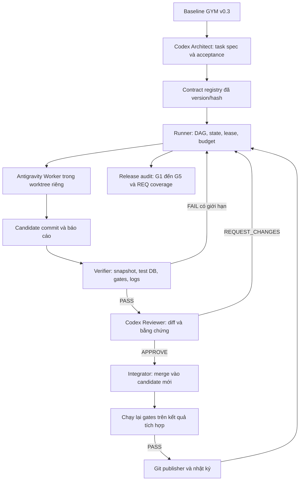
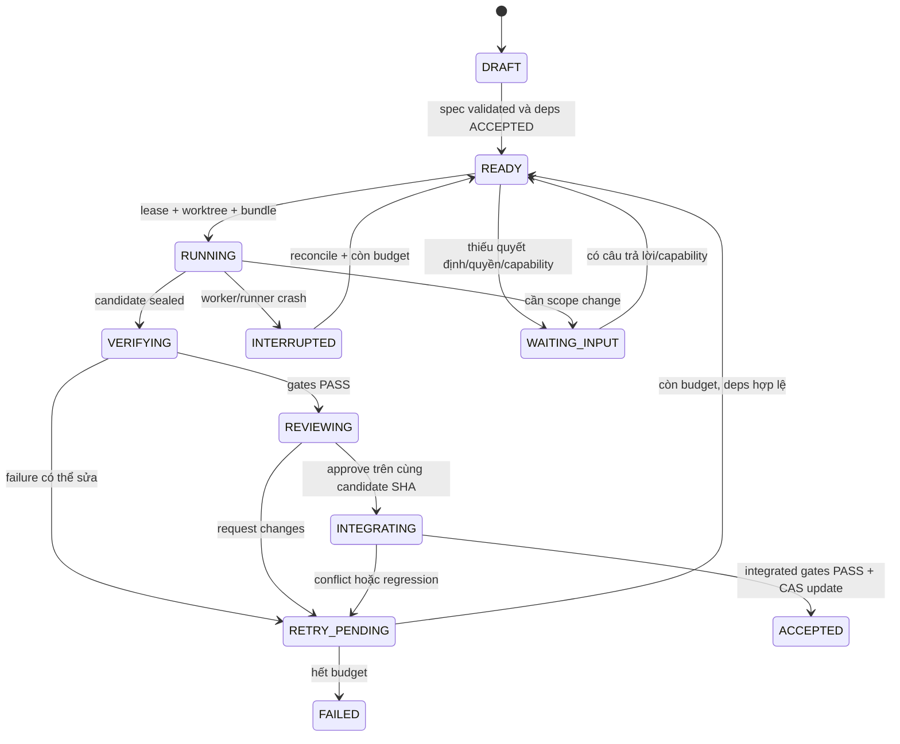

# Thiết kế Harness tự động hoàn thiện GYM — v1.0

Ngày thiết kế: 10/10/2026. Trạng thái: **Thiết kế và bộ hợp đồng mẫu; chưa có runner thực thi**.

Đầu vào là `MASTER_PLAN_MULTI_AGENT.md` trong thư mục Antigravity brain do sinh viên cung cấp, kết hợp baseline GYM v0.3 trong repository. Bản thiết kế này cụ thể hóa mô hình Codex Architect / Antigravity Implementer bằng một bộ điều phối có trạng thái, tiêu chí nghiệm thu và bằng chứng độc lập. Không sửa bản đầu vào trong thư mục `.gemini`.

## 1. Mục tiêu và phạm vi tự động

Harness là chương trình điều phối việc xây dựng phần mềm. Nó chọn task đủ điều kiện, giao cho agent, chạy kiểm thử, giao review, tích hợp thay đổi và chuyển sang task kế tiếp. Agent viết mã; harness quyết định kết quả nào có đủ bằng chứng để được nhận.

Đích sản phẩm là web GYM một cơ sở, 5 vai trò, theo REQ-01…REQ-20 và NFR-01…NFR-05. Must và Should thuộc đích nghiệm thu; REQ-15 xuất PDF/Excel là Could, phải được ghi rõ included/deferred trong phạm vi run trước khi bắt đầu. Không tự thêm thanh toán, nhiều chi nhánh, message broker hay nghiệp vụ ngoài baseline.

Một run được phép tự triển khai, kiểm tra, sửa lỗi, tạo commit và đồng bộ repository private đã cấu hình. Deploy production, đổi quyền truy cập GitHub, xử lý dữ liệu đang dùng và mua/thay đổi dịch vụ trả phí là các thao tác riêng, không thuộc đích local/demo của harness.

Yêu cầu tự động hóa mới chuyển vai trò sinh viên từ tự gõ toàn bộ code sang đọc diff và học qua từng milestone. Mỗi task được nhận phải có giải thích tiếng Việt, lệnh chạy lại, test tiêu biểu và câu hỏi tự kiểm tra. Có chế độ `milestone_pause` tùy chọn để học; chế độ `autopilot` tiếp tục qua task mà không đợi xác nhận thường xuyên.

## 2. Hiện trạng đã kiểm tra

| Thành phần | Hiện trạng / bằng chứng | Hệ quả |
|---|---|---|
| Repository | `main`, HEAD khi khảo sát `9834ecba470dd9c800e4be2a4210c1e006927fa0`, working tree sạch | Không khởi tạo lại backend hoặc Git. |
| Backend | Go module tại `server/`; Gin, config loader, pgxpool, `/health/live`, `/health/ready` | Foundation kế tiếp là test handler, lifecycle và migration. |
| Database | Theo kết quả sinh viên đã chạy: PostgreSQL 17.11 trong Docker; DB local `master-golang` | Đây không phải database test để harness reset. Chưa chạy schema GYM. |
| Test hiện có | `server/internal/config/config_test.go`; chưa có health test trong source lúc khảo sát | Không coi lời hứa viết test là test đã tồn tại. |
| Frontend | Chưa có `client/` | Tạo sau khi chốt contract machine-readable. |
| Tài liệu | SRS/API/ERD/backlog v0.3; một số đoạn trạng thái cũ chưa cập nhật theo code | Thêm task đối soát trạng thái trước khi sinh backlog máy đọc. |
| Codex CLI | `codex-cli 0.160.0`; help local có `exec`, `--json`, `--output-schema`, `-C`, `--sandbox` | Có cơ sở tích hợp CLI, nhưng chưa chạy agent probe trong buổi thiết kế. |
| Antigravity CLI | `agy` chưa có trong PATH của tiến trình kiểm tra | Cần capability probe; không suy ra IDE chưa cài. |
| Docker CLI | Không có trong PATH của tiến trình kiểm tra, dù sinh viên đã chạy ở terminal cá nhân | Doctor phải chạy dưới đúng user/session và resolve đường dẫn công cụ. |
| 9Router | Endpoint `http://127.0.0.1:20128/v1` là thông tin từ plan đầu vào; chưa kiểm tra | Là adapter tùy chọn, chưa coi fallback/RTK là tính năng đã xác nhận. |

## 3. Những phần cần bổ sung vào master plan

| Thiếu trong plan đầu vào | Quyết định thiết kế |
|---|---|
| Không có tiến trình chịu trách nhiệm lặp workflow | Runner TypeScript là control plane duy nhất. |
| Hai agent phải tự báo/chuyển tay | Adapter CLI chuyển input/output có schema; runner điều phối. |
| PASS dựa vào agent tự chạy test | Verifier do runner khởi chạy trên snapshot ứng viên; tự thu exit code, report và hash. |
| Agent sửa test để xanh | Acceptance thuộc contract đã đóng băng; worker không được sửa harness/gate/spec của task đang làm. |
| Retry vô hạn | Giới hạn attempt, thời gian, output và usage; thất bại được phân loại. |
| Cùng sửa một checkout | Worktree riêng cho mỗi task; dependency và lock theo tài nguyên. |
| Không khôi phục được sau crash | State store local + event log + lease; resume theo task/run ID. |
| `main` bị coi như production | `main` là nhánh source tích hợp; deploy là giai đoạn khác. |
| Test xanh nhưng thiếu chức năng | Coverage theo REQ/UC/BR và các luồng E2E/NFR bắt buộc. |

## 4. Kiến trúc tổng thể



9Router nếu vượt qua compatibility probe chỉ nằm trên đường inference của adapter; không giữ task state, không quyết định PASS và không chạy Git. Đây là phân tách để đổi model/provider không làm mất tiến độ dự án.

### Thành phần và quyền ghi

| Thành phần | Input / output | Quyền ghi |
|---|---|---|
| Architect | Baseline → task spec, acceptance, decision proposal | Contract mới qua bước validate/version; không sửa contract đang chạy. |
| Scheduler | Task DAG, trạng thái, lease → task được claim | State store và event log. |
| Worker adapter | Context bundle → candidate commit, report | Source theo allowed paths trong worktree; không push/merge. |
| Verifier | Snapshot + contract → gate results | Runtime evidence; không sửa code hoặc expected assertions để pass. |
| Reviewer adapter | Diff + spec + verifier results → review JSON | Review artifact; reviewer làm việc read-only. |
| Integrator/publisher | Candidate đã duyệt → accepted commit, push receipt | Integration ref và remote được cấu hình. Chạy tuần tự. |
| Reporter | Accepted results → journal và progress | Nhật ký, traceability report sau khi các kết quả được xác minh. |

Worker có thể chạy test để debug; chỉ verifier độc lập tạo kết quả gate có thẩm quyền. Hai vai trò không chia sẻ cùng hội thoại để reviewer không chỉ lặp lại giải thích của implementer.

## 5. Công nghệ runner và cấu trúc repository

Chọn **Node.js + TypeScript** cho runner đầu tiên vì máy đã có Node/npm và cần quản lý subprocess, JSONL, timeout, provider adapters. Backend GYM tiếp tục dùng Go/Gin; không đưa orchestration vào API nghiệp vụ.

MVP runner: một tiến trình scheduler, một worker đang hoạt động, một reviewer chạy sau verifier. Chỉ nâng lên tối đa hai worker khi đã kiểm thử lock, resume và integration. Không cần Redis/RabbitMQ hoặc framework nhiều agent để chạy vòng đầu tiên.

```text
TTCSN/
  server/                         # backend hiện tại
  client/                         # frontend sẽ được tạo theo backlog
  docs/                           # nguồn yêu cầu, kiến trúc, nghiệp vụ
  .harness/
    README.md                     # trạng thái và cách đọc thiết kế
    schemas/                      # task/result/review schemas
    tasks/                        # task spec có version
    prompts/                      # architect/worker/reviewer prompts (sẽ tạo)
    coverage.json                 # mapping REQ/UC/BR → task/gate (sẽ tạo)
  tools/harness/                  # runner TypeScript (chưa tạo)
    src/{scheduler,state,adapters,verifier,git,reporting}/
    tests/
  infra/harness/                  # Compose DB test, sandbox profile (chưa tạo)
  .github/workflows/              # CI verifier (chưa tạo)
```

State và log thô đặt tại thư mục runtime local **ngoài OneDrive** do doctor resolve, ví dụ `%LOCALAPPDATA%/TTCSN-Harness/<project-id>/`. Worktree tại `<runtime-root>/worktrees/<run-id>/<task-id>/`. Đường dẫn absolute thực tế phải được kiểm tra trước khi thao tác; không chạy xóa recursive trên biến chưa resolve.

State store dùng SQLite transaction ở runtime local, một writer. Đây là lựa chọn thiết kế; driver/version sẽ được pin sau probe tương thích Node trên máy. Không đặt SQLite WAL trên OneDrive. Các bảng tối thiểu: `runs`, `tasks`, `attempts`, `leases`, `gate_results`, `reviews`, `integrations`, `events`.

Task spec và schema được commit. Log, cache, database volume, credential, transcript đầy đủ và raw evidence không commit. Report công khai đã redaction được gắn commit/hash và lưu trong `docs/reports/` khi cần nộp bài.

## 6. Giao thức adapter và khả năng headless

### Contract chung

```text
probe() → {version, headless, structured_output, cancellation, usage, permission_mode}
start({run_id, task_id, attempt, cwd, context_bundle, schema, timeout}) → handle
events(handle) → normalized event stream
cancel(handle) → kết quả dừng process tree
result(handle) → worker-result hoặc review
```

Mỗi adapter phải kiểm tra process exit, terminal event, JSON schema và permission-denied/tool-error. `exit 0` hoặc chữ SUCCESS của agent không đủ để task DONE. Không gọi `resume --last` trong runner nhiều task; lưu và sử dụng session ID đúng run/task.

### Codex

Tài liệu chính thức hỗ trợ `codex exec --json` cho JSONL và `--output-schema` cho output máy đọc. Các flag này cũng có trong CLI local đã khảo sát. Adapter dùng argument array, truyền prompt qua stdin; không nối prompt vào shell command. Reviewer dùng `--sandbox read-only`, `-C <snapshot>`, `--output-schema <review-schema>`, `-o <review-output>`. Profile/model lấy từ config local đã validate, không hard-code tên model từ plan cũ.

CLI capability đã xác nhận từ help **khác** với end-to-end probe thành công. HAR-003 phải xác minh auth, schema và xử lý cancellation trước khi enable adapter. Có thể thay adapter CLI bằng SDK sau này mà giữ contract chung. [OpenAI: non-interactive mode](https://learn.chatgpt.com/docs/non-interactive-mode), [Codex SDK](https://learn.chatgpt.com/docs/codex-sdk).

### Antigravity

Tài liệu chính thức mô tả `agy -p`, `--output-format stream-json` và `--json-schema`. Cần tìm/cài CLI tương thích rồi đối chiếu local `--help`; IDE có sẵn không chứng minh CLI có sẵn. Headless có thể soft-deny tool trong khi process vẫn exit 0; adapter phải ghi nhận denied action và verifier vẫn phải tự chạy checks. [Antigravity: headless mode](https://antigravity.google/docs/cli/headless/).

Nếu probe Antigravity thất bại, trạng thái là `WAITING_INPUT` với lý do cụ thể; không giả báo đã tự động tích hợp IDE. Fallback sang Codex implementer là một lựa chọn cấu hình tường minh, được ghi trong run manifest; không tự lặng lẽ đổi kiến trúc phân công đã yêu cầu.

### 9Router

HAR-003 kiểm tra endpoint/provider bằng request tối thiểu không chứa code/secret, loại API mà CLI cần, structured output, streaming, tool loop, timeout và model identity. URL `/v1` tự nó không chứng minh tương thích. Không giả định Antigravity có thể trỏ tùy ý vào OpenAI-compatible endpoint. Nếu không có cấu hình provider chính thức tương thích thì bỏ gateway ở adapter đó, giữ đường auth/provider được hỗ trợ.

Nếu chuyển model giữa task, ghi model/provider/version trong attempt. Khi rate limit giữa tool loop, chỉ retry request theo cơ chế adapter đã kiểm thử; không replay shell write đã thực thi. Khi đổi provider hoặc hội thoại, bắt đầu attempt mới từ checkpoint và chạy lại gates. RTK/tóm tắt chỉ áp dụng prose/log tail; không nén làm biến đổi SQL, diff, enum hay expected test result.

## 7. Task contract và state machine

Task spec chứa ID, revision, mục tiêu, dependencies, requirement IDs, acceptance, allowed paths, gate IDs và budget. Mẫu schema nằm trong `.harness/schemas/task.schema.json`; task đầu tiên tại `.harness/tasks/HAR-001.json`.

State được runner giữ riêng, không để worker sửa một dòng `done=true` trong task spec:



`READY` chỉ khi dependency đã ACCEPTED, không chỉ candidate PASS. `ACCEPTED` cần test trên kết quả tích hợp. `PUBLISHED` là trạng thái receipt của run/commit, không trộn với task ACCEPTED: mạng GitHub lỗi không được làm agent triển khai lại feature đã nhận.

Mỗi claim dùng transaction + lease có expiry và heartbeat. Chỉ runner chuyển trạng thái; worker/result là dữ liệu đầu vào cần validate. Nếu recipe/gate thiếu, kết quả là `NOT_CONFIGURED`, chặn tiến trình, không coi thiếu test là SKIP xanh.

## 8. Context bundle và prompt

Runner đóng gói đúng task: spec revision/hash, base SHA, dependency accepted SHAs, trích đoạn REQ/UC/BR liên quan, contract API/schema, files cần đọc, allowed paths, gate expectations, previous failing log tail và giới hạn. Ghi SHA-256 từng input; giữ bản gốc để reviewer đọc lại.

Không đưa toàn bộ chat/brain hoặc `.env` thật vào prompt. Repository source và output công cụ là dữ liệu; chúng không thể tự cấp quyền sửa baseline hay chạy thao tác ngoài scope. Secret DB test chỉ cấp cho verifier subprocess cần kết nối; agent thiết kế không cần mật khẩu local.

Prompt worker phải yêu cầu: hoàn thành đúng acceptance; truyền dependency theo kiến trúc; bổ sung test meaningful; không bỏ qua test; không sửa frozen gates; báo blockers bằng schema; giữ log/secret được redaction. Prompt reviewer yêu cầu đánh giá diff tại candidate SHA, mapping acceptance→evidence, transaction/authz/migration và test coverage; không sửa source.

Để vẫn học được: worker report có `learning_summary_vi`, giải thích luồng, quyết định và test quan trọng. Sau task lớn runner sinh walkthrough có file/line và lệnh chạy lại; nhật ký ghi “agent thực hiện, sinh viên đã/chưa review”, không giả rằng sinh viên tự viết hoặc đã hiểu code.

## 9. Verification gates và định nghĩa PASS

Gate registry có version, command recipe, cwd, env allowlist, expected test IDs, timeout, artifact parser và applicability. Reviewer/worker không được thay gate recipe trong cùng task. Mỗi result do verifier tạo chứa: run/task/attempt, candidate SHA, tree hash, contract hash, gate revision, started/finished UTC, exit code, timeout, expected/actual test count, artifact hash và status.

Một `go test ./...` toàn `[no test files]` chỉ chứng minh compile các package; không chứng minh acceptance. PASS semantic phải có named tests và assertions tương ứng. `SKIP`, report mất, JUnit/test JSON không parse được, timeout hoặc gate chưa cấu hình đều chặn acceptance khi gate bắt buộc.

| Gate | Recipe / kiểm tra | Khi nào bắt buộc |
|---|---|---|
| DOCS | `powershell -ExecutionPolicy Bypass -File docs/check_docs.ps1` từ root; thêm traceability audit | Thay contract/docs và release. |
| FORMAT | `gofmt -l` toàn bộ file Go được track; yêu cầu output rỗng. Frontend format/lint recipe pin khi tạo client | Source liên quan. |
| GO-UNIT | `go test -json -count=1 ./...` từ `server/`, lưu test JSON; required named cases phải chạy | Backend. |
| GO-VET | `go vet ./...` từ `server/` | Backend. |
| BUILD | `go build ./cmd/api` vào runtime dir; frontend typecheck/build từ lockfile | Source/runtime. |
| SECRET-SCOPE | Scan staged diff + paths + artifact redaction; reject `.env`, key/token và ngoài allowed paths | Mọi task. |
| ARCH | Kiểm tra application/domain không import Gin, pgx adapter; không DB global | Module nghiệp vụ. |
| DB-INTEGRATION | Migrate/seed/constraints/rollback trên DB test riêng; required cases chạy thật | Schema/repository/transactions. |
| API-CONTRACT | OpenAPI validation + endpoint/error/authz tests, 5 vai trò và object scope | Endpoint nghiệp vụ. |
| DB-RACE | RACE-01/02, STATE-01, IDEMP-01 với nhiều DB connections và barrier | Booking và sửa lock/index liên quan. |
| GO-RACE | `go test -race` trên runtime amd64 đã probe | Backend concurrency; hiện Go host 386 không đủ cho gate này. |
| WEB-E2E | Luồng 5 vai trò, viewport 375/768/desktop, auth errors, refresh state | UI milestone và release. |
| NFR-RESTORE | Benchmark workload + restore drill + integrity queries; số đo thật | Release audit G5. |

Recipe DB/API/browser sẽ được viết ở task bootstrap verifier; bảng này là đặc tả, chưa có lệnh CLI harness chạy thật. Không invent `npm test` khi chưa có `client/package.json` hoặc gọi `pytest` cho backend Go.

Readiness gates có case DB ready → 200, DB unavailable → 503, request cancel/timeout truyền xuống checker, live không gọi DB; lỗi DB không lộ DSN. Pool/lifecycle có test startup failure đóng resources, shutdown không bỏ qua `defer` vì `log.Fatal/os.Exit` nằm trong resource scope.

Tỉ lệ coverage có thể là thông tin hỗ trợ, không dùng một ngưỡng chung thay acceptance. GYM cần named invariants (capacity, authz, idempotency, history), không thể nhận booking vì đạt 80% coverage tổng.

## 10. Môi trường DB, process và Windows

Verifier tạo PostgreSQL container/DB riêng theo run/task, ví dụ DB `gym_harness_<run>_<task>`, volume/prefix riêng, cổng host được cấp không đụng 5432. Chỉ expose loopback; credential test sinh riêng. Không dùng/reset container `postgres-db`, database `master-golang` hoặc dữ liệu học hiện có.

Schema bootstrap chạy trên DB rỗng. Migration có lịch sử version/checksum, fixture và kiểm tra upgrade. Reset chỉ dùng tài nguyên trong registry thuộc run đó; cleanup xác minh owner label, absolute path và run ID. Không dùng `docker compose down -v` trên Compose project khác.

Worker không được nhận Docker socket tùy ý như một sandbox an toàn; Docker/volume lifecycle do verifier quản lý. Tests của worker chạy trong container/OS sandbox kiểm soát tài nguyên/network, không có GitHub token hay provider key. Worktree chỉ cách ly thay đổi Git, không phải security sandbox.

Doctor kiểm tra Go architecture: host hiện là `windows/386`; gate race phải chạy ở môi trường Go amd64 được xác nhận, có thể container hoặc CI. Không tự đổi Go toàn hệ thống. Set `GOCACHE` riêng từng run; không dùng lại cache cố định của `ginrr`. Giữ `.env` của project học ngoài worktree; integration test nhận env riêng và không load nhầm file này.

Runner resolve đúng executable dưới tài khoản Windows của sinh viên. Dùng subprocess argv, không ghép text từ model thành PowerShell. Với shim `.cmd/.ps1`, adapter xử lý launcher cố định đã validate, tách prompt qua stdin. Timeout phải kết thúc process tree và lưu partial output; server chạy nền trên Windows dùng cửa sổ ẩn và pid/process ownership rõ ràng.

## 11. Worktree, scope và tích hợp Git

1. Preflight kiểm tra working tree. Nếu có thay đổi sinh viên, giữ nguyên và lập snapshot/điểm bắt đầu rõ; không `reset --hard` hay auto-stash để che thay đổi.
2. Tạo worktree/branch `harness/<run>/<task>` từ integration SHA đã chấp nhận. User code checkout không bị worker sửa.
3. Lock shared contracts: `go.mod/go.sum`, schema/migrations, router/app wiring, API contract. Tasks đụng lock chung chạy tuần tự; frontend độc lập chỉ song song khi contract đã freeze.
4. Seal candidate commit: worker đã dừng, diff path/secret scan xong, tree clean. Verifier dùng snapshot riêng từ SHA; sau verify sửa thêm một byte thì gate/review cũ mất hiệu lực.
5. Review artifact phải trỏ đúng candidate SHA + contract hash. Codex không chỉ review `--uncommitted` khi diff cần review đã thành commit.
6. Integrator tạo candidate tích hợp từ main mới nhất + task commit. Chạy lại mandatory gates trên kết quả merge đó; main đổi trong lúc chạy thì rebuild/retest candidate.
7. Giữ một integration branch do runner sở hữu, update ref bằng expected-old SHA (compare-and-swap). Không dùng `update-ref` trực tiếp lên `main` đang được checkout của sinh viên, vì sẽ làm index/working tree không khớp HEAD. Khi kết thúc milestone, chỉ đồng bộ checkout sạch bằng fast-forward dưới integration lock; checkout đang bẩn giữ nguyên và report pending sync. Nếu remote diverge, fetch và re-integrate; không force push.
8. Commit nhật ký/report đã redaction vào release candidate, kiểm tra source tree không thay đổi, publish và xác minh remote SHA. Push retry là publish retry, không agent retry.

Git publisher chạy dưới credential scope riêng chỉ cho repository private đã cấu hình. Worker không giữ credential push; policy “không push” trong prompt tự nó không enforce được nếu OS vẫn cấp key/socket. Preflight phải kiểm tra credential exposure và sandbox thực tế.

## 12. Retry, giới hạn và resume

Mặc định đề xuất: 1 lần triển khai + tối đa 2 lần sửa/task; 20 phút/attempt; tối đa 1.200 giây/gate riêng nếu task ghi rõ; output lưu có giới hạn, artifact lớn có retention. HAR-001 chốt ngân sách toàn run trước bật autopilot, không coi các con số này là cam kết chi phí.

| Loại failure | Xử lý |
|---|---|
| Compile/unit/business test fail | Gửi structured findings/log đã redaction cho worker; tăng attempt. |
| Docker/CLI/auth thiếu hoặc denied tool | Doctor/preflight action; WAITING_INPUT khi cần quyền/login; không sửa business code để né. |
| Rate limit/transient provider | Backoff giới hạn theo Retry-After nếu có; giữ task state/session ID; không replay tool writes. |
| JSON/schema không hợp lệ | Một lần regenerate output không sửa code nếu còn budget; sau đó fail adapter. |
| Baseline/contract mâu thuẫn | DRAFT decision proposal cho Architect; chặn task phụ thuộc; không đổi rule âm thầm. |
| Không tiến bộ | Cùng failure fingerprint hai attempts và diff không giải quyết → FAILED/escalation. |
| Push/network GitHub lỗi | ACCEPTED local giữ nguyên; publish pending, retry riêng. |
| Verifier crash/process không kết thúc | INTERRUPTED; không có PASS; kill owned process tree, reconcile artifacts và chạy lại. |

Run budget gồm max elapsed, max agent attempts, token ceiling và optional chi phí tiền theo bảng giá cấu hình local. Policy v1 của HAR-001 yêu cầu token ceiling có thể enforce; nếu provider không báo usage thì ghi `unknown` và WAITING_INPUT trước agent run. Một policy chỉ dùng wall-clock/attempt có thể được chọn tường minh và version lại sau này; không tự đổi policy hoặc ghi chi phí 0 để tiếp tục.

Resume: acquire scheduler lock → đọc committed state/events → đối chiếu lease, pid, worktree và candidate SHA → giữ nguyên candidate đã accepted → rerun incomplete gates → lấy next READY. Mất heartbeat không được spawn worker mới khi process cũ còn sống; phải xác nhận termination. Mỗi side effect có idempotency key theo run/task/attempt/phase.

## 13. Backlog xây chính harness

Các task dưới đây chưa thực hiện. Dựng và test harness trước khi cho agent làm toàn GYM.

| ID | Nội dung | Depends on | Acceptance quan trọng |
|---|---|---|---|
| HAR-001 | Doctor + capability manifest + run policy | — | Detect đúng CLI/PATH/Go architecture; không đọc/in secret; khai báo budget; không false PASS. |
| HAR-002 | Task validation, state store, lease, event log | HAR-001 | Reject cycle/unknown deps; single scheduler; resume sau crash; task không tự DONE. |
| HAR-003 | Codex/Antigravity adapter probes; gateway optional | HAR-001 | Headless edit 1 fixture, structured output, cancel/error/denied tools; không sửa GYM. |
| HAR-004 | Worktree isolation + verifier + artifact collector | HAR-002 | Exit/timeout/stdout/stderr đúng; scan scope; one-run test DB; snapshot SHA binding. |
| HAR-005 | Review + integration + publisher + journal | HAR-003/004 | Reject stale review; retest merge; push retry không chạy lại feature; journal truthful. |
| HAR-006 | Pilot health lifecycle/tests | HAR-005 | Worker sửa test/lifecycle task nhỏ; verifier và Codex review nhận; report giải thích được. |
| HAR-007 | Fault injection và full-run controls | HAR-006 | Agent crash, corrupt result, altered test, merge conflict, rate limit, budget exhaustion không DONE giả. |

MVP vận hành xong khi HAR-001…HAR-007 ACCEPTED. Trước mốc đó chỉ chạy dry-run hoặc pilot; không giao prompt “code hết dự án” rồi để vòng lặp vô hạn.

## 14. DAG hoàn thiện sản phẩm GYM

Đây là epic-level DAG. Architect phải chia mỗi epic thành task nhỏ có acceptance trước khi enqueue, thường một endpoint/transition hoặc migration được kiểm chứng. Không gọi một epic gồm cả auth, UI và DB là một task.

| Epic | Nội dung | Dependencies | Traceability / evidence |
|---|---|---|---|
| GYM-FND | Health tests, lifecycle/shutdown, isolated env, dependency tidy, error/log/request ID | HAR-007 | Named health tests + app start/stop; không `log.Fatal` bỏ cleanup trong resource scope. |
| GYM-CTR | Đối soát docs/source, chọn data adapter và token/session behavior, OpenAPI machine-readable | HAR-007 | G1; decision log nhất quán, API/error/version freeze. |
| GYM-DB | Migration bootstrap, constraint integration, seed 5 vai trò bằng dữ liệu giả | GYM-FND/CTR | 14 bảng; keys/exclusion indexes; MIG/SLOT/HISTORY; không chạy trên DB local học. |
| GYM-ID | Login/logout/me, account management, token invalidation, RBAC + object policy | GYM-DB | REQ-01/02/12; AUTHZ-01, TOKEN-01. |
| GYM-MEM | Hội viên, hạn thẻ, tìm kiếm | GYM-ID | REQ-03/11; create atomically + history. |
| GYM-FAC | Phòng, ca, phiên, capacity/status | GYM-ID | REQ-04/05; BR-06…10. |
| GYM-PT | Hồ sơ, private certificate, approve/suspend, working/unavailability | GYM-ID | REQ-16/17; PT-01, FILE-01. |
| GYM-BOOK | Create/cancel/PT response/calendar/polling, audit/idempotency/locks | GYM-MEM/FAC/PT | REQ-06/07/08/13/14/18; RACE/STATE/IDEMP/CANCEL. |
| GYM-OPS | Attendance, finalization/expiry jobs, review và metrics | GYM-BOOK | REQ-09/19/20; ATTEND/REVIEW, clock boundary tests. |
| GYM-REP | Báo cáo vận hành đúng mẫu số, optional exports | GYM-OPS | REQ-10; REQ-15 included/deferred tường minh; REPORT-01. |
| GYM-UI | React/Tailwind, typed API client, login và luồng 5 vai trò | GYM-CTR, rồi phụ thuộc module API tương ứng | NFR-04; WEB-E2E, error states, object scopes. |
| GYM-REL | E2E tất cả luồng, load 100 concurrent, security, backup/restore, demo/runbook | Tất cả epic bắt buộc | G2…G5; release report và known limits. |

UI skeleton có thể song song backend sau GYM-CTR; mỗi UI feature chỉ ACCEPTED sau API tương ứng và E2E thật. API mock hữu ích khi xây UI nhưng không thay bằng chứng integration. Jobs cần clock injectable và source-state condition; không chờ thời gian thật hàng giờ để test biên.

## 15. Điều kiện kết thúc dự án

Runner không dừng với chữ “xong” vì queue trống. Release auditor phải kiểm tra:

1. Tất cả REQ Must/Should trong phạm vi run map tới task ACCEPTED, named tests và accepted SHA; Could deferred có quyết định.
2. G1…G5 có evidence tương ứng từ `15_ke_hoach_kiem_thu.md`, không gate SKIP bắt buộc.
3. Các luồng 5 vai trò và negative object-authz chạy qua frontend/API/PostgreSQL thật.
4. Schema/migration/version, restore integrity và booking race invariants đều được kiểm chứng.
5. Source, migrations, contracts, seeds giả, hướng dẫn chạy và walkthrough khớp release SHA; không secret/critical finding mở.
6. Local release và remote private branch đồng bộ; fresh clone có thể setup bằng tài liệu và placeholder config.

Nếu thiếu NFR hoặc còn blocker, report là `INCOMPLETE`/`LIMITED_DEMO` với mục thiếu. Không tự hạ tiêu chuẩn nghiệm thu để nhận `COMPLETE`. Production deployment không phải điều kiện local/demo này.

## 16. Lệnh vận hành dự kiến

Giao diện sau là đặc tả cho HAR-001…007, **chưa chạy được** trong repository hiện tại:

```text
harness doctor
harness plan --baseline v0.3
harness run --mode autopilot --scope gym-mvp
harness status --run <run-id>
harness pause --run <run-id>        # ngừng claim mới, checkpoint task đang chạy
harness cancel --run <run-id>       # dừng owned process tree, giữ worktree/artifacts
harness resume --run <run-id>
harness verify --candidate <sha>
harness release-audit --run <run-id>
```

Run dài phải có tiến trình nền/service thực, watchdog và notification phù hợp; đóng cửa sổ chat không được coi là scheduler vẫn sống. HAR-007 thử restart runner/host. Lần đầu chạy foreground theo một task để dễ quan sát, rồi mới bật background.

## 17. Handoff cho bên triển khai

Đọc file này và `.harness/README.md`, bắt đầu **HAR-001**, không bắt đầu Auth hay Booking ngay. Chỉ chỉnh `tools/harness/`, fixture/harness tests và template config cần thiết cho task đó. Đọc local CLI help, chứng minh capability bằng probes có log và fake fixture; không chạy provider call khi chưa có cấu hình auth/permission phù hợp. Không cần đọc `.env` của sinh viên.

Hoàn tất HAR-001 bằng doctor có exit code chính xác và capability report đã redaction. HAR-003 mới chạy agent headless probe. HAR-004 mới tạo isolated DB. HAR-006 mới giao worker task trên source GYM. Tài liệu, `.harness/schemas` và `.harness/tasks/HAR-001.json` được cung cấp trong buổi này; không có runner, agent process hoặc automation đã được khởi chạy.
