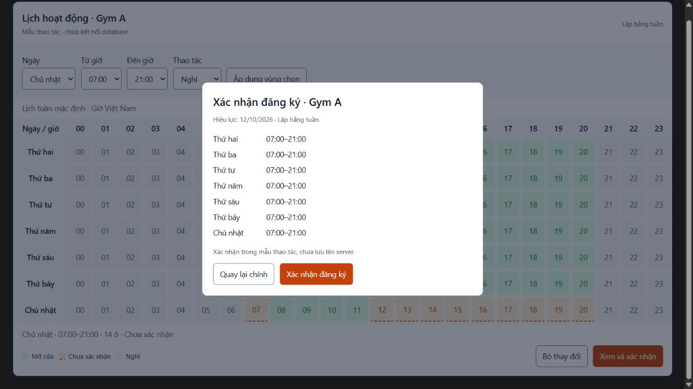

# Kế hoạch lịch hoạt động phòng — bảng 7 ngày × 24 giờ

**Ngày lập:** 11/10/2026. **Trạng thái hiện tại:** Đã được giao triển khai; backend, migration và giao diện demo local đã có. Hướng dẫn hiện hành: `21_huong_dan_lich_phong.md`; kết quả kiểm chứng: `reports/room_calendar_verification_2026-10-11.md`. Phần bằng chứng lập kế hoạch ở mục 13 giữ nguyên như snapshot trước khi code.

**Yêu cầu người dùng đã chốt:** Admin và Quản lý tạo phòng, đăng ký khung giờ phòng hoạt động bằng bảng giống Excel, 7 hàng tương ứng Thứ hai–Chủ nhật, 24 cột tương ứng 24 giờ; có kéo chọn/kéo thả và xác nhận. Lịch **lặp hằng tuần + ngoại lệ theo ngày** đã được người dùng chọn. Các mặc định kỹ thuật và hành vi chi tiết dưới đây là đề xuất triển khai của Codex.

Kế hoạch này bổ sung phần Phòng/Ca/Phiên của kế hoạch 19 và được ưu tiên trước Booking trong kế hoạch 18. Gói CRUD giữ kết quả kiểm chứng cũ; kết quả triển khai lịch mới được ghi riêng ở mục 14. Các cổng nghiệm thu dưới đây vẫn là mục tiêu, không tự chuyển toàn bộ thành PASS.

## 1. Mục tiêu và mô hình nghiệp vụ

Admin/Quản lý tạo phòng → mở “Lịch hoạt động” của phòng → vẽ giờ mở cửa trong tuần → xem thay đổi/tác động → xác nhận đăng ký → hệ thống áp dụng lặp mỗi tuần và tạo các phiên hợp lệ theo ngày.

Ba khái niệm được tách rõ:

| Dữ liệu | Ý nghĩa | Ví dụ |
|---|---|---|
| Lịch hoạt động phòng | Phòng được phép mở lúc nào; riêng cho từng phòng, lặp theo tuần. | Phòng Gym A: Thứ hai 07:00–21:00. |
| Ca đặt chỗ | Độ dài một lượt tập, dùng danh mục `time_slots` hiện có. | Ca 08:00–09:00. |
| Phiên phòng | Một ca cụ thể tại phòng/ngày; chốt giờ, capacity và trạng thái, được booking tham chiếu. | Gym A, 25/10/2026, 08:00–09:00, 20 chỗ. |

Vùng mở 07:00–21:00 không trở thành một booking dài 14 giờ. Chỉ ca nằm trọn trong vùng mở mới được tạo phiên. Không tự đổi danh mục ca hiện tại thành ca 1 giờ hoặc sửa ca đã được dùng; nếu sau này muốn mọi lượt tập dài 1 giờ, thực hiện một thay đổi riêng có kiểm tra chuyển đổi dữ liệu.

Hai phòng có thể cùng mở 07:00–21:00. Một phòng có thể có nhiều vùng mở trong ngày, ví dụ 07:00–12:00 và 14:00–21:00, hoặc nghỉ cả ngày. Capacity mặc định vẫn thuộc phòng; capacity phiên là snapshot riêng.

## 2. Quyền và điều kiện hoạt động

- Admin/Manager: tạo/sửa phòng; đọc, soạn, xem tác động và công bố lịch tuần; thêm/sửa/rút ngoại lệ ngày; xem lịch sử và tạo lại phiên bằng quy trình xem trước/xác nhận.
- Receptionist/Member/PT: chỉ đọc lịch đã có hiệu lực và phiên phù hợp vai trò. Không thấy bản nháp, danh tính/liên hệ booking hoặc ghi chú nội bộ qua màn lịch công khai.
- UI ẩn thao tác sửa theo quyền; backend kiểm tra lại quyền ở mọi endpoint, kể cả URL trực tiếp.
- Phòng mới chưa có lịch được công bố thì chưa tạo phiên nhận đặt chỗ. “AVAILABLE” và “đang mở theo lịch” là hai điều kiện khác nhau.
- Trạng thái phòng MAINTENANCE/INACTIVE chặn hoạt động dù lịch tuần có vùng mở. Ngoại lệ mở thêm không vượt qua trạng thái phòng. Cấu hình lịch cho thời gian sau vẫn được phép, nhưng màn xem trước phải nêu rõ phòng hiện chưa khả dụng.
- Không tự xóa phòng, ca, phiên, booking hoặc lịch sử. Công bố thay đổi + điều chỉnh phiên + audit là một transaction.

## 3. Bảng lịch giống Excel

### Cấu trúc

- Trang `/management/rooms/:id/calendar`, mở từ danh sách hoặc chi tiết phòng. Header ghi tên phòng, trạng thái, capacity và múi giờ Việt Nam; không sửa nhầm phòng khi đổi trang.
- Hai chế độ: **Lịch tuần mặc định** để cấu hình mẫu; **Tuần theo ngày** để xem ngày cụ thể, ngoại lệ và phiên đã tạo.
- Đúng 7 hàng từ Thứ hai đến Chủ nhật, 24 cột giờ từ `00` đến `23`. Cột `07` là 07:00–08:00, cột `20` là 20:00–21:00; mép phải cuối ngày là 24:00.
- Giai đoạn đầu chọn theo bước **1 giờ**. 07:00–21:00 chiếm 14 ô, từ cột 07 đến hết cột 20; 21:00 là thời điểm đóng cửa, không chọn thêm ô 21.
- Header giờ và cột tên ngày được giữ trong vùng nhìn khi cuộn bảng. Tooltip và dòng tóm tắt ghi giờ bắt đầu/kết thúc đầy đủ; không chỉ dùng màu để diễn đạt trạng thái.

### Thao tác

1. Kéo trên vùng trống để chọn khoảng giờ; kéo hình chữ nhật qua nhiều hàng để áp cùng khoảng cho nhiều ngày. Kéo ngược chiều cho cùng kết quả theo min/max, không sinh khoảng âm.
2. Thả chuột chỉ cập nhật **bản nháp**, chưa gọi API lưu. Vùng chọn hiện “Thứ hai–Thứ sáu · 07:00–21:00”; có nút Áp dụng/Hủy vùng chọn.
3. Vùng đã tạo có thể kéo sang giờ/ngày khác để di chuyển, kéo hai mép để đổi độ dài, chọn rồi sửa bằng form hoặc bỏ vùng khỏi bản nháp. Di chuyển giữ nguyên độ dài, không lấn sang ngày khác âm thầm.
4. Có chế độ **Mở cửa / Nghỉ**, chọn nhiều ngày, “Sao chép ngày này sang…”, “Áp dụng 07:00–21:00 cả tuần”. Không tự đổi các ngày khi chỉ sửa một hàng.
5. Chuẩn hóa vùng liền kề thành một khoảng; một ô chỉ thuộc một vùng mở. Không kéo chồng để cộng thêm sức chứa hoặc tạo bản ghi trùng.
6. Undo/Redo trong bản nháp; Escape hủy thao tác đang kéo; “Bỏ thay đổi” trở về dữ liệu server gần nhất. Rời trang/đổi phòng/đổi chế độ khi có thay đổi phải có lựa chọn giữ lại hoặc bỏ.
7. Có lựa chọn **Ngày + Từ giờ + Đến giờ** và nút Áp dụng để làm mọi thao tác chính mà không phải kéo. Nhập 22:00–02:00 phải đề nghị tách thành 22:00–24:00 ngày đầu và 00:00–02:00 ngày sau, có xác nhận; Chủ nhật nối sang Thứ hai. Không nhận một khoảng có start >= end.

### Trạng thái và bố cục

| Trạng thái | Cách hiển thị |
|---|---|
| Giờ mở đã công bố | Nền xanh nhạt, nhãn “Mở cửa”, giờ từ–đến trên block. |
| Thay đổi bản nháp | Nền cam nhạt/viền nét đứt, nhãn “Chưa lưu”. |
| Nghỉ/chưa mở | Nền trung tính, ký hiệu và nhãn “Nghỉ”. |
| Ngoại lệ nghỉ/bảo trì | Màu cảnh báo + biểu tượng/nhãn; lý do trên phần quản lý. |
| Thay đổi xung đột | Viền lỗi và thông báo theo ngày/giờ, có liên kết tới phiên liên quan. |

Giữ palette/font/component của UI quản trị hiện tại. Bảng được cuộn ngang **bên trong vùng lịch**, không làm toàn trang tràn ngang; không ép 24 cột quá nhỏ. Desktop dùng ô tối thiểu khoảng 36px, hàng khoảng 56px. Mobile mặc định dùng danh sách 7 ngày với các khoảng giờ và form nhập; có thể chuyển sang bảng cuộn, vùng thao tác chạm khoảng 44px, cuộn không bị hiểu nhầm thành kéo chọn. Kiểm tra 375/768/1024/1440px, zoom 200%.

Grid dùng điều hướng mũi tên, Home/End, Shift chọn vùng, Enter/Space mở form/áp dụng và Escape hủy; một điểm vào grid qua Tab và focus nhìn rõ. Screen reader nghe ngày, giờ và trạng thái; thay đổi vùng được thông báo sau thao tác, không đọc từng frame kéo. Pattern tham khảo: [WAI-ARIA Grid](https://www.w3.org/WAI/ARIA/apg/patterns/grid/). Form/nút bấm là phương án thay thế kéo theo [WCAG Dragging Movements](https://www.w3.org/WAI/WCAG22/Understanding/dragging-movements.html); chỉ hỗ trợ keyboard chưa đủ thay cho thao tác chạm không kéo.

## 4. Luồng xác nhận đăng ký

1. **Tạo phòng:** nhập tên/loại/capacity/mô tả, lưu phòng bằng API hiện tại, chuyển tới trang lịch có thông báo “Chưa đăng ký giờ hoạt động”. Không báo tạo lịch thành công khi chỉ mới tạo phòng.
2. **Soạn lịch:** chọn vùng; xem tóm tắt 7 ngày. Chọn ngày bắt đầu áp dụng và nhập lý do thay đổi đối với lịch đã công bố. Lịch mới không sửa dữ liệu trong quá khứ.
3. **Xem trước:** nút “Xem và xác nhận” gửi toàn bộ bản nháp cho backend kiểm tra. Dialog ghi tên phòng, lịch trước/sau, ngày hiệu lực, ngoại lệ được giữ, số phiên thêm/đóng/giữ và các booking giữ chỗ bị ảnh hưởng. Kèm thông báo các ca chưa được cấu hình hoặc không nằm trọn trong vùng mở.
4. **Xác nhận:** chỉ có nút “Xác nhận đăng ký” khi không còn xung đột. Preview có hạn 5 phút, gắn với actor, payload, phiên bản lịch và dữ liệu phụ thuộc; đây không phải thao tác giữ chỗ hoặc khóa phòng trong 5 phút.
5. **Lưu:** backend xác minh lại quyền, trạng thái và booking trong transaction; UI disable nút khi đang gửi. Thành công đọc lại lịch/phiên từ DB, chuyển về trạng thái “Đã đăng ký”; lỗi giữ bản nháp và chỉ rõ cách xử lý.
6. Nếu lịch/ca/phiên đã đổi từ lúc xem trước, trả 409 và yêu cầu tải/xem tác động lại; không ghi đè lặng lẽ. Một booking mới phát sinh sau preview vẫn được kiểm tra lại lúc xác nhận.

Xác nhận là của Admin/Manager đang thao tác; không thêm vòng duyệt bắt buộc giữa hai vai trò. Tải lại trang có bản nháp chưa lưu không được giả là đã đăng ký. Khi 401, về đăng nhập và không tự gửi lại thao tác công bố.

## 5. Lặp tuần, ngày hiệu lực và ngoại lệ

- Lịch tuần áp dụng theo `Asia/Ho_Chi_Minh`, ISO weekday: 1 = Thứ hai, 7 = Chủ nhật. Khoảng thời gian nửa mở `[start, end)`: các khoảng sát nhau hợp lệ.
- Sửa lịch tuần tạo **version mới**, giữ version cũ phục vụ tra cứu. Đề xuất mặc định hiệu lực từ ngày mai; với phòng mới có thể từ hôm nay nhưng chỉ tạo phiên chưa bắt đầu. Sửa lịch đã có từ ngày mai trở đi; thay đổi khẩn trong hôm nay dùng ngoại lệ và vẫn bảo vệ phiên đang diễn ra/booking giữ chỗ.
- Mỗi ngày có tối đa một ngoại lệ ACTIVE: **nghỉ cả ngày** hoặc **thay thế toàn bộ giờ mở ngày đó**. Ví dụ thứ Hai thường 07:00–21:00, ngày lễ chỉ 09:00–12:00; ngoại lệ ghi đúng ngày, lý do, actor, thời điểm.
- Ngoại lệ thay thế có thể mở ngoài lịch thường, phải nêu rõ trong xác nhận. Ngoại lệ không cộng dồn ngầm với lịch tuần; muốn nghỉ trưa chọn các khoảng còn được mở.
- Ưu tiên: trạng thái không khả dụng của phòng → ngoại lệ ngày → lịch tuần có hiệu lực. Lịch tuần mới giữ nguyên ngoại lệ tương lai đã có; muốn rút ngoại lệ là thao tác riêng có preview/audit.
- Ngoại lệ không làm thay đổi tuần sau. Không sửa/xóa dữ liệu đã kết thúc; rút ngoại lệ lưu lịch sử thay vì hard-delete.
- Phiên quá khứ/đang diễn ra giữ timestamps/capacity/status và nguồn lịch đã chốt; trang lịch lịch sử không tái tính từ mẫu tuần mới.

## 6. Sinh phiên và tương thích ca đang có

Lịch mở lặp lâu dài; phiên là dữ liệu cụ thể hữu hạn. Đề xuất luôn chuẩn bị **28 ngày tới**, giới hạn thao tác xem trước tối đa 56 ngày để kiểm soát kích thước transaction.

- Với từng ngày/phòng, tính các vùng mở hiệu lực; chọn `time_slots` ACTIVE nằm trọn một vùng. Tạo phiên nếu chưa có và chưa bắt đầu, với giờ Việt Nam và capacity snapshot hiện tại. Không tạo ca từ mỗi ô đã chọn; nhiều ca có thể nằm trong một vùng mở dài.
- Một ca 06:30–07:30 không hợp lệ khi phòng chỉ mở từ 07:00. Ca 08:00–12:00 không hợp lệ nếu phòng nghỉ 10:00–11:00. Không tự cắt ca đã dùng thành nhiều ca nhỏ.
- Các phiên mở thủ công cũng phải tuân thủ lịch có hiệu lực; không được lách qua API POST/PATCH room-sessions. Ngoại lệ đóng thủ công trên phiên được giữ, không tự mở lại khi job sinh phiên chạy.
- Chạy bổ sung phiên khi công bố lịch, khi API khởi động và hàng ngày lúc 00:05 Việt Nam. Chạy lại không sinh trùng; sau downtime bổ sung cửa sổ còn thiếu. Khi phòng/ca thay đổi, áp dụng lại quy trình tương ứng hoặc bổ sung phiên hợp lệ; không âm thầm đổi snapshot cũ.
- Tác vụ tự động chỉ tạo thêm phiên thiếu; không overwrite phiên đã có. Thay đổi đóng/mở do công bố lịch phải có preview/diff, và cơ chế marker nguồn trạng thái để phân biệt đóng do lịch với đóng thủ công.
- Phiên do mẫu lịch tạo ghi nguồn version và sự kiện SYSTEM; không ghi job tự động thành thao tác tay của sinh viên/nhân viên. Lỗi job phải có log an toàn và thông báo trong trang quản lý, nêu rõ ngày cuối đã chuẩn bị; không báo có phiên nếu DB chưa tạo được.
- Ca có mép 24:00 cần xử lý/test riêng trong parser, serialize và phép cộng ngày; không giả định `time.Parse("15:04")` chấp nhận 24:00. Không phát hành sinh phiên cuối ngày trước khi test biên này PASS.

Giữ `time_slots`, `room_sessions`, FK booking và các ID hiện có. Phiên mới không được chồng thời gian phiên OPEN khác trong cùng phòng, kể cả khi ca cũ đã ngừng hoạt động. Bổ sung constraint/index sau khi kiểm tra dữ liệu hiện có; nếu dữ liệu legacy vi phạm thì báo danh sách và xử lý có chủ đích, không tự xóa để migration qua.

## 7. Bảo vệ booking và thao tác đồng thời

- Mọi đóng/thu hẹp/dịch lịch có phiên tương lai chứa PENDING_PT hoặc CONFIRMED: **chặn toàn bộ công bố**, trả danh sách phiên/thời gian/số chỗ ảnh hưởng. Không tự hủy booking. Khi có luồng hủy/đổi lịch riêng được phép ở chặng Booking, xử lý qua luồng đó rồi xem trước lại.
- Phiên không còn giữ chỗ có thể đóng theo lịch mới; không xóa bản ghi. Nếu mở lại sau đó, chỉ mở phiên do lịch đã đóng, chưa bắt đầu, phù hợp vùng mở, không xung đột; phiên đóng thủ công vẫn đóng.
- Thay default capacity không đổi capacity phiên cũ; sửa capacity phiên qua nghiệp vụ riêng và không dưới số chỗ giữ. Kéo vùng mở không đổi capacity.
- Lock phòng trước, sau đó các phiên bị ảnh hưởng theo ID tăng dần; kiểm tra holds sau khi có lock. Các endpoint tạo/sửa phiên phải dùng cùng protocol. Chặng Booking sẽ khóa phòng → PT nếu có → phiên, kiểm tra lại lịch/sức chứa trong transaction; không chỉ dựa vào preview hoặc check trước transaction.
- `calendar_revision` tăng mỗi thay đổi lịch/ngoại lệ/trạng thái/cấu hình phòng liên quan; `base_revision` chặn hai quản lý overwrite nhau. Preview kiểm tra thêm fingerprint ca và phiên phụ thuộc. Quy tắc DB chống overlap và uniqueness là hàng rào cuối.
- Xác nhận có `Idempotency-Key`: cùng key/payload trả lại kết quả cũ, khác payload trả conflict; retry sau mất kết nối không sinh thêm version, phiên hoặc audit trùng. Dùng bảng idempotency đang có.
- Mutation, lịch sử và audit commit cùng transaction. Audit lỗi thì rollback hết; job sinh phiên cũng xử lý theo transaction từng phòng/cửa sổ có checkpoint rõ.

## 8. Thiết kế dữ liệu đã triển khai

Không lưu 168 boolean rời rạc làm nguồn dữ liệu chính. Grid là biểu diễn UI; backend nhận các khoảng thời gian chuẩn hóa.

| Thay đổi | Trường/chính sách hiện hành |
|---|---|
| `rooms` | Thêm `calendar_revision`, `calendar_required`, ngày đã chuẩn bị phiên và mã lỗi job; trạng thái/capacity được giữ. |
| `room_schedule_versions` | room_id, ngày hiệu lực từ/đến, published_by_user_id, created_at, reason, payload_hash, ACTIVE/SUPERSEDED. Các vùng ACTIVE không chồng; version đã thay thế được giữ; hash mutation cũng lưu trong idempotency_keys. |
| `room_weekly_hours` | version_id, weekday 1–7, start_minute/end_minute; exclusion chống overlap trong cùng version/ngày. |
| `room_calendar_exceptions` | room_id, ngày, mode CLOSED/REPLACE, loại nghỉ/bảo trì, reason, ACTIVE/WITHDRAWN, actor/timestamps. Unique một ngoại lệ ACTIVE/phòng/ngày. |
| `room_exception_hours` | exception_id, start_minute/end_minute; mode CLOSED không có interval, REPLACE có ít nhất một interval; kiểm tra overlap và tính nhất quán trong transaction. |
| `room_sessions` | Thêm nguồn MANUAL/CALENDAR, nguồn version/ngoại lệ và nguồn đóng trạng thái; giữ ID/time_slot/FK booking. Cho `created_by_user_id` nullable chỉ với phiên tự động có nguồn lịch rõ; phiên MANUAL vẫn bắt buộc actor. |

Minute dùng số nguyên 0–1440: `0 <= start < end <= 1440`, bước 60 trong giai đoạn đầu; 24:00 chỉ là điểm kết thúc. Dùng date cho ngày địa phương, TIMESTAMPTZ cho thời điểm thực tế. Miền phút cho phép bổ sung 30/15 phút sau này mà không đảo thứ tự bảng 24 cột; mở mức đó là thay đổi sau, chưa nằm trong chặng này.

Migration v3 thêm bốn bảng, nâng schema lên 18 bảng nghiệp vụ ngoài bảng Goose. Không sửa migration v1/v2 hoặc reset DB dev. Phòng có trước migration giữ `calendar_required=false` đến khi chủ động công bố tuần đầu tiên; phòng mới mặc định true. Schema cài mới, ERD, API và hướng dẫn đã được cập nhật.

## 9. API hiện hành

Tất cả dưới `/api/v1`, envelope/error có request_id. Write/preview/history chỉ Admin/Manager; read giờ đã công bố yêu cầu đăng nhập và đã lọc nội dung nhạy cảm.

| API | Mục đích |
|---|---|
| GET `/rooms/{id}/weekly-schedule` | Đọc mẫu/phiên bản hiệu lực và revision để chỉnh; quản lý. |
| POST `/rooms/{id}/calendar/preview` | Nhận kind WEEKLY/EXCEPTION/WITHDRAW/EXTEND + payload; validate và trả changes/conflicts/preview_id. |
| PUT `/rooms/{id}/weekly-schedule` | Công bố version từ preview, base_revision và Idempotency-Key; quản lý. |
| GET `/rooms/{id}/calendar?from=…&to=…` | Ngày/giờ đã công bố, nguồn WEEKLY/CLOSED/REPLACE/trạng thái phòng, version/exception ID; tối đa 56 ngày; không trả lý do quản trị hoặc booking. |
| GET `/rooms/{id}/calendar/history` | Lịch sử version/ngoại lệ, phân trang 20–100; quản lý. |
| POST `/rooms/{id}/calendar/exceptions` | Xác nhận ngoại lệ từ preview. |
| PATCH `/rooms/{id}/calendar/exceptions/{exceptionId}` | Sửa ngoại lệ tương lai từ preview. |
| POST `/rooms/{id}/calendar/exceptions/{exceptionId}/withdraw` | Rút ngoại lệ từ preview, giữ lịch sử. |
| POST `/rooms/{id}/calendar/materialize` | Xác nhận mở rộng cửa sổ phiên từ preview; không là API nhập ca tự do. |

Payload lịch tuần gồm `kind: "WEEKLY"`, `effective_from`, `base_revision`, `hours: [{weekday, start_minute, end_minute}]` và `reason`; ngày không có khoảng là ngày nghỉ, cả tuần nghỉ dùng `hours: []`. Confirm thêm `preview_id` và header Idempotency-Key. Không gửi bitmask, capacity, actor hoặc timestamps tự gán. Contract đầy đủ và cách replay sau restart tại tài liệu 21.

422 cho khoảng sai/bước giờ sai/ngày quá khứ; 403 sai quyền; 409 cho revision cũ, preview hết hạn/thay đổi, holds hoặc phiên chồng; 401 hết phiên. Lỗi có code ổn định và chi tiết ngày/giờ/phiên được phép xem, không SQL hoặc thông tin cá nhân booking. Không tự retry publish nhạy cảm.

OpenAPI/Postman hiện có 58 operations, gồm chín operations lịch phòng; đối chiếu router và schema refs bằng `scripts/generate_api_contracts.py --check`. Collection chưa được chạy bằng Postman.

## 10. Package và component

Giữ chuẩn project Gin tham chiếu: `internal/domain/facility` cho models/intervals, `internal/service/v1` cho calendar rules/preview/publish, `internal/repository` cho transaction/queries; `handler/v1`, `dto/v1`, `routes/v1`, `app` ghép dependency; job trong `internal/job` hoặc module job hiện hữu khi bổ sung. Domain/service không import Gin, handler không có SQL. Thêm file theo nghiệp vụ, không nhét lịch mới vào handler/list hiện tại.

Frontend trong `features/facilities/calendar/`: RoomCalendarPage, WeeklyHoursGrid, DayHoursEditor, ScheduleToolbar, SchedulePreviewDialog, CalendarExceptions, interval/types và hook draft/history. Tách state server đã công bố, bản nháp, vùng đang chọn và preview; undo/redo không sửa object server. Dùng Pointer Events cho grid DOM 7×24, không làm spreadsheet đầy đủ hoặc thêm thư viện Excel nặng; chỉ chọn thư viện kéo nếu cần và chứng minh hỗ trợ pointer/keyboard đúng.

## 11. Chặng thực hiện

| Chặng | Công việc | Cổng hoàn thành |
|---|---|---|
| CAL-1 — Chốt contract/chuyển đổi | Đối chiếu REQ-04/05, UC-10/11, D02 và ma trận quyền; lập nguồn schema/API mới; kiểm kê phòng/ca/phiên legacy và chọn cách xác nhận lịch cho phòng cũ. | Không suy ra lịch lặp từ vài phiên demo; không bật gate mới cho phòng legacy chưa được chuyển đổi có chủ đích. Bản mô phỏng chỉ phục vụ review. |
| CAL-2 — Backend lịch tuần | Migration mới, interval validation, version/revision, GET/preview/publish, audit/idempotency/holds/concurrent guards; bổ sung room-session gate. | Unit + DB/API PASS, publish/rollback/idempotency/2 quản lý và booking-vs-publish đúng. |
| CAL-3 — UI Excel | Grid 7×24, chọn/kéo/di chuyển/resize, form thay thế, copy, undo/redo, dirty guard, dialog xác nhận nối API. | Tạo phòng → đăng ký → đọc lại DB thật; pointer/keyboard/mobile có thể hoàn tất; lỗi không mất nháp. |
| CAL-4 — Ngoại lệ/sinh phiên | Ngoại lệ CLOSED/REPLACE/withdraw; calendar theo ngày; job và horizon, nguồn trạng thái/snapshot, resume sau downtime. | Lặp nhiều tuần đúng, ngoại lệ chỉ đúng ngày, job lặp không trùng/không mở lại manual closure, chặn holds và ca không trọn vùng. |
| CAL-5 — Bàn giao | Regression tất cả module, responsive/zoom/focus, OpenAPI/Postman, schema/checker/runbook/báo cáo, commit theo phần. | Go/vet/DB/API/frontend test/build/docs PASS; ảnh/mẫu thao tác và luồng DB thật; liệt kê phần chưa kiểm chứng. |

Mỗi chặng thực hiện → kiểm thử → chẩn đoán lỗi → sửa → chạy lại. Không đổi lịch/phân công Excel hoặc ghi ngày hoàn thành thực tế trước khi có bằng chứng.

## 12. Acceptance tests bắt buộc

1. Admin/Manager tạo và công bố được; ba role còn lại bị 403 trên write/preview/history dù gọi API trực tiếp.
2. Thứ hai 07:00–21:00 = 14 ô; kéo ngược/kéo nhiều ngày/copy/di chuyển/resize đúng; bỏ/hủy/undo/redo không gọi API lưu.
3. Nhiều vùng trong một ngày, nghỉ cả ngày, liền kề được chuẩn hóa; overlap/bước sai/out-of-range/24:00 đầu khoảng bị từ chối; 23:00–24:00 và Chủ nhật qua Thứ hai đúng múi giờ.
4. Form/tap thay thế kéo và keyboard hoàn tất cùng kết quả; 375/768/1024/1440px, 200% zoom, focus/label/lỗi rõ; không tràn ngang ngoài vùng bảng.
5. Trước xác nhận DB không đổi; double-click/retry cùng key không thêm version/audit/phiên; 422/409/mất mạng giữ bản nháp, 401 không tự publish lại.
6. Hai quản lý dùng cùng revision: chỉ một thắng; preview cũ/hết 5 phút/ca đổi buộc xem lại. Holds mới giữa preview và confirm khiến rollback toàn bộ.
7. Đóng/thu hẹp có PENDING_PT/CONFIRMED bị chặn; terminal booking không giữ chỗ; phiên đang diễn ra/quá khứ/snapshot cũ không bị viết lại. Audit failure rollback cả lịch và phiên.
8. Lịch tuần lặp đúng các tuần sau; ngoại lệ thay cả ngày; nghỉ/bảo trì/rút ngoại lệ không rò sang tuần khác hoặc vượt phòng INACTIVE; version mới giữ ngoại lệ cũ.
9. Ca nằm trọn vùng mới sinh phiên; ca qua khoảng nghỉ không sinh; phòng chưa đăng ký không tạo phiên mới; API room-session không bỏ qua gate. Không chồng OPEN phiên kể cả legacy và concurrent.
10. Job 28 ngày, restart/catch-up/idempotent; lỗi báo đúng horizon; không tự mở phiên đóng thủ công; generated audit là SYSTEM. Migration up/repeat/rollback kiểm tra riêng DB test, dữ liệu dev cũ được giữ.

**Luồng demo:** Manager tạo Gym A, capacity 20 → đặt Thứ hai–Thứ bảy 07:00–21:00, Chủ nhật 08:00–12:00 → xác nhận → xem tuần sau vẫn lặp → thêm ngoại lệ ngày lễ nghỉ → chỉ ngày đó đóng → fixture booking CONFIRMED → thu hẹp giờ của phiên đó bị chặn → rút ngoại lệ ngày khác → đọc lại DB và audit. Đây là test dự kiến, chưa phải kết quả đã chạy.

## 13. Bằng chứng lập kế hoạch

Đã đối chiếu code/domain/DDL/router và kết quả bàn giao CRUD hiện có, cùng `ui-ux-pro-max`/`ui-styling`. Search UX tìm được hướng dẫn kéo có phương án thay thế; search React cho grid/state không có match được xác minh, nên không persist kết quả đó. Hướng keyboard dựa trên WAI-ARIA Grid và kiến trúc ứng dụng, không tự tuyên bố đã đạt WCAG.

Chỉ tài liệu/kế hoạch và mẫu thao tác local được bổ sung trong lần này. Chưa chạy migration, chưa thêm route calendar, chưa thay dữ liệu phòng/ca/phiên hoặc giao diện sản phẩm. Mẫu xem trong cuộc trò chuyện chỉ mô phỏng kéo chọn/nhập giờ/xác nhận cục bộ, không chứng minh API hoặc DB hoạt động.

Checker tài liệu PASS với baseline đang chạy: 20 yêu cầu, 16 use case, 26 quy tắc và 14 bảng. Mẫu đã kiểm tra cú pháp JavaScript, nhìn đủ 7 hàng/24 cột, nhập Chủ nhật 07:00–21:00 hiện 14 ô chưa xác nhận; dialog liệt kê lại 7 ngày, xác nhận đổi trạng thái cục bộ. Thao tác kéo chưa được kiểm chứng qua công cụ browser do hạn chế xác định tọa độ trong iframe; không ghi là PASS. Di chuyển/resize, ngoại lệ và backend vẫn thuộc các chặng triển khai phía trên.

## 14. Kết quả triển khai và kiểm chứng

Migration v3, domain/service/repository/handler/job và UI tuần/ngoại lệ/lịch thực tế/lịch sử đã có. Grid dùng Pointer Events và thao tác bàn phím; tạo phòng chuyển thẳng đến trang lịch. Ba role không quản lý có trang chỉ đọc. Backend kiểm tra giờ phòng, giữ snapshot, chống overlap/holds, transaction audit và replay idempotency cả sau restart.

Go tests với PostgreSQL test, go vet, 26 frontend tests/build và kiểm tra 58 API operations đã PASS. Demo manager tạo phòng mới, kéo chọn/di chuyển/resize/undo và công bố lịch 88 giờ/tuần đã lưu DB, sinh 27 phiên. UI ngoại lệ, chỉ đọc, ma trận responsive/zoom và thời điểm job 00:05 chưa kiểm chứng trực tiếp; kiểm tra browser bị auto-review chặn do hạn mức tài khoản. Báo cáo chi tiết: `reports/room_calendar_verification_2026-10-11.md`. Mẫu ảnh mục 13 vẫn chỉ là bản mô phỏng trước triển khai, không dùng làm bằng chứng sản phẩm.
