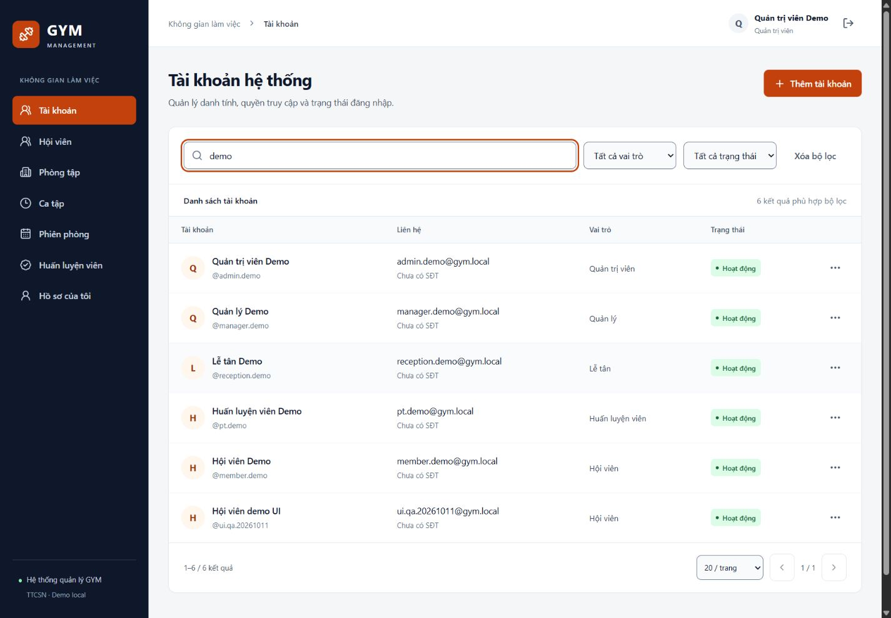
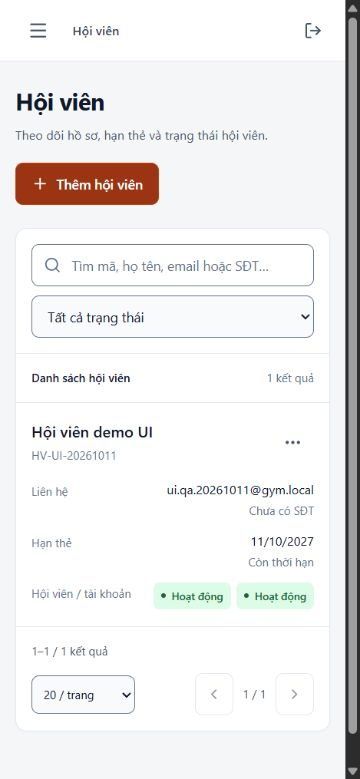

# Kiểm chứng CRUD quản trị và UI/UX — 11/10/2026

Codex thực hiện theo yêu cầu triển khai kế hoạch 19. Đây là báo cáo kiểm thử local bằng dữ liệu demo/fixture, không phải phê duyệt nghiệp vụ thực tế hoặc nghiệm thu MVP GYM đầy đủ. Excel và các dữ liệu người dùng có trước được giữ nguyên.

## Phần đã triển khai

| Module | Backend và UI |
|---|---|
| Identity | Login/logout/me, Admin list/search/filter/page/create/detail/contact edit/status/role/reset; token revoke và audit |
| Members | Tạo account + profile atomically hoặc liên kết MEMBER chưa có profile; list/scope/detail/contact/profile/membership |
| Facilities | Phòng list/detail/create/edit/impact; ca list/detail/create/edit unused/activate/retire; phiên list/detail/create/snapshot/capacity/status |
| PT | PT SELF profile/certificate/submit; Admin/Manager decision; weekly hours/absence/withdrawal; file download có xác thực |
| UI chung | Route/guard, sidebar/drawer, token memory/TTL/401, native date/time, form dirty/busy/error, dialog focus/Escape, action menu, table/card và pagination |

Backend giữ `internal/handler/v1 → internal/service/v1 → internal/repository`, ghép dependency trong `internal/app`, model nghiệp vụ ở `internal/domain`, DTO HTTP ở `internal/dto/v1`. Domain/service không import Gin, handler không chứa SQL. Project khóa học tham chiếu cũng không có `internal/model`; nó có model do SQLC sinh tại `internal/db/sqlc/models.go`. GYM dùng SQL pgx viết tay nên model nằm ở domain; không thêm alias model trùng lặp chỉ để đổi tên thư mục.

PostgreSQL 17 chạy riêng tại 127.0.0.1:5433, DB dev/test riêng. Migration v1 giữ nguyên, v2 thêm exclusion cho giờ làm PT; schema vẫn 14 bảng nghiệp vụ. Upload nằm ở thư mục private bị Git bỏ qua. Các sửa nghiệp vụ và audit commit cùng transaction.

## Kết quả tự động

| Lệnh/kiểm tra | Kết quả và phạm vi |
|---|---|
| `go test ./... -count=1` với `TEST_DATABASE_URL` | PASS; không skip các integration test DB; test chỉ reset đúng `ttcsn_gym_test` |
| `go vet ./...` | PASS |
| `npm.cmd test` | PASS: 19 tests, 2 files, không có unhandled rejection |
| `npm.cmd run build` | PASS: TypeScript + Vite; route feature được tách chunk, initial JS khoảng 469 kB trước gzip |
| `python scripts/generate_api_contracts.py --check` | PASS: 49 API operations trùng method/path Gin router; references/artifact đồng bộ |
| Swagger Parser validate OpenAPI | VALID (`@apidevtools/swagger-parser`, cài riêng trong artifact ignored) |
| `docs/check_docs.ps1` | PASS: 20 REQ, 16 UC, 26 BR, 14 schema tables, không DROP TABLE |
| `/health/ready` | HTTP 200, `status=ready`; Compose PostgreSQL healthy |

Các kiểm tra DB/API mới nằm trong `server/internal/repository/management_integration_test.go`, dùng router Gin thật với pgx/PostgreSQL:

- Login đủ 5 vai trò; 4 non-Admin bị 403 ở quản lý tài khoản. Detail/edit account lưu audit và không trả hash.
- Member create mới buộc MEMBER; link tài khoản đúng điều kiện; duplicate profile/member code rollback tài khoản; fixture trigger audit lỗi làm rollback cả account/profile. SELF ngoài phạm vi trả 404, PT ASSIGNED chỉ được dữ liệu giới hạn và không tìm kiếm bằng email/SĐT đã ẩn.
- Tên phòng unique không phân biệt hoa thường. Hai request tạo ca chồng cùng lúc: một 201, một 409; ca liền kề hợp lệ. Ca đã dùng không sửa giờ; ngừng ca ngăn tạo phiên mới.
- Phiên lấy capacity snapshot, giờ Việt Nam; fixture giữ hai chỗ chặn giảm capacity/đóng phiên/đổi phòng không sẵn sàng. Preview impact khớp số giữ chỗ.
- PT: DRAFT → PENDING → REJECTED → sửa → PENDING → APPROVED; PENDING không sửa. File giả/oversize bị 422, owner/operator tải binary, Member bị 403, anonymous 401, JSON không có private path.
- Weekly hours không phá booking; khoảng nghỉ overlap hoặc ảnh hưởng booking bị chặn; đình chỉ PT có booking giữ bị chặn. `available_at` loại booking đang giữ, có end boundary exclusive, trả PT sau khi booking fixture hoàn tất. Lý do quyết định không lộ cho Member.
- Khóa/reset/đổi role/logout khiến token cũ 401. Hai thao tác khóa hai Admin đồng thời chỉ một thành công và vẫn giữ một Admin hoạt động.
- Migration down/up/repeat-up được kiểm tra trên DB test. Không rollback DB dev.

Frontend kiểm tra hành vi trong `client/src/management.test.tsx`: quyền 4 role, protected 401, login busy/error/không prefill password, create conflict giữ form, reset confirm, role/reason, dirty navigation, AbortSignal/filter, response cũ không ghi đè mới, native date input commit, liên kết MEMBER không gửi role, ca đảo giờ không gọi API, PT pending chỉ đọc và Escape trả focus về trigger menu. Các API trong component tests là mock; chúng không thay cho test DB/API ở trên.

## Kiểm tra trình duyệt với DB dev thật

Codex In-app Browser trên máy Windows; giao diện tại http://127.0.0.1:5173, API tại http://127.0.0.1:8080. Chỉ dữ liệu synthetic local được tạo/sửa để QA:

1. Admin tạo `ui.qa.20261011` (MEMBER), mở chi tiết, sửa họ tên, khóa rồi mở lại; trạng thái cuối ACTIVE. Escape trên dialog trực tiếp và từ action menu trả focus về nút mở.
2. Liên kết tài khoản trên thành `HV-UI-20261011`, thẻ 11/10/2026–11/10/2027; danh sách đọc lại dữ liệu đã lưu. Lỗi native date hiển thị nhưng state không cập nhật được sửa bằng input/blur commit, sau đó tạo thành công.
3. Tạo “Phòng Gym demo”, capacity 20, “Ca sáng demo” 08:00–09:00 và phiên ngày 25/10/2026; UI hiển thị 0/20, 08:00–09:00, OPEN.
4. `pt.demo` tự lưu hồ sơ có nhãn minh họa, upload PNG synthetic, tải file thành công, gửi PENDING; form chuyên môn chuyển sang chỉ đọc.
5. `manager.demo` đọc hồ sơ, APPROVE với lý do chỉ dùng kiểm thử local, lưu lịch Thứ hai 08:00–17:00 và khoảng nghỉ 01/12/2026 12:00–13:00. Trang đọc lại có APPROVED/lịch/khoảng nghỉ đúng giờ.
6. Phiên TTL thực tế đã hết trong lúc QA và UI chuyển login với thông báo cần đăng nhập lại; login mới hoạt động. Drawer mobile điều hướng được, bảng chuyển card; modal đóng bằng Escape.

Reset mật khẩu/đổi role đã kiểm tra bằng API integration và frontend component tests; chưa thao tác đổi credential/role thủ công bằng browser trong lần QA này. UI/DB không chứng minh production readiness.

| Viewport | Màn đã xem | Kiểm tra |
|---|---|---|
| 375 × 812 | Login, hội viên card, dialog thẻ, PT detail | Không tràn ngang toàn trang, label/nút đọc được, drawer hoạt động |
| 768 × 900 | Hội viên table | Không tràn ngang, filter/bảng/pagination nằm trong trang |
| 1024 × 900 | Tài khoản có filter demo | Sidebar, table và action menu không tràn ngang |
| 1440 × 1000 | Tài khoản, form | Bảng desktop, sidebar và form có khoảng cách nhất quán |

Ảnh chỉ chứa dữ liệu demo, không chứa bản ghi liên hệ cá nhân có trước:

## Giới hạn và bước tiếp theo

- Chưa có Booking/Attendance/Review/Report APIs hoặc UI. Booking ở test là fixture để bảo vệ dữ liệu nền; cần protocol khóa cùng hàng room_session/PT khi triển khai Booking.
- Chưa chạy benchmark p95/100 users, restore drill, production migration, nhiều browser, screen reader, zoom 200% hoặc audit accessibility đầy đủ. CSS có reduced-motion/focus nhưng chưa đủ để tuyên bố toàn bộ NFR đã nghiệm thu.
- Certificate PDF dùng allowlist/signature/EOF; không có antivirus hoặc object storage production. File cũ khi thay được giữ local; chính sách dọn/retention thuộc vận hành sau.
- OpenAPI đã validate và đối chiếu router; Postman collection chưa chạy bằng Postman runner. Ví dụ mutation cần ID thật và trạng thái đúng, không chạy toàn bộ collection tự động trên DB dev.
- Cấu hình secret/upload/cache không commit; `.agents/` và file `s` có trước không được đưa vào commit tác vụ này. DeepSeek Harness được giữ.

Hướng dẫn chạy, tài khoản demo và dừng ứng dụng: `../17_huong_dan_chay_local.md`. Model/domain và package không thay đổi thành SQLC trong gói CRUD này.
