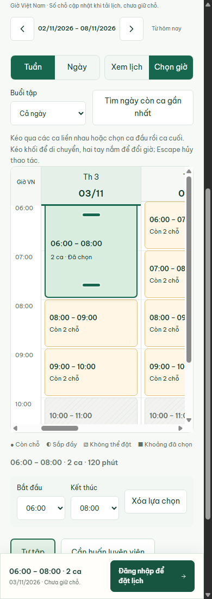
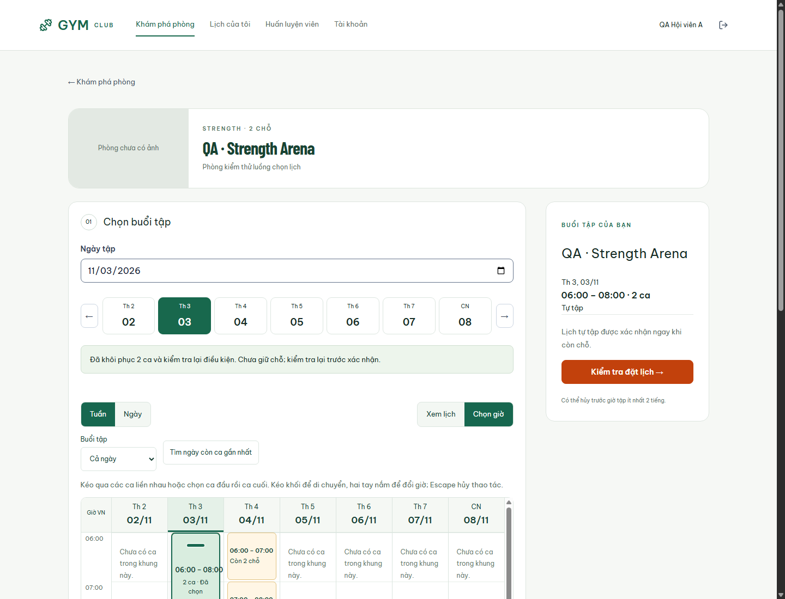
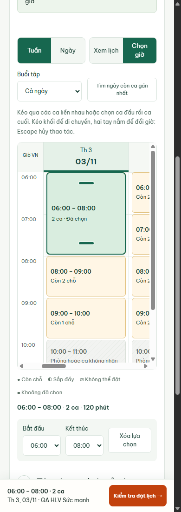
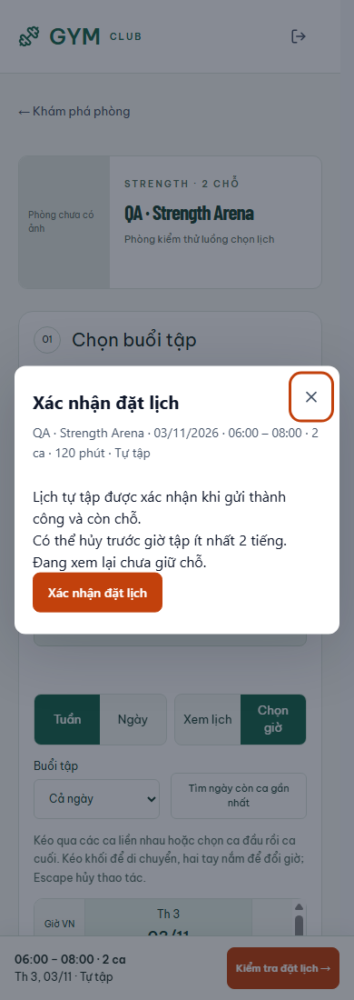
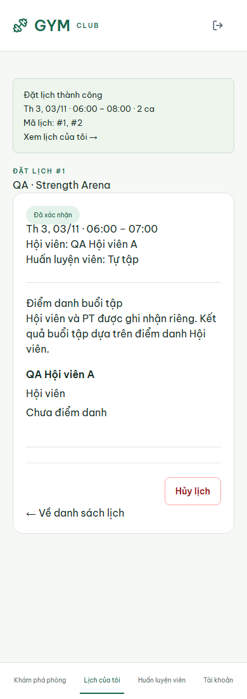
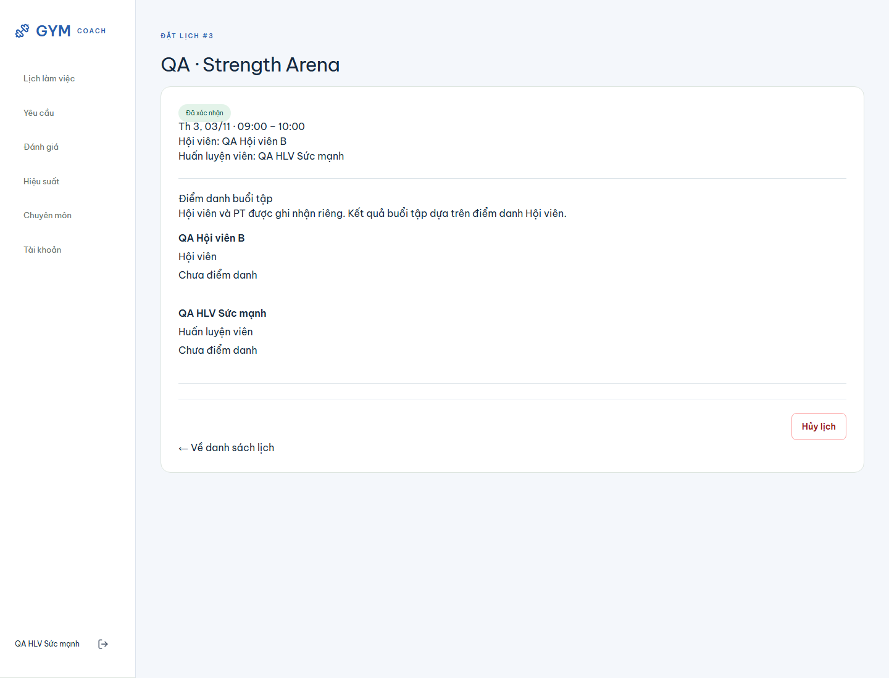

# Hoàn thiện UI/UX U2–U4 — 01/11/2026

## Bàn giao

Đã thực hiện tiếp kế hoạch 35 theo yêu cầu người dùng, trên ứng dụng React/Go hiện hữu. Trang chủ/phòng/HLV tiếp tục mở công khai; chức năng đặt lịch và thông tin riêng vẫn yêu cầu xác thực. U2–U4 không thêm API hoặc migration, giữ hợp đồng 83 operations và quyền backend hiện hành.

**U2:** lịch tuần/ngày với trục giờ, tiêu đề ngày bám khi cuộn. Máy tính đủ rộng hiển thị cả 7 cột; điện thoại giữ đủ tuần bằng cuộn bên trong lịch. Hai chế độ Xem lịch/Chọn giờ tách việc vuốt xem với kéo chọn. Chọn dải bằng kéo hoặc hai lần chạm/click; kéo thân giữ thời lượng, hai tay nắm đổi biên. Phím mũi tên trên thân/tay nắm và ô Bắt đầu/Kết thúc là phương án thay thế. Escape hủy kéo; thả ngoài hoặc qua vùng không hợp lệ giữ lựa chọn trước. Có tự cuộn dọc gần mép, xóa lựa chọn, bộ lọc sáng/chiều/tối và tìm ngày còn ca trong tối đa 28 ngày tới. Chỉ chọn session thật liền nhau, cùng ngày, tối đa 24 ca; không tự chia nhỏ giờ hoặc dùng công cụ mở/đóng lịch quản trị.

**U3:** khách chọn thử dải và ý định tự tập/cần HLV trước login. Bản nháp sessionStorage tối đa 30 phút lưu ID/giờ ca và ý định, không chứa token/mật khẩu và không giữ chỗ. Sau login, bản nháp được gắn tài khoản, kiểm tra lại giờ/điều kiện; tài khoản khác, ca đổi hoặc hết chỗ không được khôi phục. HLV phải phù hợp toàn dải; HLV không còn phù hợp buộc chọn lại hình thức tập, không tự chuyển tự tập. Ngày được đồng bộ URL để đổi tuần rồi trở lại không mất ngữ cảnh. Rời ô ngày mà không đổi giá trị không xóa lựa chọn. Đăng xuất chủ động xóa bản nháp, hết phiên có thể khôi phục sau login cùng tài khoản.

Trước mở xem lại, client lấy lại điều kiện ca và HLV. Xác nhận vẫn dựa vào kiểm tra atomically/idempotency tại server; khóa gửi trùng. Mất phản hồi sau khi server đã tạo lịch cho phép gửi lại cùng key, nhận lại kết quả cũ. Lỗi điều kiện cập nhật lịch để chọn lại, không tự đổi ca/HLV. Kết quả hiển thị các mã lịch, khoảng giờ tổng, trạng thái xác nhận/chờ HLV và đường dẫn xem lịch.

**U4:** kiểm tra hồi quy, Chrome với thao tác pointer/touch/bàn phím, dữ liệu PostgreSQL thật và báo cáo. Đã sửa thêm lỗi tải lại khi cửa sổ nhận focus làm khung lịch co lại: giữ snapshot cùng phòng/tuần trong lúc cập nhật, không hủy kéo nếu nội dung ca không đổi, vẫn khóa xác nhận đến khi cập nhật xong. Không giữ snapshot của phòng/tuần/tài khoản khác.

## Kiểm chứng

| Hạng mục | Kết quả |
|---|---|
| Frontend Vitest, 1 worker, không song song file, timeout CLI 20 giây | **76/76 PASS**, 13 file |
| TypeScript/Vite production build | PASS |
| `go test -p 1 ./... -count=1 -timeout 300s` | PASS toàn bộ, PostgreSQL integration trên `ttcsn_gym_test` |
| `go vet ./...` | PASS |
| Contract generator `--check` | PASS, 83 operations |
| `docs/check_docs.ps1` | PASS |
| Chrome profile sạch, 1440/720/390/320 CSS px | PASS; không tràn ngang toàn trang; 7 cột vừa khung desktop, mobile cuộn trong lịch |
| Giả lập Intl timezone America/Los_Angeles | Ca 06:00 vẫn hiển thị 06:00 giờ VN |
| Kéo tạo/đổi hai biên/di chuyển, touch và Escape/thả ngoài | PASS trên browser |
| Khách → login → khôi phục → xem lại/xác nhận mobile | PASS với API và DB thật |
| Cố ý làm mất HTTP 201 sau khi batch đã commit, rồi gửi lại | Hai POST dùng cùng key, chỉ tạo hai booking, nhận lại kết quả thành công |
| Ý định cần HLV → chọn HLV → PENDING_PT → PT nhận | PASS, trạng thái cuối CONFIRMED |
| Thẻ hết hạn / bản nháp có ca vừa bị lấy hết chỗ | Không khôi phục dải để đặt; không tạo booking trái điều kiện |
| Hết phiên khi đã chọn HLV → login lại cùng tài khoản | Khôi phục dải/ngày, kiểm tra lại và chọn đúng HLV; logout xóa bản nháp |
| Đối chiếu DB QA | 5 booking, tất cả CONFIRMED; 0 booking của tài khoản hết hạn |
| Runtime exceptions trong hai lượt browser QA hoàn chỉnh | 0 |

Đợt browser chạy ứng dụng thật tại API `127.0.0.1:18080` + Vite `127.0.0.1:15173`, cấu hình riêng `client/vite.qa.config.ts`, dữ liệu chỉ ở `ttcsn_gym_test`. Fixture ca ngày **03/11/2026** dùng tài khoản QA tổng hợp; không đặt thêm booking vào DB demo. Helper/JSON/log local lưu trong `.artifact_work/u4/` (`browser-result.json`, `session-result.json`, `database-result.json`, `frontend-test.log`, `go-test.log`).

Các test mới còn kiểm tra: khoảng có lỗ/ca chặn/cross-day, giữ thời lượng khi di chuyển, đổi tuần và khôi phục, blur ô ngày không xóa lựa chọn, không tháo khung khi refresh, bản nháp hết 30 phút/sai owner/ca đổi, HLV phải được chọn rõ và preflight đổi điều kiện không gửi mutation.

Phạm vi nghiệm thu là UI/UX U2–U4 local. Touch được giả lập bằng Chrome DevTools; chưa phải kiểm chứng điện thoại vật lý, toàn bộ browser matrix, screen reader, tải/NFR hoặc phát hành production. Các kết quả NFR cũ không được nâng thành PASS từ đợt này.

## Dữ liệu và dừng máy

DB dev vẫn có **26 users, 14 rooms, 51 bookings** khi đối chiếu. Test có reset/ghi DB chỉ dùng `ttcsn_gym_test`. Không reset volume, không ghi đè ảnh phòng người dùng và không reset/commit các thay đổi Git có sẵn.

Đã lưu bản sao PostgreSQL custom archive:

- `.artifact_work/backups/ttcsn_gym_dev-u4-20261101-000317.dump`
- 5.343.404 bytes; SHA256 `A229657A6271CDC97D8CB714767F833602F561F372131F486778398E6240DEB1`.
- Đã kiểm tra manifest bằng `pg_restore --list`; không tuyên bố đã chạy restore archive này.

Sau khi kiểm tra xong, dừng riêng API/Vite QA, chạy `scripts/stop-local.ps1` để dừng tiến trình dự án và PostgreSQL nhưng giữ volume, rồi lên lịch tắt Windows theo yêu cầu người dùng. Trạng thái thực thi cuối lưu ở `.artifact_work/u4/shutdown-status.json`.

Lần sau mở lại bằng:

```powershell
powershell -ExecutionPolicy Bypass -File .\scripts\start-local.ps1 -SkipSeed
```

Sau đó mở `http://127.0.0.1:5173/` để demo công khai. Không cần seed lại hoặc restore DB để tiếp tục.

## Ảnh ứng dụng thật












