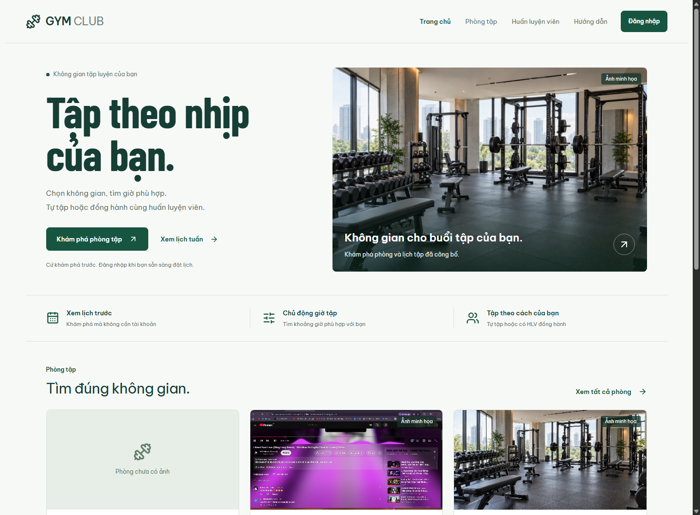
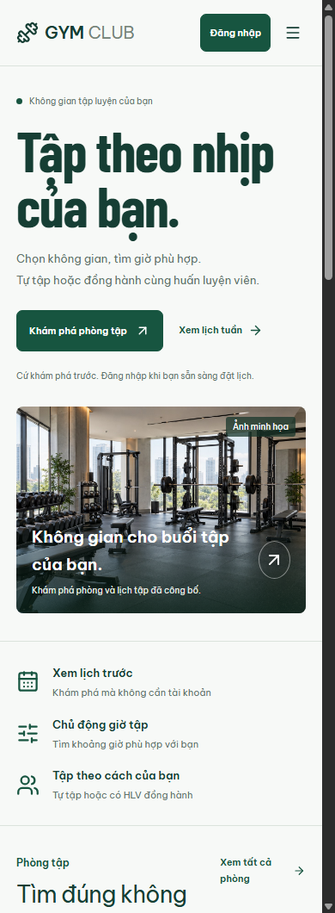
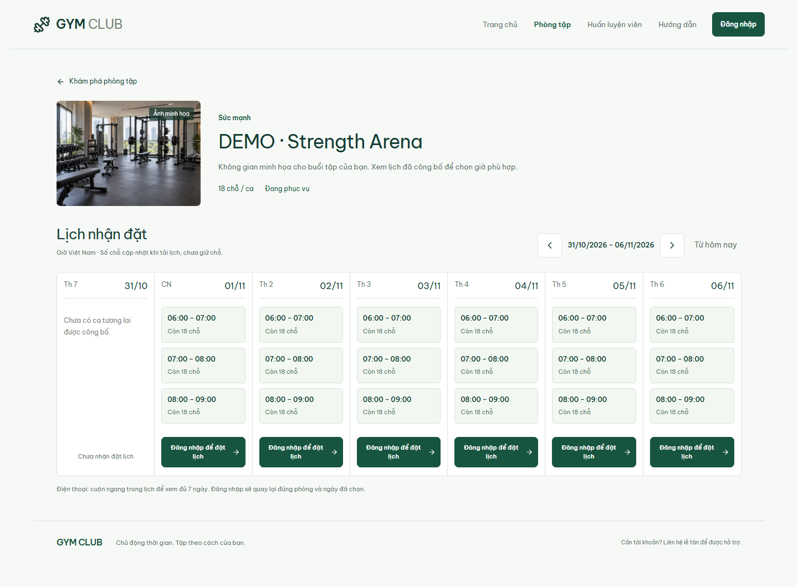
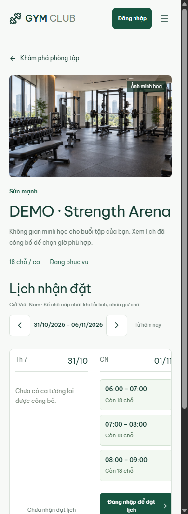

# Kiểm chứng U1 — Khám phá công khai, 31/10/2026

Cập nhật: [U2–U4 đã hoàn thiện ngày 01/11/2026](public_booking_u2_u4_2026-11-01.md). Giới hạn lịch đọc/bản nháp phòng-ngày trong báo cáo U1 dưới đây là mốc lịch sử.

## Kết quả và phạm vi

U1 của kế hoạch 35 đã triển khai trên ứng dụng local tại `http://127.0.0.1:5173/`: trang chủ không cần login, danh sách/tìm kiếm/lọc/phân trang phòng, danh sách HLV, chi tiết phòng và lịch đọc 7 ngày. Dữ liệu lấy từ API thật. Trên điện thoại, khung lịch cuộn ngang đủ 7 ngày; toàn trang không tràn ngang. Khách bấm đặt được đưa đến login với đích phòng/ngày; Hội viên nhận lại ngày hợp lệ ở form chọn lịch, role khác về khu vực phù hợp. Đích sau login được giới hạn đường dẫn nội bộ theo role.

Trang chủ dùng ảnh minh họa tĩnh từ ảnh Strength của U0, nhãn minh họa hiển thị rõ. Card/chi tiết phòng vẫn dùng đúng ảnh phòng từ DB, kể cả ảnh người dùng đã tải lên. Không thay ảnh hoặc dữ liệu demo của người dùng. U1 không đổi schema và không reset/seed lại DB dev; chỉ khởi động lại API đã xác minh thuộc dự án, lưu log trước đó trong `.artifact_work/runtime-history`.

## API và quyền

Năm GET endpoint có chung tiền tố `/api/v1/public`: `/rooms`, `/rooms/:id`, `/rooms/:id/cover-image`, `/rooms/:id/sessions`, `/trainers`. Backend dùng DTO/query whitelist riêng, không trả nguyên entity quản trị.

- Phòng AVAILABLE/MAINTENANCE được xem; INACTIVE và ảnh tương ứng trả 404, kể cả request có ETag cũ.
- HLV phải APPROVED, tài khoản ACTIVE và có role PT. Không trả liên hệ tài khoản, chứng chỉ, metadata duyệt hoặc lịch riêng.
- Lịch bắt buộc from/to hợp lệ, tối đa 7 ngày bao gồm hai đầu. Chỉ có phiên còn thời gian tương lai theo lịch đã công bố/legacy được phép dùng; số chỗ trừ booking đang giữ. Không trả danh tính người đặt, lý do nội bộ hoặc kết luận điều kiện Hội viên. Phòng bảo trì có remaining=0.
- Phân trang tối đa 100; frontend lấy đủ các trang của dải lịch để không bỏ sót ca.
- API cá nhân/quản trị/đặt lịch hiện hữu tiếp tục yêu cầu xác thực. Xem lịch không giữ chỗ.
- OpenAPI/Postman đã tái sinh, kiểm tra khớp **83 operations**; public requests được đánh dấu noauth.

## Bằng chứng kiểm tra

| Kiểm tra | Kết quả |
|---|---|
| `go test -p 1 ./... -count=1 -timeout 300s` với TEST_DATABASE_URL đúng `ttcsn_gym_test` | PASS toàn bộ; repository ~84 giây |
| `go vet ./...` | PASS |
| UI Vitest, một worker, không chạy song song file, `--testTimeout=20000` | **65/65 PASS**, 12 file |
| Production TypeScript/Vite build | PASS |
| `python scripts/generate_api_contracts.py --check` | PASS, 83 operations |
| `docs/check_docs.ps1` | PASS |
| API đang chạy: GET public không Bearer, GET private bookings không Bearer | Public 200; private 401 |
| Chrome headless profile sạch, ứng dụng thật | PASS: 1440px desktop; 390px trang chủ/phòng/HLV/lịch; 320px trang chủ/menu; không lỗi runtime |
| Lịch mobile và CTA khách | 7 cột, khung rộng 335px/nội dung 1225px cuộn được; CTA chuyển `/login` với `/member/rooms/9?date=2026-11-01` |

Lần Vitest đầu có 63 bài đạt, hai bài keyboard của WeeklyGrid quản trị vượt timeout mặc định 5 giây. Không đổi assertion hoặc tăng timeout trong mã test; chạy lại riêng bộ UI với timeout CLI 20 giây đạt 65/65. Đã có test mới cho projection/visibility public, đếm chỗ, ảnh/ETag, 401 của route riêng, trang khách, lịch nhiều trang, lỗi/retry, đích login theo role và giữ ngày vào RoomBooking.

Phạm vi browser lần này là đọc công khai và chuyển tới form login. Việc quay lại sau login được kiểm tra ở logic đích theo role và form RoomBooking; **chưa chạy một luồng login → tạo booking thật hoàn chỉnh trong browser ở U1**. Đây không phải bằng chứng toàn bộ MVP hoặc tải/NFR đã đạt.

## Ảnh chụp ứng dụng thật

## Bước tiếp theo

**U2:** thay giao diện chọn ca Hội viên bằng grid tuần có khối kéo, tay nắm đổi giờ và kéo chuyển khối theo các session thật; hỗ trợ điện thoại xem đủ tuần, chế độ tương tác tránh xung đột cuộn, và phương án bàn phím. **U3:** giữ bản nháp dải giờ qua login, kiểm tra lại điều kiện/chỗ và xác nhận. U1 chỉ giữ phòng/ngày; không tuyên bố grid kéo chỉnh hoặc toàn bộ bản nháp đã được tích hợp.
